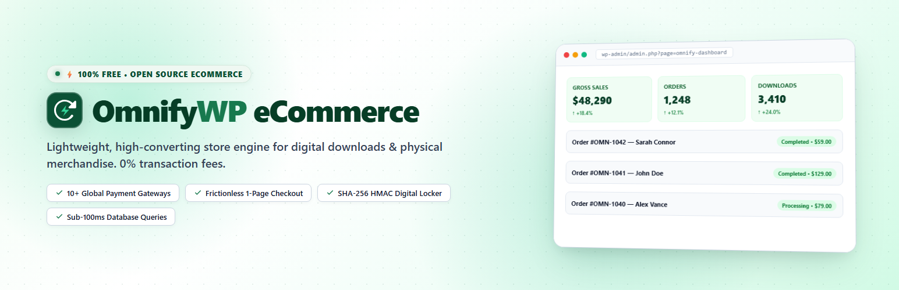

<p align="center">
  
</p>

# OmnifyWP eCommerce

<p align="center">
  <strong>Fast, Lightweight, and Conversion-Optimized eCommerce Engine for WordPress.</strong><br>
  Sell digital downloads, software, physical merchandise, and multi-attribute variations with 12 built-in global payment gateways and zero transaction fees.
</p>

<p align="center">
  <a href="https://wordpress.org/plugins/omnifywp-ecommerce/"></a>
  <a href="https://github.com/omnifywp/omnifywp-ecommerce"></a>
  <a href="https://wordpress.org"></a>
  <a href="https://php.net"></a>
  <a href="https://gnu.org/licenses/gpl.html"></a>
  <a href="https://omnifywp.com/doc/"></a>
  <a href="https://playground.wordpress.net/?blueprint-url=https%3A%2F%2Fraw.githubusercontent.com%2Fomnifywp%2Fomnifywp-ecommerce%2Fmain%2Fblueprint.json"></a>
  <a href="#developer-extensibility"></a>
</p>

---

## Quick Links, Demo & Resources

* 🌐 **Official Website:** [https://omnifywp.com](https://omnifywp.com)
* 🚀 **Interactive Live Demo:** [https://demo.omnifywp.com](https://demo.omnifywp.com) | [Launch in WordPress Playground →](https://playground.wordpress.net/?blueprint-url=https%3A%2F%2Fraw.githubusercontent.com%2Fomnifywp%2Fomnifywp-ecommerce%2Fmain%2Fblueprint.json) *(Full storefront & admin sandbox, zero setup required)*
* 🐙 **GitHub Repository:** [https://github.com/omnifywp/omnifywp-ecommerce](https://github.com/omnifywp/omnifywp-ecommerce)
* 📚 **Official Documentation:** [https://omnifywp.com/doc/](https://omnifywp.com/doc/)
* 📖 **User & Merchant Guide:** [`docs/USER_DOCUMENTATION.md`](docs/USER_DOCUMENTATION.md) | [Interactive HTML User Guide](docs/user-guide.html)
* 💻 **Developer Guide & REST API:** [`docs/DEVELOPER_DOCS.md`](docs/DEVELOPER_DOCS.md)
* 📝 **Release Changelog:** [`readme.txt`](./readme.txt) | [https://omnifywp.com/changelog/](https://omnifywp.com/changelog/)

---

## Why OmnifyWP?

* **Sub-100ms Storefront Performance**: Purpose-engineered relational tables (`wp_omnify_*`) bypass heavy `wp_postmeta` joins, guaranteeing instant page loads and checkout responsiveness.
* **0% Platform Fees**: Keep 100% of your revenue. No plugin commissions, transaction markups, or recurring annual extension fees.
* **12 First-Party Payment Gateways**: Pre-integrated support for major global and regional payment gateways with zero third-party add-ons required.
* **Cryptographically Protected Digital Locker**: Time-limited SHA-256 HMAC digital tokens and 8KB chunked streaming buffers prevent piracy and unauthorized hotlinking.
* **Modern Admin Design System**: Elevated card architecture with emerald accent tokens, zero-emoji typography, and high-performance AJAX interactions.

---

## Complete Features Overview

### 1. Product Types & Advanced Variation Builder
* **Simple Digital Products**: Instant access upon payment with file download limits, expiration dates, and HMAC link generation.
* **Simple Physical Products**: Inventory tracking, weight/dimensions, SKU, barcode (UPC/EAN), low-stock thresholds, and shipping calculations.
* **Variable Products**: Offer multiple sizes, colors, formats, or licensing tiers with unique SKUs, stock levels, and pricing.
* **Redesigned Product Variations Builder**:
  * **Unified Attribute Badge Controls**: Clean uppercase badge chips (`SIZE`, `COLOR`) paired with integrated borderless dropdowns and custom SVG chevron indicators.
  * **Laser-Aligned 3-Column Inputs**: Normalized 42px height, 8px radius inputs across SKU, Regular Price, and Sale Price with currency prefix indicators.
  * **Stock & Inventory Tracking**: Explicit "Inventory Tracking" toggle container perfectly aligned with Stock Qty and Stock Status fields.
  * **Availability & Preorders Card**: Structured fulfillment panel with "Allow backorders" and "Preorder" toggles, plus subgrid controls for Release Date, Preorder Limit, and Notice Message.
  * **Estimated Delivery Field**: Single-row full-width input with green transport icon prefix and dedicated label spacing.
  * **Icon Action Tooltips**: Space-efficient 32×32px icon buttons (`dashicons-upload`, `dashicons-trash`) with accessible tooltips for image selection and removal.
  * **Lightweight Variation Notes**: Fast, responsive native textareas replacing heavy TinyMCE toolbars.
* **Bundled Products**: Combine multiple catalog items into a single curated package with custom discount pricing.
* **Back-In-Stock Waitlist**: Dedicated customer opt-in on out-of-stock products/variations with automated email notifications when stock is replenished.
* **Product Upsells & Cross-Sells**: Configurable related product recommendations displayed strategically across product details and shopping cart pages.
* **Granular Product Taxonomies**: Built-in support for Hierarchical Categories, Searchable Tags, Brand Directories, and Global/Custom Variation Attributes.

### 2. Modern Storefront & Conversion Architecture
* **4-Layout Dynamic Catalog Switcher**: Instant switching between 4-column dense grid, 3-column standard grid, 2-column large grid, and 1-column detailed list view without page reloads.
* **Responsive Full-Width Image Cards**: Engineered CSS rules (`width: 100%`, `max-width: 100%`, `object-fit: cover`) preventing distortion across third-party WordPress themes.
* **Card Hover Action Toolbar**: Floating product card toolbar with Wishlist toggle, Quick View modal trigger, and Product Compare launcher.
* **Interactive Color Swatches**: Selectable color dots on catalog product cards with smooth active indicator states.
* **Quick Filter Pills Strip**: Dynamic horizontal filter bar for 1-click client-side filtering by Flash Deals, Bestsellers, New In, and top categories with dynamic counter badges.
* **Flash Sale Announcement Ticker**: Persistent countdown timer with 1-click coupon code copy button (`FLASH30`) and clipboard feedback.
* **Multi-Currency Switcher**: Dynamic currency selector (`[omnify_currency_switcher]`) with real-time conversion rates, 1-year cookie persistence, and smart payment gateway compatibility filtering.
* **Floating Slide-Out Mini-Cart**: Instant AJAX drawer/dropdown widget (`[omnify_mini_cart]`) with live line item quantity adjustment, item removal, and subtotal calculation.
* **Recently Viewed Products Engine**: Cookie-backed section with automatic product cloning, responsive 4-column layout, and auto-hiding when empty.
* **Storefront Value Propositions Bar**: Customizable 4-slot trust bar highlighting secure payments, instant access, money-back guarantees, and 24/7 customer support.
* **1-Click AJAX Quick Add**: Add products directly to cart without page reloads, accompanied by micro-animations and live cart count updates.
* **Faceted Sidebar Filtering**: Instant price range sliders, category pills, brand toggles, and stock status filters.
* **3-Column Product Details (PDP)**: Media gallery, feature callouts, trust badges, customer reviews, and a sticky purchase action panel.
* **Customer Wishlist**: Save favorite items to user accounts for increased returning-visitor conversions.
* **Cart Scarcity Countdown & Free Shipping Bar**: Session-persisted countdown timer and free-shipping progress tracker designed to minimize checkout drop-offs.

### 3. Conversion-Optimized 1-Page Checkout Engine
* **Single-Page Checkout**: Streamlined checkout layout requiring zero page reloads, drastically reducing checkout abandonment.
* **1-Click Checkout Order Bump**: Eye-catching promotional callout directly in checkout with special discount pricing and instant order total recalculation.
* **Intelligent Multi-Item Abandoned Cart Recovery**: Automatically tracks abandoned checkouts for both single-product purchases and multi-item shopping carts. Dispatches automated personalized recovery email sequences with dynamic item summaries, incentive coupons, and 1-click cart restoration.
* **Country-First Dynamic Selectors**: Smart address selectors with automatic state/region filtering and saved address book autofill.
* **Flexible Account Handling**: Seamless support for guest checkouts, optional account creation, or automatic account provisioning.
* **Timezone-Aware Coupons & Discount Rules**: Percentage or fixed discounts with usage caps, minimum spend rules, and local store timezone expiration accuracy (`wp_timezone()`).
* **Express Digital Wallets**: Native support for Apple Pay, Google Pay, and one-click express payment buttons.
* **Guest Order Tracking**: Dedicated shortcode `[omnify_order_tracking]` enabling buyers to check order status, delivery progress, shipment carrier tracking, and PDF invoices without an account.
* **Custom Offline Payment Methods**: Create unlimited custom offline payment options with bespoke instructions, titles, and IDs alongside BACS, Cheque, and COD.

### 4. Enterprise-Grade Digital File Delivery
* **Cryptographically Signed URLs**: Generates HMAC-SHA256 authenticated links with customizable expiration windows and download attempt limits.
* **Secure Chunked Streaming**: Delivers files through 8KB memory-efficient streaming buffers that conceal physical server paths and prevent hotlinking or memory exhaustion.
* **Self-Service Customer Portal**: Embed `[omnify_customer_downloads]` or `[omnify_customer_portal]` to give buyers an instant, batch-loaded dashboard to access purchased files, view order histories, and manage billing details.
* **Comprehensive Download Logs**: Audit IP addresses, user agents, download counts, and bandwidth directly in your WordPress admin.

### 5. Marketing, CRM, Analytics & Taxes
* **Executive Financial Dashboard**: Real-time KPI cards ($ Gross Sales, Net Sales, Orders, Average Order Value), 30-day health monitor, and revenue charts.
* **Customer Relationship Management (CRM)**: Track customer lifetime value (LTV), order frequency, saved addresses, and customer activity logs.
* **Automated Fraud Risk Scoring**: Calculates fraud risk levels (low, medium, high) based on IP geolocation, proxy indicators, billing/shipping mismatches, and transaction velocity.
* **Review Moderation System**: Dedicated workflow to approve, edit, filter, or trash user reviews, star ratings, and verified buyer badges.
* **17 Automated HTML Email Triggers**: Pre-designed responsive templates for order receipts, digital access, shipping tracking, pickup readiness, refunds, notes, back-in-stock alerts, admin alerts, and failed orders.
* **Native Custom SMTP Relay**: Built-in SMTP settings (host, port, encryption, authentication) ensuring 100% reliable inbox delivery without third-party mailer plugins.
* **Analytics & Conversion Tracking**: Built-in integration for Google Analytics 4 (GA4) and Meta Pixel (Facebook Pixel) with e-commerce purchase events.
* **Country-Specific Tax Rules**: Multi-tier tax tables with inclusive/exclusive pricing toggles, compound rates, shipping tax options, and digital tax exemptions.
* **Shipping Zones & Rates**: Define country- and region-based shipping rates, flat fees, free shipping thresholds, and local pickup.
* **GDPR & Privacy Compliance**: Integrated with WordPress core privacy tools, including privacy policy templates and 1-click Personal Data Export & Erasure.
* **Automated Database Maintenance**: Scheduled recurring background cron (`omnify_daily_database_cleanup`) for abandoned cart pruning, transient expiration, and index optimization.

### 6. Admin Diagnostics, Seeding & Tools
* **Live Database Diagnostics Overview**: Real-time 4-KPI metric strip in Tools reporting live counts for Products, Orders, Customers, and Customer Reviews.
* **Demo Data Seeding & Granular Cleanup**: One-click demo data generation with animated progress bar; granular cleanup utilities for individual data types and elevated Danger Zone wiping.
* **Server Runtime Specifications Panel**: Diagnostic inspection of PHP version, MySQL version, WordPress core version, memory limits, and database table prefix.
* **Dataset Export & Import Suite**: One-click CSV exports for Products, Orders, and Customers with UTF-8 encoding; CSV drag-and-drop import container with column override option and CSV schema reference table.
* **Administrative Activity Audit Trail**: Filterable chronological log with Actor, Category, Search, and Date filters, active filter chips, category badge treatments, and irreversible log clearing.
* **Outbound Webhooks Engine**: Register unlimited endpoints with HMAC-SHA256 signature verification (`X-Omnify-Signature`), event subscriptions, retry queues with exponential backoff, and delivery logs.
* **REST API Keys Management**: Generate secure Consumer Key and Consumer Secret pairs with permission scopes (read, write, read/write) and one-click copy modal.
* **Payment Gateway & URL Diagnostics**: Live API verification cards for Stripe, PayPal, and Paddle testing authentication credentials, environment mode, and roundtrip latency; arbitrary URL connection checker with latency rating and filtered response headers.

### 7. Shortcodes & Gutenberg Blocks

#### Shortcode Directory
| Shortcode | Description |
| :--- | :--- |
| `[omnify_storefront]` | Renders the primary product catalog with 4-layout switcher, instant search, and faceted filters. |
| `[omnify_cart]` | Displays the shopping cart with scarcity countdown timer, free-shipping meter, and coupon form. |
| `[omnify_mini_cart]` | Embeds a slide-out drawer or floating mini-cart button with live AJAX cart counts. |
| `[omnify_checkout]` | Renders the single-page checkout engine with express digital wallets and order bumps. |
| `[omnify_customer_portal]` | Self-service account dashboard for customer orders, addresses, profiles, and download locker. |
| `[omnify_customer_downloads]` | Dedicated digital download locker displaying purchased files with download limits and expiring links. |
| `[omnify_order_tracking]` | Guest order tracking lookup form to check shipment status, carrier tracking, and PDF invoices. |
| `[omnify_currency_switcher]` | Customer-facing currency selector dropdown with real-time price recalculation. |
| `[omnify_download_page]` | Dedicated template handler for secure file download links. |

### Blocks

This plugin provides 20 blocks.

<table>
  <tbody>
    <tr>
      <td width="52" align="center" valign="middle">
        <div style="width:40px;height:40px;border:1px solid #e2e8f0;border-radius:8px;display:flex;align-items:center;justify-content:center;font-size:20px;background:#f8fafc;">🛒</div>
      </td>
      <td>
        <strong>Product Grid</strong><br>
        Display an interactive, responsive product grid with instant search and filters.
      </td>
    </tr>
    <tr>
      <td width="52" align="center" valign="middle">
        <div style="width:40px;height:40px;border:1px solid #e2e8f0;border-radius:8px;display:flex;align-items:center;justify-content:center;font-size:20px;background:#f8fafc;">🛍️</div>
      </td>
      <td>
        <strong>Shopping Cart</strong><br>
        Display the full shopping cart with dynamic quantity controls and coupon input.
      </td>
    </tr>
    <tr>
      <td width="52" align="center" valign="middle">
        <div style="width:40px;height:40px;border:1px solid #e2e8f0;border-radius:8px;display:flex;align-items:center;justify-content:center;font-size:20px;background:#f8fafc;">🗃️</div>
      </td>
      <td>
        <strong>Mini Cart</strong><br>
        A floating or embedded mini cart button with slide-out drawer.
      </td>
    </tr>
    <tr>
      <td width="52" align="center" valign="middle">
        <div style="width:40px;height:40px;border:1px solid #e2e8f0;border-radius:8px;display:flex;align-items:center;justify-content:center;font-size:20px;background:#f8fafc;">💳</div>
      </td>
      <td>
        <strong>Checkout</strong><br>
        High-converting one-page checkout experience with 14+ global payment gateways.
      </td>
    </tr>
    <tr>
      <td width="52" align="center" valign="middle">
        <div style="width:40px;height:40px;border:1px solid #e2e8f0;border-radius:8px;display:flex;align-items:center;justify-content:center;font-size:20px;background:#f8fafc;">👤</div>
      </td>
      <td>
        <strong>Customer Portal</strong><br>
        Self-service portal for customer order history, file downloads, and account details.
      </td>
    </tr>
    <tr>
      <td width="52" align="center" valign="middle">
        <div style="width:40px;height:40px;border:1px solid #e2e8f0;border-radius:8px;display:flex;align-items:center;justify-content:center;font-size:20px;background:#f8fafc;">📦</div>
      </td>
      <td>
        <strong>Digital Downloads Locker</strong><br>
        Dedicated customer digital file locker with HMAC signed URLs, expiration notices, and limits.
      </td>
    </tr>
    <tr>
      <td width="52" align="center" valign="middle">
        <div style="width:40px;height:40px;border:1px solid #e2e8f0;border-radius:8px;display:flex;align-items:center;justify-content:center;font-size:20px;background:#f8fafc;">🚚</div>
      </td>
      <td>
        <strong>Order Tracking</strong><br>
        Real-time visual order and shipment tracking timeline.
      </td>
    </tr>
    <tr>
      <td width="52" align="center" valign="middle">
        <div style="width:40px;height:40px;border:1px solid #e2e8f0;border-radius:8px;display:flex;align-items:center;justify-content:center;font-size:20px;background:#f8fafc;">🏷️</div>
      </td>
      <td>
        <strong>Product Card</strong><br>
        Display an individual high-converting product card with 1-click buy.
      </td>
    </tr>
    <tr>
      <td width="52" align="center" valign="middle">
        <div style="width:40px;height:40px;border:1px solid #e2e8f0;border-radius:8px;display:flex;align-items:center;justify-content:center;font-size:20px;background:#f8fafc;">💱</div>
      </td>
      <td>
        <strong>Currency Switcher</strong><br>
        Interactive currency switcher dropdown supporting 22 global currencies.
      </td>
    </tr>
    <tr>
      <td width="52" align="center" valign="middle">
        <div style="width:40px;height:40px;border:1px solid #e2e8f0;border-radius:8px;display:flex;align-items:center;justify-content:center;font-size:20px;background:#f8fafc;">⭐</div>
      </td>
      <td>
        <strong>Order Bump</strong><br>
        High-converting 1-click checkout upsell checkbox with instant AJAX cart addition.
      </td>
    </tr>
    <tr>
      <td width="52" align="center" valign="middle">
        <div style="width:40px;height:40px;border:1px solid #e2e8f0;border-radius:8px;display:flex;align-items:center;justify-content:center;font-size:20px;background:#f8fafc;">📌</div>
      </td>
      <td>
        <strong>Sticky Add to Cart</strong><br>
        High-conversion floating bottom/top bar with product thumbnail, price, and instant checkout.
      </td>
    </tr>
    <tr>
      <td width="52" align="center" valign="middle">
        <div style="width:40px;height:40px;border:1px solid #e2e8f0;border-radius:8px;display:flex;align-items:center;justify-content:center;font-size:20px;background:#f8fafc;">🎁</div>
      </td>
      <td>
        <strong>Free Shipping Goal</strong><br>
        Gamified dynamic progress bar displaying remaining amount for free shipping with live celebrations.
      </td>
    </tr>
    <tr>
      <td width="52" align="center" valign="middle">
        <div style="width:40px;height:40px;border:1px solid #e2e8f0;border-radius:8px;display:flex;align-items:center;justify-content:center;font-size:20px;background:#f8fafc;">🛡️</div>
      </td>
      <td>
        <strong>Trust Badges &amp; Guarantee Strip</strong><br>
        Showcase SSL security, payment providers, fast shipping, and money-back guarantees.
      </td>
    </tr>
    <tr>
      <td width="52" align="center" valign="middle">
        <div style="width:40px;height:40px;border:1px solid #e2e8f0;border-radius:8px;display:flex;align-items:center;justify-content:center;font-size:20px;background:#f8fafc;">🖼️</div>
      </td>
      <td>
        <strong>Product Image</strong><br>
        Product thumbnail with custom aspect ratio, zoom, and secondary flip.
      </td>
    </tr>
    <tr>
      <td width="52" align="center" valign="middle">
        <div style="width:40px;height:40px;border:1px solid #e2e8f0;border-radius:8px;display:flex;align-items:center;justify-content:center;font-size:20px;background:#f8fafc;">✍️</div>
      </td>
      <td>
        <strong>Product Title</strong><br>
        Dynamic product title with customizable heading tag and link.
      </td>
    </tr>
    <tr>
      <td width="52" align="center" valign="middle">
        <div style="width:40px;height:40px;border:1px solid #e2e8f0;border-radius:8px;display:flex;align-items:center;justify-content:center;font-size:20px;background:#f8fafc;">🏷️</div>
      </td>
      <td>
        <strong>Product Price</strong><br>
        Dynamic product price with sale comparison and discount pill.
      </td>
    </tr>
    <tr>
      <td width="52" align="center" valign="middle">
        <div style="width:40px;height:40px;border:1px solid #e2e8f0;border-radius:8px;display:flex;align-items:center;justify-content:center;font-size:20px;background:#f8fafc;">⭐</div>
      </td>
      <td>
        <strong>Product Rating</strong><br>
        Product review star rating and review count breakdown.
      </td>
    </tr>
    <tr>
      <td width="52" align="center" valign="middle">
        <div style="width:40px;height:40px;border:1px solid #e2e8f0;border-radius:8px;display:flex;align-items:center;justify-content:center;font-size:20px;background:#f8fafc;">🎖️</div>
      </td>
      <td>
        <strong>Product Badge</strong><br>
        Highlight tags like Sale, Out of Stock, or Verified Download.
      </td>
    </tr>
    <tr>
      <td width="52" align="center" valign="middle">
        <div style="width:40px;height:40px;border:1px solid #e2e8f0;border-radius:8px;display:flex;align-items:center;justify-content:center;font-size:20px;background:#f8fafc;">🔘</div>
      </td>
      <td>
        <strong>Product Button</strong><br>
        Interactive Add to Cart or Buy Now button with quantity stepper.
      </td>
    </tr>
    <tr>
      <td width="52" align="center" valign="middle">
        <div style="width:40px;height:40px;border:1px solid #e2e8f0;border-radius:8px;display:flex;align-items:center;justify-content:center;font-size:20px;background:#f8fafc;">☁️</div>
      </td>
      <td>
        <strong>Template Cloud</strong><br>
        Browse and insert pre-built, high-converting eCommerce starter layouts with 1-click.
      </td>
    </tr>
  </tbody>
</table>

---

#### Native Gutenberg Blocks (20 Specialized Blocks & Full Site Editing Suite)

OmnifyWP includes an agency-grade, enterprise-ready Gutenberg block suite featuring 20 specialized blocks with live debounced previews, responsive controls, WordPress `theme.json` Global Styles harmony, and 4 design style variations (*Default Emerald*, *Minimalist Luxury*, *Neo-Brutalist*, *Dark Elegance*):

##### 🛒 Core Storefront & Catalog Blocks
| Block Name | Identifier | Key Capabilities |
| :--- | :--- | :--- |
| **Product Grid** | `omnify/product-grid` | Responsive catalog grid with 4-layout switcher, live category filter pills, flash sale countdown ticker, and faceted search. |
| **Product Card** | `omnify/product-card` | Standalone featured card with vertical/horizontal layouts, multi-image hover flip, 1-click **Buy Now** checkout, and sale badges. |
| **Currency Switcher** | `omnify/currency-switcher` | Multi-currency dropdown or pill strip supporting 22 global currencies with live exchange rates. |

##### 🚀 High-Converting Revenue & Checkout Blocks
| Block Name | Identifier | Key Capabilities |
| :--- | :--- | :--- |
| **Shopping Cart** | `omnify/cart` | Full shopping cart with live quantity steppers, free shipping meter, trust badges, and cross-sell recommendations. |
| **Mini-Cart Drawer** | `omnify/mini-cart` | Slide-out header/navigation drawer with live item counter pill, subtotal, and instant checkout link. |
| **1-Page Checkout** | `omnify/checkout` | High-converting checkout with 1-col minimal / 2-col standard layouts, cart reservation countdown timer, and guarantee seals. |
| **Order Bump** | `omnify/order-bump` | High-converting 1-click checkout upsell checkbox with instant AJAX cart addition without page refresh. |
| **Sticky Add to Cart** | `omnify/sticky-add-to-cart` | Floating mobile/desktop conversion bar with thumbnail, price, quantity stepper, and quick buy button. |
| **Free Shipping Goal** | `omnify/free-shipping-goal` | Gamified progress bar calculating remaining cart amount in real-time with confetti milestone celebrations. |
| **Trust Badges & Guarantees** | `omnify/trust-badge-bar` | Security strip showcasing 256-Bit SSL, 30-Day Money Back, instant HMAC dispatch, and payment badges (horizontal or 2x2 grid). |

##### 👤 Customer Experience & Self-Service Blocks
| Block Name | Identifier | Key Capabilities |
| :--- | :--- | :--- |
| **Customer Portal** | `omnify/customer-portal` | Self-service customer dashboard with welcome greeting, order history with 1-click re-order, invoice downloads, and wishlist. |
| **Digital Downloads Locker** | `omnify/customer-downloads` | Dedicated digital file locker with HMAC signed URLs, download expiry notices, and remaining download attempt counters. |
| **Order Tracking** | `omnify/order-tracking` | Order lookup form with visual delivery timeline stepper and direct support contact links. |

##### 🧩 Composable Atomic Micro-Blocks (InnerBlocks Suite)
| Block Name | Identifier | Key Capabilities |
| :--- | :--- | :--- |
| **Product Image** | `omnify/product-image` | Micro-block with aspect ratio controls (`1/1`, `4/3`, `16/9`), border radius, and hover zoom effects. |
| **Product Title** | `omnify/product-title` | Micro-block with customizable heading tags (`h2`–`h4`, `p`), font size slider, and clickable permalink toggle. |
| **Product Price** | `omnify/product-price` | Micro-block with formatted store currency, strike-through regular price comparison, and discount savings pill (`Save 20%`). |
| **Product Rating** | `omnify/product-rating` | Micro-block with star reviews rating summary, custom star color picker, and review count indicator. |
| **Product Badge** | `omnify/product-badge` | Micro-block with dynamic labels (`Sale`, `New`, or custom text) and custom background color styling. |
| **Product Button** | `omnify/product-button` | Micro-block with Add to Cart vs. Direct Checkout action and optional quantity stepper input. |

##### ☁️ Templates, Query Loop & Full Site Editing (FSE)
| Block / Feature | Identifier | Key Capabilities |
| :--- | :--- | :--- |
| **Template Cloud** | `omnify/template-cloud` | In-editor modal offering 1-click insertion of 20+ pre-designed niche store layouts, sales funnels, and checkout flows. |
| **Query Loop Variation** | `core/query` (*Omnify Products*) | Registered variation for WordPress Core Query Loop block with pre-configured filters and atomic block loop scaffolding. |
| **Block Theme Templates** | `single-omnify_product`, `archive-omnify_product` | Native block templates and template parts (`omnify-header-cart`) fully customizable in the WordPress Site Editor. |
| **Block Patterns** | Category: `omnify` | 7 pre-built commercial patterns (Heroes, Flash Sales, High-Conversion Checkouts, and Account Hubs). |

---

## Built-In Integrations

OmnifyWP includes first-party integrations with leading payment gateways, analytics providers, and services. All integrations follow a **Secure-by-Default Architecture** (inactive until credentials are provided):

### Global & Regional Payment Gateways
| Gateway | Supported Regions | Supported Payment Methods | Key Capabilities |
| :--- | :--- | :--- | :--- |
| **Stripe** | Global (47+ countries) | Cards, Apple Pay, Google Pay, Stripe Checkout | Automated refund sync (`charge.refunded`), dispute sync (`charge.dispute.created`), 3D Secure 2. |
| **PayPal Commerce** | Global (200+ markets) | PayPal, Pay in 4, Credit/Debit Cards | Express Checkout, smart payment buttons, automated refund sync (`PAYMENT.CAPTURE.REFUNDED`). |
| **Paddle** | Global (200+ countries / MoR) | Cards, PayPal, Apple Pay, Google Pay, iDEAL, Wire Transfers | Merchant of Record (MoR) automated global sales tax & VAT compliance, SaaS billing, automated refund/adjustment synchronization via Paddle API. |
| **Paystack** | Africa (Nigeria, Ghana, South Africa, Kenya) | Cards, Mobile Money (M-Pesa, MTN, Airtel), Bank Transfer, USSD | Native webhook verification, live/test mode switches, automated refunds. |
| **Tap Payments** | Middle East & GCC (Saudi Arabia, UAE, Kuwait, Qatar, Bahrain, Oman, Egypt, Jordan) | mada, KNET, Benefit, NAPS, Cards | GCC localized currency handling, live webhook processing, automated refunds. |
| **Mollie** | European Union & EEA | iDEAL, Bancontact, SEPA Bank Transfer, Klarna, Cards | Multi-currency European checkout, automated refund processing. |
| **Razorpay** | India | UPI (Google Pay, PhonePe, Paytm), RuPay, Netbanking, Cards, Wallets | Real-time HMAC-SHA256 signature verification, automated refunds. |
| **Khalti** | Nepal | Khalti Digital Wallet, Mobile & Internet Banking | Official ePayment v2 API, automated verification, live transaction status lookups. |
| **eSewa** | Nepal | eSewa Digital Payment Wallet | Cryptographic HMAC-SHA256 signature verification, official ePay v2 integration. |
| **Alipay** | China & Global Cross-Border | Alipay Wallet, Mobile QR Code | Instant QR code presentation, automated callback verification. |
| **WeChat Pay** | China & Global Cross-Border | WeChat Pay Mobile App, Native QR Code | Unified order API, dynamic QR generation, mobile checkout. |
| **SSLCommerz** | Bangladesh | Cards, Mobile Banking (bKash, Nagad, Rocket), Internet Banking | IPN notification handlers, automated transaction validation. |
| **Direct Bank Transfer (BACS)** | Global | Manual Bank Transfer | Automated bank account detail presentation on receipt and order confirmation emails. |
| **Cash on Delivery (COD)** | Global | Cash / Physical Delivery | Gated strictly to physical orders, custom instructions. |

### Analytics & Marketing Integrations
* **Google Analytics 4 (GA4)**: Automatic tracking of e-commerce events (`view_item_list`, `view_item`, `add_to_cart`, `begin_checkout`, `purchase`) with transaction revenue, currency, and item parameters.
* **Meta Pixel (Facebook Pixel)**: Server-aligned client-side tracking for standard e-commerce events (`PageView`, `ViewContent`, `AddToCart`, `InitiateCheckout`, `Purchase`).
* **Gravatar**: Automatic avatar resolution for customer profiles and customer product reviews.

---

## REST API Reference

OmnifyWP provides a fully functional REST API under `/wp-json/omnify/v1` for headless frontends, mobile apps, and custom webhooks.

### Public Storefront Endpoints
| Route | Method | Description |
| :--- | :---: | :--- |
| `/status` | `GET` | Retrieve store status and database migration health. |
| `/products/public` | `GET` | Query catalog products with filters, sorting, and pagination. |
| `/products/public/slug/{slug}` | `GET` | Retrieve product details by slug. |
| `/cart` | `GET` \| `POST` \| `DELETE` | Read, update, or clear customer cart contents. |
| `/checkout` | `POST` | Process customer checkout payload. |
| `/checkout/validate-coupon` | `POST` | Validate and calculate coupon discounts. |
| `/checkout/payment-methods` | `GET` | Fetch enabled storefront payment gateways. |

### Protected Management Endpoints
| Route | Method | Description |
| :--- | :---: | :--- |
| `/products` | `GET` \| `POST` | Create or list catalog products. |
| `/products/{id}` | `GET` \| `PUT` \| `DELETE` | Read, update, or delete an existing product. |
| `/orders` | `GET` | List store orders with status and date filters. |
| `/orders/{id}` | `GET` | Fetch full order details including line items and customer records. |
| `/customers` | `GET` \| `POST` | List or register customer profiles. |
| `/settings` | `GET` \| `POST` | Retrieve or update store configuration. |

---

## Developer Extensibility

OmnifyWP is architected around WordPress hooks and an extensible dependency injection container.

### Core Action & Filter Hooks
```php
// Intercept or customize price formatting
add_filter('omnify_format_price', function($formatted_price, $amount, $settings) {
    return $formatted_price;
}, 10, 3);

// Custom validation rule during checkout
add_filter('omnify_after_checkout_validation', function($error, $data, $settings, $items) {
    if (empty($data['billing_email'])) {
        return new \WP_Error('invalid_email', 'Please enter a valid email address.');
    }
    return $error;
}, 10, 4);

// Hook into settings updates
add_action('omnify_settings_saved', function($section, $posted) {
    // Perform custom cache invalidation or audit logging
}, 10, 2);
```

### Accessing Internal Services
```php
$container = omnify()->container();
$product_repo = $container->get(\Omnify\eCommerce\Repositories\Product_Repository::class);
$featured_products = $product_repo->all(['is_featured' => 1]);
```

---

## External Services & Privacy

OmnifyWP integrates with external third-party payment gateways and services to process orders and transactions. Data is transmitted securely only when the respective service is enabled by the administrator or chosen by the buyer:

* **Stripe** ([Terms](https://stripe.com/legal/consumer) | [Privacy](https://stripe.com/privacy))
* **PayPal Commerce** ([User Agreement](https://www.paypal.com/us/legalhub/useragreement-full) | [Privacy Statement](https://www.paypal.com/us/legalhub/privacy-full))
* **Paddle** ([Terms](https://www.paddle.com/legal/terms) | [Privacy](https://www.paddle.com/legal/privacy))
* **Paystack** ([Terms](https://paystack.com/terms) | [Privacy](https://paystack.com/privacy))
* **Tap Payments** ([Terms & Privacy](https://tap.company/privacy))
* **Mollie** ([Terms & Privacy](https://www.mollie.com/en/privacy))
* **Razorpay** ([Terms](https://razorpay.com/terms/) | [Privacy](https://razorpay.com/privacy/))
* **Khalti** ([Terms & Privacy](https://khalti.com/privacy/))
* **eSewa** ([Terms & Privacy](https://esewa.com.np/#/privacy-policy))
* **Alipay** ([Terms](https://render.alipay.com/p/f/agreementpages/alipayterms.html) | [Privacy](https://render.alipay.com/p/f/agreementpages/alipayprivacy.html))
* **WeChat Pay** ([Terms](https://www.wechat.com/en/service_terms.html) | [Privacy](https://www.wechat.com/en/privacy_policy.html))
* **SSLCommerz** ([Terms](https://sslcommerz.com/terms-and-conditions/) | [Privacy](https://sslcommerz.com/privacy-policy/))
* **Gravatar** ([Automattic Privacy](https://automattic.com/privacy/))
* **Google Analytics 4 & Meta Pixel** *(Optional merchant conversion tracking)*

---

## Changelog

For the latest release notes, refer to [`readme.txt`](./readme.txt). The complete historical changelog is maintained at <a href="https://omnifywp.com/changelog/">https://omnifywp.com/changelog/</a>.

---

## License

OmnifyWP eCommerce is open-source software licensed under the **GPL-2.0-or-later**.
