# OmnifyWP eCommerce — Complete User Manual & Store Owner Guide

> **Official User Documentation for OmnifyWP eCommerce**  
> **Plugin Version:** 1.4.3 | **WordPress Requirements:** 6.5+ | **PHP Requirements:** 8.2+ | **Database:** MySQL 5.7+ / MariaDB 10.3+  
> **Official Website:** [https://omnifywp.com](https://omnifywp.com) | **wp.org:** [https://wordpress.org/plugins/omnifywp-ecommerce/](https://wordpress.org/plugins/omnifywp-ecommerce/)  
> **Developer Docs:** [`DEVELOPER_DOCS.md`](./DEVELOPER_DOCS.md) | **HTML Guide:** [`user-guide.html`](./user-guide.html)

---

## Table of Contents
1. [Introduction to OmnifyWP eCommerce](#1-introduction-to-omnifywp-ecommerce)
2. [Installation, Activation & Onboarding](#2-installation-activation--onboarding)
   - [System Prerequisites](#system-prerequisites)
   - [Step-by-Step Installation](#step-by-step-installation)
   - [Onboarding Setup Wizard](#onboarding-setup-wizard)
   - [Core Generated Store Pages](#core-generated-store-pages)
3. [Store Dashboard & Performance Overview](#3-store-dashboard--performance-overview)
   - [Key Performance Indicators (KPIs)](#key-performance-indicators-kpis)
   - [Store at a Glance & Quick Actions](#store-at-a-glance--quick-actions)
   - [Recent Orders & Customer Feeds](#recent-orders--customer-feeds)
4. [Product Catalog & Inventory Management](#4-product-catalog--inventory-management)
   - [Products Directory & Filters](#products-directory--filters)
   - [Adding & Editing Products](#adding--editing-products)
   - [Supported Product Types (Physical, Variable, Digital, Bundle)](#supported-product-types)
   - [Pricing, Sales Scheduling & Inventory Rules](#pricing-sales-scheduling--inventory-rules)
   - [Product Taxonomies: Categories, Tags, Brands & Attributes](#product-taxonomies)
5. [Order Lifecycle, Fulfillment & Refunds](#5-order-lifecycle-fulfillment--refunds)
   - [Orders Listing & Status Workflows](#orders-listing--status-workflows)
   - [Order Details & Financial Breakdown](#order-details--financial-breakdown)
   - [Fraud & Risk Assessment Engine](#fraud--risk-assessment-engine)
   - [Processing Refunds & Automatic License Revocation](#processing-refunds--automatic-license-revocation)
   - [Order Notes & Customer Receipts](#order-notes--customer-receipts)
6. [Customer Relationship Management (CRM)](#6-customer-relationship-management-crm)
   - [Customer Directory & Lifetime Analytics](#customer-directory--lifetime-analytics)
   - [Customer Address Books & Access Control](#customer-address-books--access-control)
7. [Promotions, Discounts & Coupons Engine](#7-promotions-discounts--coupons-engine)
   - [Creating Promotional Coupons](#creating-promotional-coupons)
   - [Discount Rules, Restrictions & Usage Limits](#discount-rules-restrictions--usage-limits)
8. [Store Analytics & Business Intelligence](#8-store-analytics--business-intelligence)
   - [Sales Over Time & Performance Cards](#sales-over-time--performance-cards)
   - [Conversion Rates, AOV & Metric Comparisons](#conversion-rates-aov--metric-comparisons)
   - [Exporting Reports to CSV](#exporting-reports-to-csv)
9. [Customer Reviews Moderation](#9-customer-reviews-moderation)
   - [Review Directory & Ratings Management](#review-directory--ratings-management)
   - [Review Approvals, Spam Handling & Trashing](#review-approvals-spam-handling--trashing)
10. [Abandoned Cart Recovery](#10-abandoned-cart-recovery)
    - [Automated Cart Tracking](#automated-cart-tracking)
    - [Recovery Notification Workflows & Conversion Stats](#recovery-notification-workflows--conversion-stats)
11. [Store Configuration & Settings](#11-store-configuration--settings)
    - [General Settings (Currency, Locales, Formatting)](#general-settings)
    - [Payment Gateways Configuration & Step-by-Step Setup](#payment-gateways-configuration)
      - [Gateway Activation & Secure-by-Default Architecture](#gateway-activation--secure-by-default-architecture)
      - [Stripe Setup Guide (Credit/Debit, Apple Pay, Google Pay, SEPA)](#stripe-setup-guide)
      - [PayPal Commerce Platform Setup Guide](#paypal-commerce-platform-setup-guide)
      - [Razorpay Setup Guide (India: UPI, NetBanking, RuPay)](#razorpay-setup-guide)
      - [SSLCommerz Setup Guide (Bangladesh: bKash, Nagad, Rocket)](#sslcommerz-setup-guide)
      - [Cash on Delivery (COD) Setup Guide](#cash-on-delivery-cod-setup-guide)
      - [Direct Bank Transfer (BACS / Wire) Setup Guide](#direct-bank-transfer-bacs--wire-setup-guide)
      - [Cheque Payment Setup Guide](#cheque-payment-setup-guide)
    - [Shipping & Delivery Zones](#shipping--delivery-zones)
    - [Tax Calculation & Regional Rates](#tax-calculation--regional-rates)
    - [Customer Email Notifications & Templates](#customer-email-notifications--templates)
    - [Checkout Flow Configuration](#checkout-flow-configuration)
    - [Store Pages Mapping](#store-pages-mapping)
12. [System Tools, Demo Seeding & Maintenance](#12-system-tools-demo-seeding--maintenance)
    - [One-Click Demo Data Generation & Reset](#one-click-demo-data-generation--reset)
    - [Database Integrity Check & Cache Flushing](#database-integrity-check--cache-flushing)
13. [Administrative Activity Audit Log](#13-administrative-activity-audit-log)
14. [REST API Access & Integrations](#14-rest-api-access--integrations)
15. [Customer Storefront Experience](#15-customer-storefront-experience)
    - [Multi-Layout Catalog & Switcher (4-Col Grid, 3-Col Standard, 2-Col Split, 1-Col List)](#multi-layout-catalog--switcher)
    - [Flash Sale Ticker & 1-Click Coupon Code Copy](#flash-sale-ticker--1-click-coupon-code-copy)
    - [Interactive Quick Filter Pills Strip](#interactive-quick-filter-pills-strip)
    - [Modern Product Card Visual Architecture](#modern-product-card-visual-architecture)
    - [Recently Viewed Products Engine & Cookie Storage](#recently-viewed-products-engine--cookie-storage)
    - [Storefront Catalog & Faceted Sidebar Filters](#storefront-catalog--faceted-sidebar-filters)
    - [Single Product Page (Gallery, Swatches, Urgency, Reviews)](#single-product-page)
    - [Interactive Shopping Cart & Free Shipping Progress Bar](#interactive-shopping-cart--free-shipping-progress-bar)
    - [Frictionless Multi-Step & Slide-Over Checkout](#frictionless-multi-step-checkout)
    - [Customer Account Portal 2.0 & Order Tracking](#customer-account-portal--order-tracking)
    - [Cryptographic Digital Downloads Delivery](#cryptographic-digital-downloads-delivery)
16. [Variable Products, Preorders & Availability](#16-variable-products-preorders--availability)
17. [Shipping Zones, Taxes & Multi-Currency](#17-shipping-zones-taxes--multi-currency)
18. [Email Notifications, SMTP & Logs](#18-email-notifications-smtp--logs)
19. [Roles, Staff Permissions & Fraud](#19-roles-staff-permissions--fraud)
20. [Conversion Tracking (GA4 & Meta Pixel)](#20-conversion-tracking-ga4--meta-pixel)
21. [Privacy, GDPR & Data Maintenance](#21-privacy-gdpr--data-maintenance)
22. [Import, Export & Data Management](#22-import-export--data-management)
23. [Frequently Asked Questions & Troubleshooting](#23-frequently-asked-questions--troubleshooting)

---

> **How to use this manual**
> - **Just installed?** Begin with Chapter 2 (Installation & Onboarding).
> - **Running the store day to day?** Chapters 3–14 cover catalog, orders, customers, and marketing.
> - **Configuring payments, tax, or shipping?** Chapter 11 (Settings) plus Chapters 17 and 18.
> - **Delegating to staff?** See Chapter 19 (Roles & Permissions).
> - **Stuck?** Jump to Chapter 23 (FAQ & Troubleshooting).

---

## 1. Introduction to OmnifyWP eCommerce

**OmnifyWP eCommerce** is a high-performance eCommerce solution engineered from the ground up for modern WordPress store owners, digital entrepreneurs, creators, and merchants.

### Why OmnifyWP eCommerce?
Traditional WordPress eCommerce plugins rely heavily on the WordPress core `wp_posts` and `wp_postmeta` tables. As your store grows to thousands of orders and products, querying EAV (Entity-Attribute-Value) postmeta creates massive database overhead, slow page loads, and checkout bottlenecks.

OmnifyWP solves this with:
* **Custom Normalized SQL Tables**: 27 dedicated tables specifically indexed for products, variations, orders, customers, downloads, reviews, webhooks, inventory, and logs.
* **Instantaneous Page Loads**: Sub-millisecond database queries regardless of store size.
* **All-in-One Product Support**: Sell physical goods, variable multi-attribute items, software, audio/video courses, digital downloads, and product bundles simultaneously.
* **Enterprise Digital Locker**: Built-in HMAC-SHA256 cryptographically signed download tokens, 8KB chunked memory-safe file delivery, and automated access revocation upon refunds.
* **Zero-Friction Checkout**: Sleek single-page and multi-step checkout layouts designed to maximize conversion rates.

---

## 2. Installation, Activation & Onboarding

### System Prerequisites
Ensure your hosting environment meets the following specifications before installing OmnifyWP eCommerce:
* **WordPress:** 6.5 or higher
* **PHP:** 8.2 or higher (with `mbstring`, `openssl`, `curl`, and `json` extensions enabled)
* **Database:** MySQL 5.7+ or MariaDB 10.3+
* **HTTPS/SSL:** Required for production Stripe, PayPal, and digital download token security.

### Step-by-Step Installation
1. Download the plugin archive `omnifywp-ecommerce.zip` from your account portal or repository.
2. In your WordPress dashboard, navigate to **Plugins → Add New → Upload Plugin**.
3. Choose the `.zip` file and click **Install Now**.
4. Click **Activate Plugin**.

### Onboarding Setup Wizard
Upon initial activation, OmnifyWP offers a streamlined **Setup Wizard** accessible via **Omnify → Setup Wizard** (`admin.php?page=omnify-setup`). The wizard guides you through currency selection, business contact details, default payment gateways, and page creation in just four quick steps.

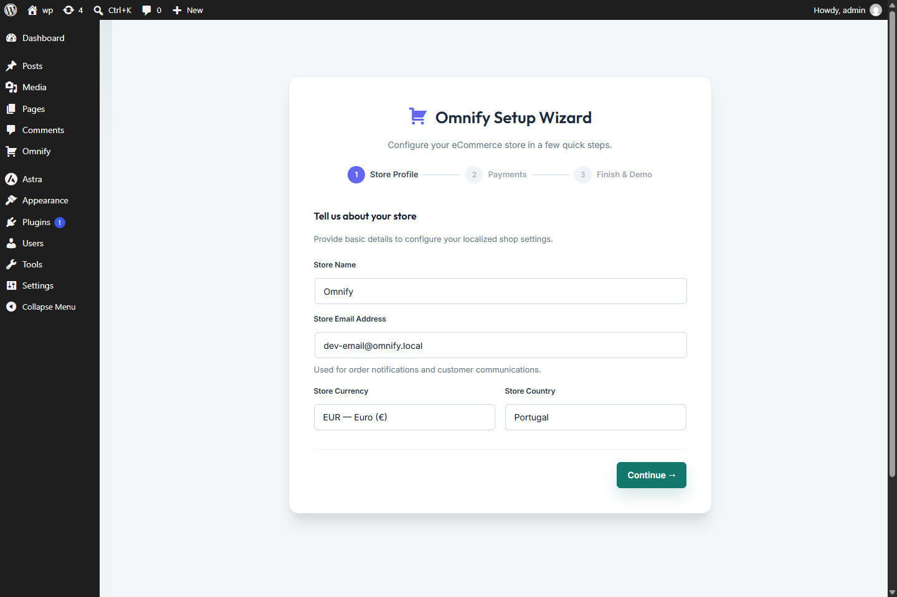
*Figure 2.1: OmnifyWP eCommerce Setup Wizard guiding store owners through essential initial configuration.*

### Core Generated Store Pages
During installation, OmnifyWP creates and configures the following dedicated storefront pages:

| Page Title | Default Slug | Shortcode | Description |
| :--- | :--- | :--- | :--- |
| **Storefront** | `/storefront/` | `[omnify_storefront]` | Main shop catalog grid featuring responsive filtering and search. |
| **Cart** | `/cart/` | `[omnify_cart]` | Interactive shopping cart with quantity selectors and coupon box. |
| **Mini-Cart** | Anywhere | `[omnify_mini_cart]` | Slide-out AJAX mini-cart drawer or dropdown widget with live count pill. |
| **Checkout** | `/checkout/` | `[omnify_checkout]` | Frictionless conversion-optimized checkout and payment form. |
| **Customer Portal** | `/customer-portal/` | `[omnify_customer_portal]` | Customer self-service dashboard for orders, addresses, and downloads. |
| **Digital Locker** | `/downloads/` | `[omnify_customer_downloads]` | Dedicated digital file locker for instant customer downloads. |
| **Order Tracking** | `/order-tracking/` | `[omnify_order_tracking]` | Instant public tracking lookup via Order Number and Billing Email. |
| **Currency Switcher**| Anywhere | `[omnify_currency_switcher]` | Customer-facing multi-currency selector with real-time conversion. |
| **Secure Download** | `/secure-download/` | `[omnify_download_page]` | Cryptographic streaming handler for authorized digital files. |

---

## 3. Store Dashboard & Performance Overview

The **Omnify Dashboard** (**Omnify → Dashboard**) serves as your central command center, offering real-time visibility into sales metrics, order volumes, inventory, and customer activity.

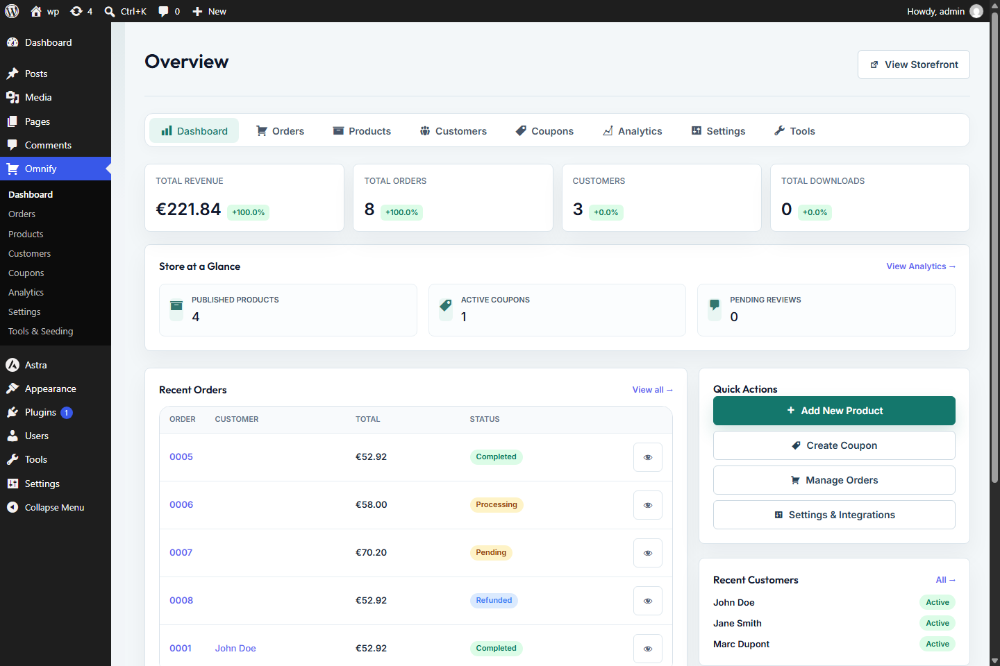
*Figure 3.1: Omnify Store Dashboard showing financial KPIs, active coupons, recent transactions, and quick action shortcuts.*

### Key Performance Indicators (KPIs)
At the top of the dashboard, four metric cards display vital statistics along with percentage comparisons against previous periods:
* **Total Revenue**: Cumulative gross revenue generated by completed and processing orders.
* **Total Orders**: Total volume of customer transactions processed.
* **Customers**: Registered customer profiles and purchasing accounts.
* **Total Downloads**: Cumulative authorized digital product deliveries.

### Store at a Glance & Quick Actions
* **Store at a Glance**: Displays published products count, active coupon campaigns, and customer reviews pending administrative moderation.
* **Quick Actions Panel**: Direct one-click shortcuts to:
  * **+ Add New Product**: Jump straight into the product creation suite.
  * **Create Coupon**: Launch a new promotional campaign.
  * **Manage Orders**: Navigate to the orders fulfillment table.
  * **Settings & Integrations**: Configure gateways, taxes, and system settings.
* **Recent Orders & Recent Customers**: Real-time tabular previews of your latest incoming customer transactions and newly registered shoppers.

---

## 4. Product Catalog & Inventory Management

### Products Directory & Filters
Navigate to **Omnify → Products** to inspect, search, and manage your entire product catalog. The listing displays the product thumbnail, SKU, regular/sale price, publication status, assigned categories, tags, physical/digital file badges, and quick management actions.

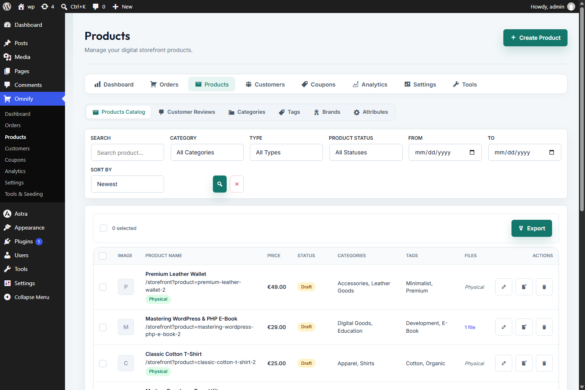
*Figure 4.1: Product catalog management table with multi-attribute filtering, date ranges, status filters, and bulk export.*

#### Filter and Search Capabilities:
* **Search Field**: Instantly search by product title, SKU, or slug.
* **Category Filter**: Filter items by specific catalog taxonomies.
* **Product Type**: Narrow down by Physical, Digital Download, Variable, or Bundle.
* **Product Status**: View All, Published, Draft, or Trashed records.
* **Date Range**: Filter products added between specific calendar dates.
* **Bulk Export**: Export your filtered catalog to CSV with a single click.

---

### Adding & Editing Products (4-Step Wizard & Live Preview)
To create a new product, click **+ Add New Product** or edit an existing product to open the product editor wizard.

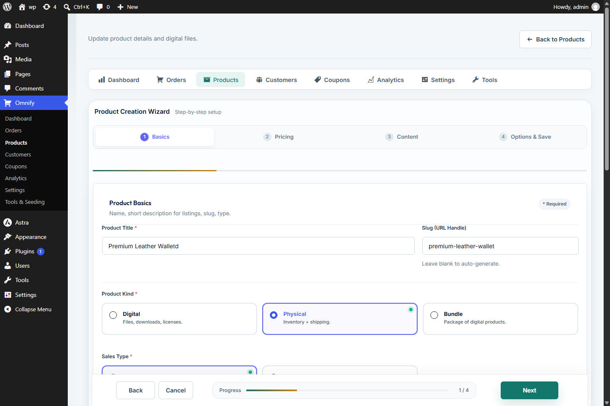
*Figure 4.2: 4-Step Product Editor Wizard with live storefront preview modal and granular developer action hooks.*

#### 4-Step Wizard Workflow:
1. **Step 1: General & Pricing**:
   * **Product Name & Slug**: Enter a descriptive title and customize the SEO-friendly URL slug.
   * **Product Type**: Choose between Physical, Digital / Downloadable Asset, Variable Merch, or Curated Bundle.
   * **Pricing & Sale Rules**: Regular retail price, promotional sale price, and optional schedule dates.
   * **Short & Full Description**: Rich HTML description and concise excerpt for card previews.
2. **Step 2: Inventory & Stock Management**:
   * **SKU (Stock Keeping Unit)**: Unique warehouse identifier.
   * **Manage Stock**: Toggle inventory tracking on/off, specify available warehouse units, and configure backorder policies.
   * **Shipping Dimensions**: Weight (kg/lbs), package length, width, and height for live carrier rates.
3. **Step 3: Digital Files & Media Assets**:
   * **HMAC-SHA256 File Locker**: Attach secured digital files with download limit counters and token expiration windows.
   * **Product Gallery**: Upload primary hero image and multi-angle product thumbnail gallery.
4. **Step 4: Attributes, Variations & SEO**:
   * **Variation Matrix**: Configure color, size, and custom attribute axes with independent variation pricing and stock.
   * **SEO Meta**: Meta title, description, and OpenGraph social preview tags.

#### Redesigned Product Variations Builder (v1.4.3):
The variable-product editor has been rebuilt into a cleaner, faster variation authoring surface:
* **Unified Attribute Badge Controls**: Each attribute axis renders as a clean uppercase badge chip (e.g. `SIZE`, `COLOR`) paired with an integrated borderless dropdown and a custom SVG chevron indicator, replacing the legacy boxed selects.
* **Laser-Aligned Pricing & Stock Grid**: SKU, Regular Price, and Sale Price inputs share a normalized 42px height and 8px radius with currency-prefix indicators; the explicit **Inventory Tracking** toggle container sits perfectly aligned with **Stock Qty** and **Stock Status**.
* **Availability & Preorders Panel**: A structured fulfillment card with **Allow backorders** and **Preorder** toggles, plus a subgrid for **Release Date**, **Preorder Limit**, and a **Notice Message** shown to shoppers.
* **Estimated Delivery Field**: A single full-width input with a transport icon prefix and dedicated label spacing to communicate per-variation dispatch expectations.
* **Compact Icon Actions**: Variation image selection and removal use space-efficient 32×32px icon buttons (`dashicons-upload`, `dashicons-trash`) with accessible tooltips instead of text links.
* **Lightweight Variation Notes**: Fast, responsive native textareas replace the heavy TinyMCE WYSIWYG toolbars, removing editor bloat and improving render performance.

#### Live Product Preview Modal:
Clicking the **Preview Product** button in the editor header opens a live, interactive modal displaying exactly how the product will look in the frontend storefront—including 3-column gallery, swatches, and tab panels—without having to save drafts or expose unpublished changes to public store visitors.

---

### Product Taxonomies

OmnifyWP eCommerce includes structured taxonomies to organize your storefront catalog:

#### 1. Product Categories (**Omnify → Categories**)
Group items hierarchically (e.g., *Apparel → Jackets*, *Digital Goods → Templates*). Categories can have custom images, descriptions, and slugs.

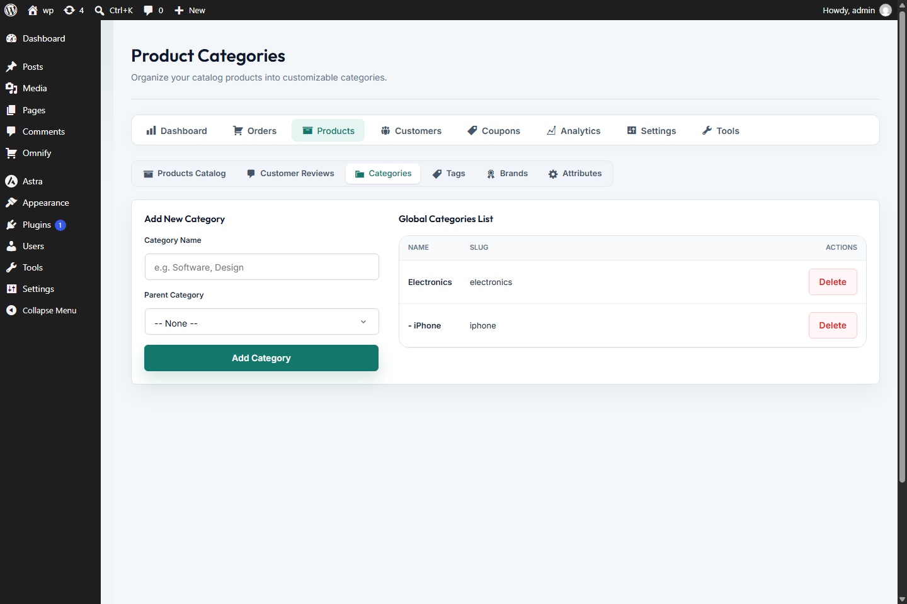
*Figure 4.3: Category management table for organizing storefront catalog taxonomy.*

#### 2. Product Tags (**Omnify → Tags**)
Attach granular keywords and thematic tags to help customers discover related items.

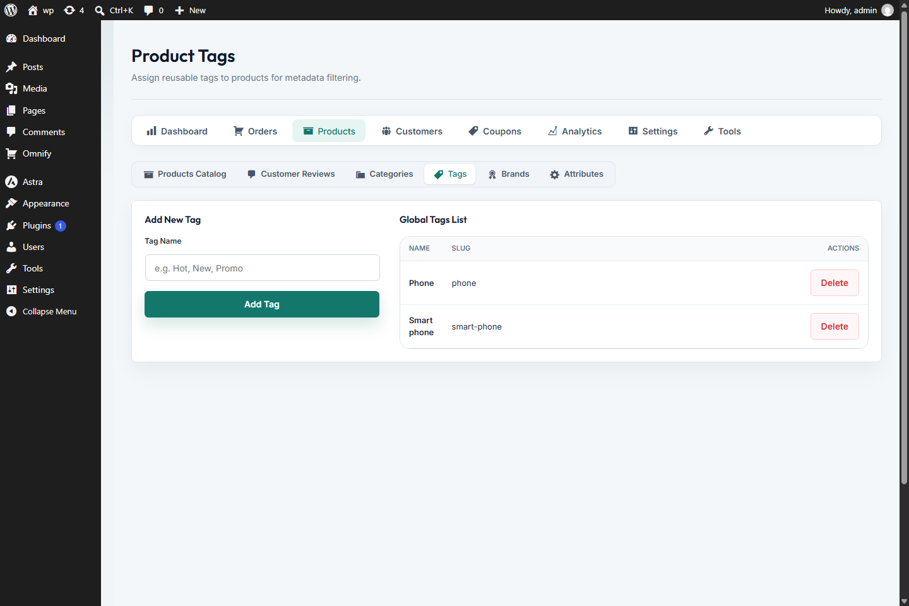
*Figure 4.4: Tag directory showing tag names, slugs, and associated product counts.*

#### 3. Product Brands (**Omnify → Brands**)
Assign manufacturer or brand identifiers to products with dedicated brand logos and storefront filtering.

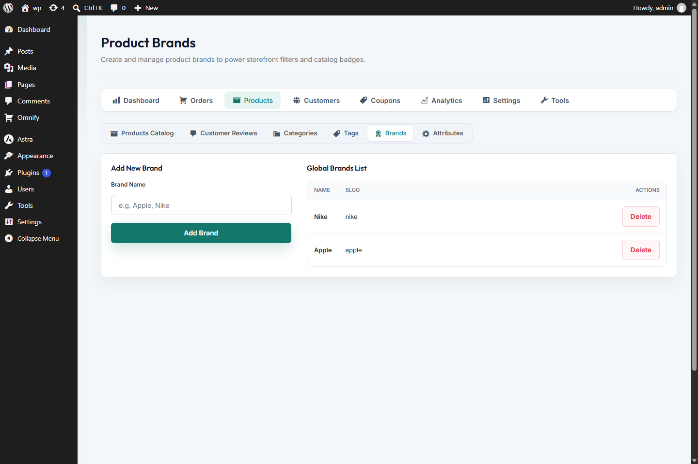
*Figure 4.5: Brands management table for catalog brand filtering.*

#### 4. Product Attributes (**Omnify → Attributes**)
Define global attributes (such as *Color*, *Size*, *Format*, or *Storage*) and assign terms (e.g., *Small, Medium, Large* or *Red, Navy, Charcoal*) used to create variable product matrix variations.

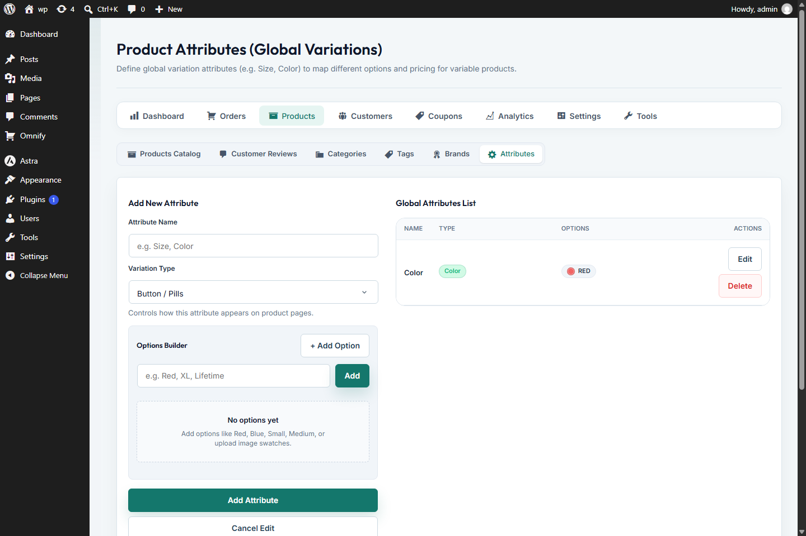
*Figure 4.6: Global Attributes manager for configuring variation axes and terms.*

---

## 5. Order Lifecycle, Fulfillment & Refunds

### Orders Listing & Status Workflows
Manage all storefront transactions under **Omnify → Orders**. Every order displays its unique sequential Order Number, Customer Name, Timestamp, Payment Method, Fulfillment Status, and Total Amount.

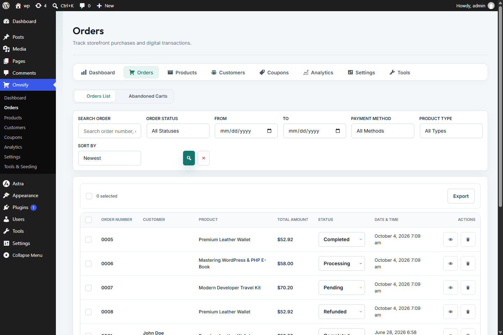
*Figure 5.1: Orders management directory with status tabs, customer details, and action shortcuts.*

#### Supported Order Statuses & Lifecycle State Machine:

| Status Code | Display Label | Description & Triggers | Stock Impact | Digital Access | Notification Triggered |
| :--- | :--- | :--- | :--- | :--- | :--- |
| `pending_payment` | **Pending Payment** | Customer started checkout; awaiting gateway response or redirect completion. | Reserved | Locked | Order Initiated |
| `processing` | **Processing** | Payment successfully confirmed via gateway callback or instant capture. Awaiting physical packing. | Decremented | Unlocked | Payment Received Receipt |
| `completed` | **Completed** | Physical goods dispatched or digital order finalized. | Decremented | Permanently Granted | Order Completed / Download Ready |
| `on_hold` | **On Hold** | Offline payment method chosen (Direct Wire Transfer, Cheque). Awaiting bank clearance. | Reserved | Locked | Bank Wire Instructions Email |
| `cancelled` | **Cancelled** | Order aborted by customer, admin, or session expiration timeout. | Restored | Revoked | Order Cancelled Notice |
| `partially_refunded` | **Partially Refunded** | Partial sum returned via admin or external gateway webhook; balance remains retained. | Optional Restock | Active for Remaining Items | Partial Refund Confirmation |
| `refunded` | **Refunded** | Transaction funds returned via one-click refund or gateway webhook. | Optional Restock | Revoked Immediately | Refund Confirmation |
| `failed` | **Failed** | Card declined, 3DS authentication failed, or gateway error returned. | Restored | Locked | Payment Failed Notice |

#### State Transition Logic:
- **Instant Digital Delivery**: When an order consists exclusively of digital downloadable products and transitions to `processing`, Omnify automatically advances it to `completed` and grants signed download access within sub-millisecond execution.
- **Automated Revocation**: When an order status transitions to `refunded`, Omnify's `Omnify_Order_Lifecycle_Service` immediately queries `wp_omnify_customer_access` and revokes digital download entitlements, terminating valid HMAC signature tokens.
- **Partially Refunded Orders**: When an order is partially refunded (either through the admin order detail screen or via Stripe/PayPal external webhooks), the order status updates to `partially_refunded`. The refunded sum is added to `refunded_amount`, audit notes log the reversal, and digital access is maintained for non-refunded items.
- **Gateway Webhook Refund & Dispute Sync**: Native webhook listeners for Stripe (`charge.refunded`, `charge.dispute.created`) and PayPal (`PAYMENT.CAPTURE.REFUNDED`, `CUSTOMER.DISPUTE.CREATED`) automatically sync reversals and chargebacks without requiring manual merchant reconciliation.

---

### Order Details & Financial Breakdown
Click on any order or the eye icon to view the comprehensive **Order Detail** screen (`admin.php?page=omnify-orders&action=view&id=...`).

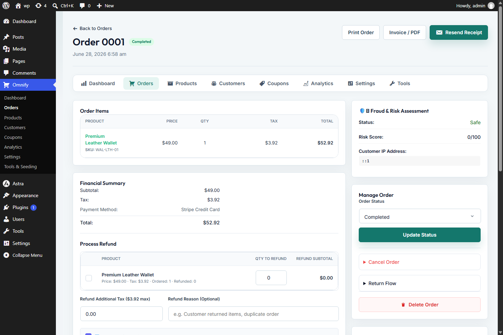
*Figure 5.2: Order detail view showing item breakdown, financial summary, fraud risk assessment, and refund tools.*

#### Key Sections of Order Detail:
1. **Order Items Table**: Line-by-line item names, variation attributes, SKUs, unit prices, purchased quantities, applied taxes, and line totals.
2. **Financial Summary**: Subtotal, shipping fees, tax calculation, discount deductions, payment gateway reference, and grand total.
3. **Fraud & Risk Assessment**: Built-in security widget evaluating transaction safety:
   * **Status**: `Safe`, `Suspicious`, or `High Risk`.
   * **Risk Score**: Score from 0 to 100 based on IP location, billing address validation, and email velocity.
   * **Customer IP Address**: Direct IPv4/IPv6 logging for dispute defense.
4. **Fulfillment Controls**: Change status dropdown, print packing slip, generate PDF invoice, or resend email receipts.
5. **Process Refund Module**:
   * Select specific items and quantities to refund.
   * Input refund amount and additional tax adjustments.
   * State optional refund rationale.
   * Omnify automatically updates inventory counts and revokes associated digital download licenses immediately upon refund completion.

---

## 6. Customer Relationship Management (CRM)

### Customer Directory & Lifetime Analytics
Under **Omnify → Customers**, store owners have a built-in CRM directory profiling every registered and guest shopper.

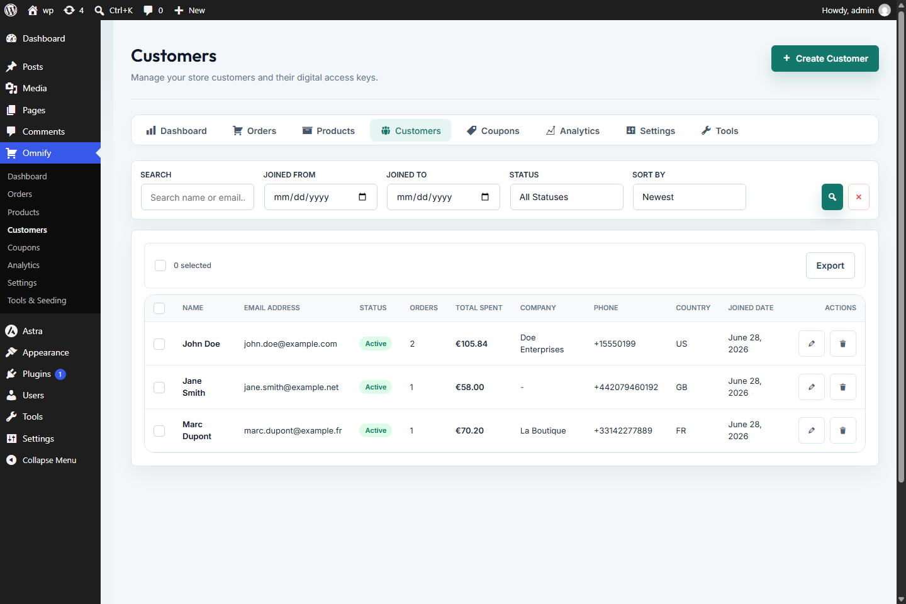
*Figure 6.1: Customer relationship management directory displaying buyer history, order volume, and lifetime spend.*

#### Customer Profile Attributes:
* **Customer Name & Email**: Primary billing and communication contacts.
* **Orders Count**: Total lifetime orders placed.
* **Lifetime Value (LTV)**: Total revenue generated by the customer.
* **Country & Location**: Primary registered geographic territory.
* **Account Status**: `Active`, `VIP`, or `Restricted`.
* **Address Book**: Primary Billing and Shipping addresses saved for seamless one-click storefront checkouts.

---

## 7. Promotions, Discounts & Coupons Engine

Promotions drive sales velocity. Under **Omnify → Coupons**, you can create and manage discount codes with comprehensive usage restrictions.

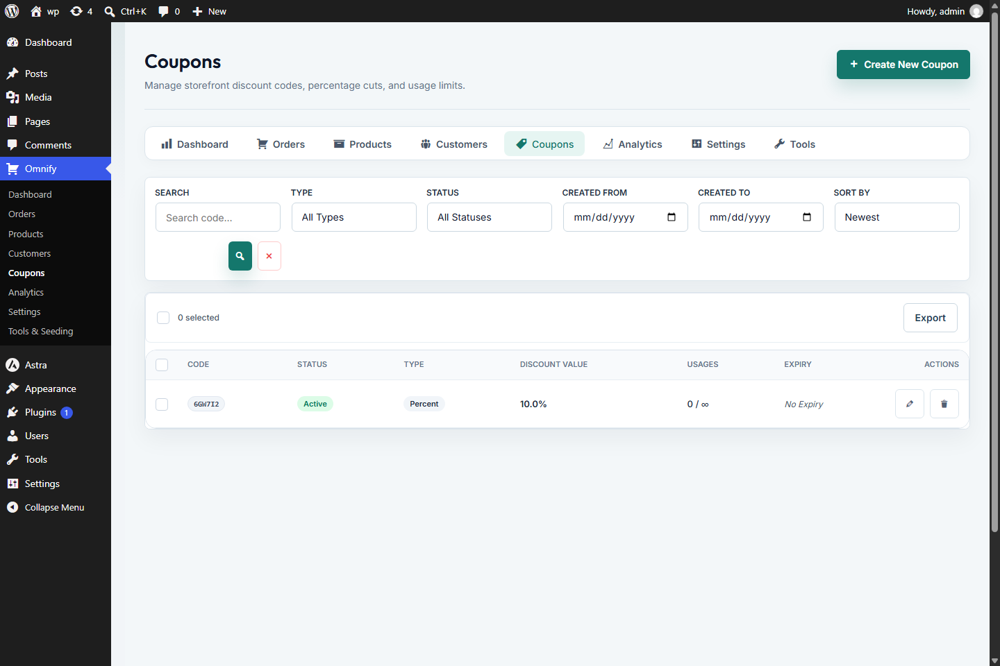
*Figure 7.1: Promotional coupon campaigns manager with usage counters, expiration dates, and discount rules.*

### Creating Promotional Coupons
Click **+ Create Coupon** to configure your promotional campaign:

| Setting Field | Options / Format | Description |
| :--- | :--- | :--- |
| **Coupon Code** | Alphanumeric (e.g., `SUMMER20`) | The code customers enter during checkout. |
| **Discount Type** | `Percentage (%)`, `Fixed Cart ($)`, `Fixed Product ($)` | Determines how the deduction is computed. |
| **Coupon Amount** | Numerical value | Percentage off or fixed monetary amount. |
| **Minimum Spend** | Monetary threshold | Minimum cart subtotal required to activate code. |
| **Maximum Spend** | Monetary cap | Maximum allowed cart value for coupon eligibility. |
| **Individual Use Only** | Yes / No | Prevents stacking with other promotional coupons. |
| **Usage Limit per Coupon** | Integer | Total times the coupon may be redeemed storewide. |
| **Usage Limit per User** | Integer | Total times an individual customer email may redeem the code. |
| **Expiry Date** | Date picker | Automatic expiration date and time. |

---

## 8. Store Analytics & Business Intelligence

Under **Omnify → Analytics**, store owners can monitor store performance with comprehensive visual reporting and financial metrics.

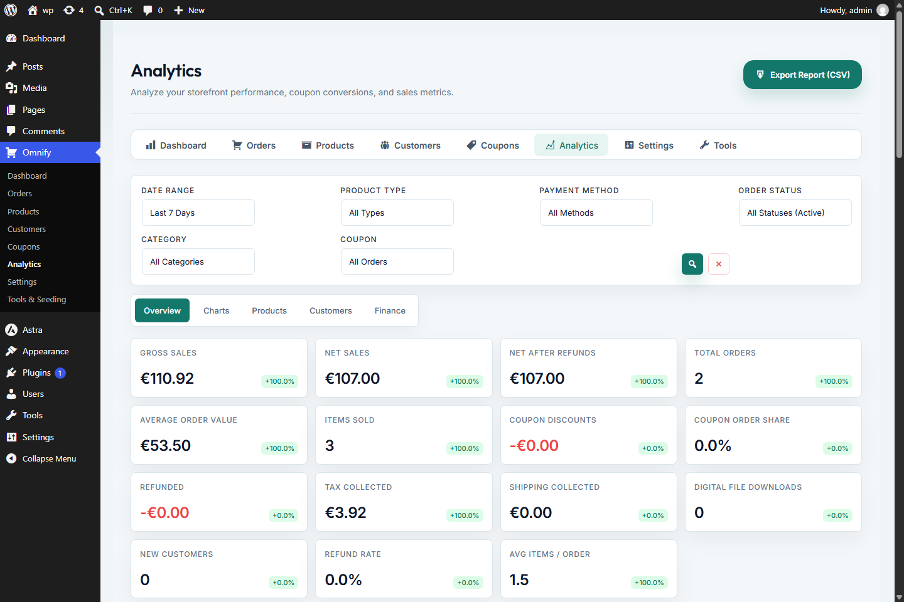
*Figure 8.1: Real-time analytics dashboard presenting sales figures, conversion metrics, AOV, and performance cards.*

### Performance Metric Cards
* **Gross Sales**: Total revenue before refunds and fees.
* **Net Sales**: Gross sales minus discounts and refunds.
* **Average Order Value (AOV)**: Mean revenue generated per transaction.
* **Items Sold**: Total units of physical and digital products purchased.
* **Coupon Discounts**: Total monetary value redeemed through promotions.
* **Tax & Shipping Collected**: Breakdown of collected governmental taxes and delivery fees.
* **Digital File Downloads**: Number of successful cryptographic download accesses.
* **CSV Export**: Click **Export Report (CSV)** to download complete transaction and accounting spreadsheets for external bookkeeping.

---

## 9. Customer Reviews Moderation

Customer feedback builds trust. Under **Omnify → Reviews**, manage all submitted product testimonials, ratings, and customer commentary.

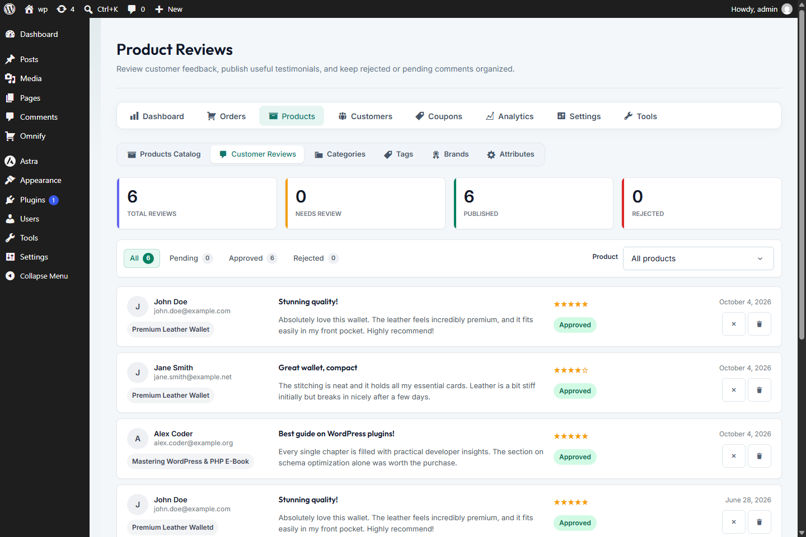
*Figure 10.1: Customer reviews moderation table with star ratings, verified buyer indicators, and status controls.*

### Review Features:
* **Verified Buyer Badge**: Automatically flags reviews left by customers who purchased the product through OmnifyWP.
* **Star Ratings**: Visual 1 to 5 star ratings.
* **Approval Workflow**: Reviews can be marked as `Approved`, `Unapproved` (held for moderation), or sent to `Trash`.
* **Direct Moderation**: Edit customer comments or reply directly to queries from the admin panel.

---

## 10. Abandoned Cart Recovery

Shopping cart abandonment is one of the biggest revenue leaks in online commerce. Under **Omnify → Abandoned Carts**, OmnifyWP automatically tracks unfinished checkouts and recovers lost sales.

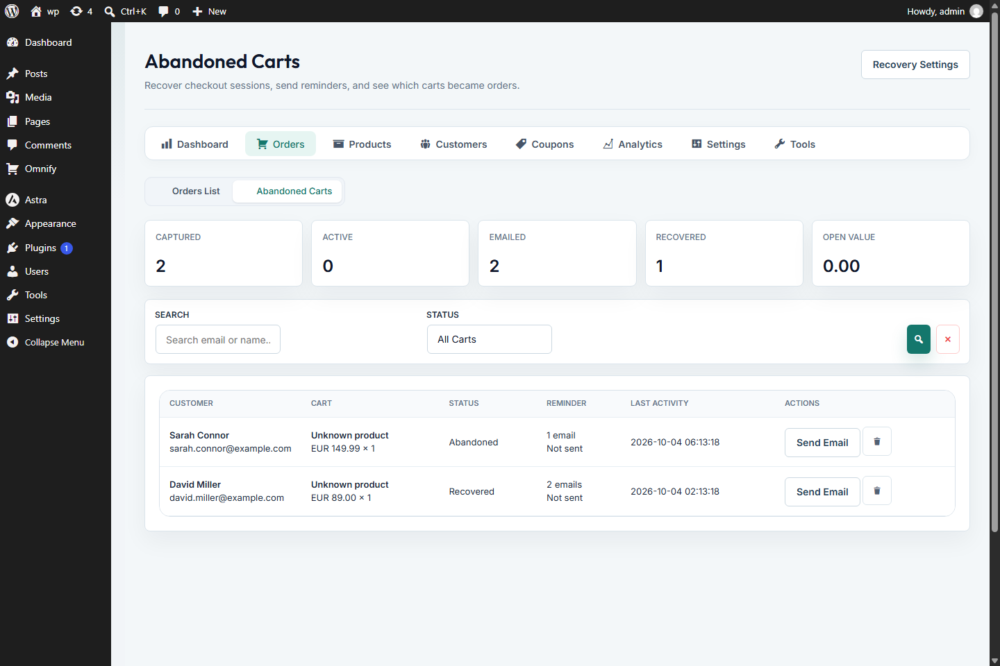
*Figure 10.1: Abandoned cart recovery directory tracking shopper email, cart contents, subtotal, and recovery status.*

### How Abandoned Cart Tracking Works:
1. **Dynamic Multi-Item Capture**: When a customer enters their contact email on the checkout page, Omnify securely serializes the entire cart contents (all products, chosen variations, quantities, and pricing) along with customer metadata.
2. **Abandonment Threshold**: If the checkout is not completed within 60 minutes, the session is marked as `Abandoned`.
3. **Automated Recovery Emails**: Omnify dispatches scheduled recovery reminder emails containing direct, cryptographic one-click checkout restoration links.
4. **Instant Basket Restoration**: When the shopper clicks the recovery link, their entire multi-item shopping basket is instantly restored in their session with previous selections intact.
5. **Recovery Attribution**: When a customer returns via the link and completes payment, the status automatically switches to `Recovered`, crediting the recovery to your store reports.

---

## 11. Store Configuration & Settings

Navigate to **Omnify → Settings** to configure your store's operating rules, payment processors, tax calculations, and communication templates.

### General Settings
Configure core regional, financial, and product display parameters (**Settings → General**).

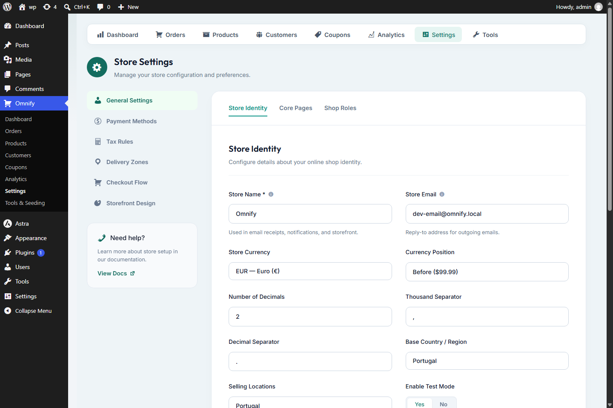
*Figure 11.1: General settings tab for store currency, formatting, and measurement units.*

* **Store Currency**: Choose from over 30 global currencies (USD, EUR, GBP, CAD, AUD, JPY, INR, BDT, etc.).
* **Currency Symbol Position**: Display symbol before (`$100`) or after (`100 €`) the numerical amount.
* **Thousand & Decimal Separators**: Set custom formatting (e.g., `,` vs `.`).
* **Decimals**: Choose decimal precision (typically `2` decimal places).
* **Weight & Dimension Units**: Specify kilograms (`kg`), pounds (`lbs`), centimeters (`cm`), or inches (`in`).

---

### Payment Gateways Configuration & Step-by-Step Setup
Under **Omnify → Settings → Payments**, store owners can configure and activate payment gateways to process transactions securely across international and local markets.

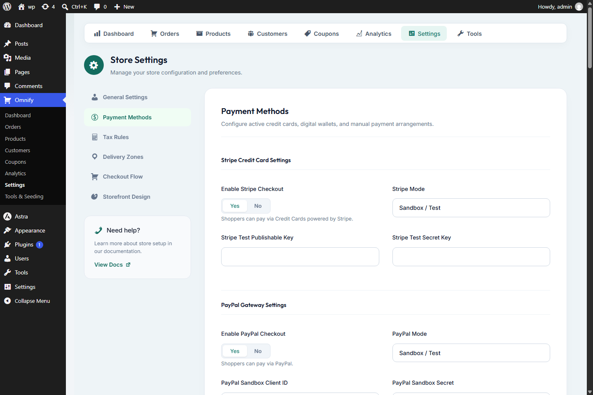
*Figure 11.2: Payment gateways settings screen supporting Stripe, PayPal, Razorpay, SSLCommerz, and manual payment options.*

#### Gateway Activation & Secure-by-Default Architecture
> [!IMPORTANT]
> **Secure-by-Default Policy**: When OmnifyWP eCommerce is freshly installed, **all payment gateways are disabled by default** (`'0'` / inactive). A payment method will never be exposed to shoppers on the checkout page until the store owner explicitly toggles it active and saves the required API credentials. This prevents incomplete transactions, customer confusion, and accidental live checkouts without proper merchant accounts.

---

#### Stripe Setup Guide
**Supported Payment Methods**: Visa, MasterCard, American Express, Discover, JCB, Apple Pay, Google Pay, SEPA Direct Debit, and 3D Secure / SCA.

##### Step 1: Create or Access Your Stripe Account
1. Visit [https://stripe.com](https://stripe.com) and create or log in to your Stripe Merchant Dashboard.
2. Complete your business verification in the Stripe dashboard to enable live payouts.

##### Step 2: Retrieve API Keys
1. In the Stripe Dashboard, navigate to **Developers → API keys**.
2. Notice the **Test mode** toggle in the top-right corner:
   * **For Sandbox Testing**: Ensure Test Mode is toggled **ON**. Copy the **Publishable Key** (starts with `pk_test_...`) and the **Secret Key** (click *Reveal live/test key*, starts with `sk_test_...`).
   * **For Live Sales**: Toggle Test Mode **OFF**. Copy your **Publishable Key** (`pk_live_...`) and **Secret Key** (`sk_live_...`).

##### Step 3: Configure Webhook Endpoint
Webhooks are essential for instant order confirmation, handling 3D Secure bank redirects, payment failure notifications, and automatic file access revocation upon refunds.
1. In Stripe Dashboard, navigate to **Developers → Webhooks**.
2. Click **+ Add an endpoint**.
3. In the **Endpoint URL** field, enter:
   ```
   https://yourdomain.com/wp-json/omnify/v1/webhook/stripe
   ```
   *(Replace `yourdomain.com` with your actual store domain name).*
4. Under **Select events to listen to**, choose:
   * `payment_intent.succeeded` — Confirms successful customer payments and unlocks order fulfillment.
   * `payment_intent.payment_failed` — Marks orders as failed when card authorization fails.
   * `charge.refunded` — Automatically records refunds in Omnify and revokes digital download access.
5. Click **Add endpoint**.
6. On the newly created webhook overview page, find **Signing secret** and click **Reveal**. Copy the secret string (starts with `whsec_...`).

##### Step 4: Configure Stripe in OmnifyWP Settings
1. In WordPress Admin, go to **Omnify → Settings → Payments**.
2. Locate the **Stripe** card and click **Configure**.
3. Toggle **Enable Stripe** to active (`ON`).
4. Set **Test Mode**:
   * Turn **ON** for Sandbox testing.
   * Turn **OFF** when ready to accept real customer payments.
5. Paste your **Publishable Key**, **Secret Key**, and **Webhook Secret**.
6. *(Optional)* Customize the **Title** (e.g., *Credit Card / Debit Card (Stripe)*) and **Statement Descriptor** (appears on customer bank statements, max 22 characters).
7. Click **Save Changes**.

##### Step 5: Test Verification
1. With Test Mode enabled, add a product to the cart and proceed to checkout.
2. Enter Stripe's official test card number: `4242 4242 4242 4242`, any future expiration date (e.g., `12/30`), and any 3-digit CVC (`123`).
3. Place order and verify the order status updates to **Processing** or **Completed** in **Omnify → Orders**.

---

#### PayPal Commerce Platform Setup Guide
**Supported Payment Methods**: PayPal Wallet Balance, Pay in 4 / Pay Later installments, Venmo, and credit cards via PayPal Smart Buttons.

##### Step 1: Create a PayPal Developer App
1. Visit the [PayPal Developer Dashboard](https://developer.paypal.com) and log in with your PayPal business credentials.
2. Go to **Dashboard → Apps & Credentials**.
3. Toggle between **Sandbox** (for testing) or **Live** (for production).
4. Click **Create App**:
   * **App Name**: Enter a name (e.g., *OmnifyWP Storefront*).
   * **App Type**: Select *Merchant*.
5. Click **Create App**.

##### Step 2: Retrieve Client ID and Secret
1. On your newly created application details page, copy the **Client ID**.
2. Click **Show** under **Secret** and copy your **Secret Key**.

##### Step 3: Configure PayPal Webhooks
1. Scroll down to the **Webhooks** section on the app page and click **Add Webhook**.
2. Enter your Webhook URL:
   ```
   https://yourdomain.com/wp-json/omnify/v1/webhook/paypal
   ```
3. Under **Event Types**, check:
   * `CHECKOUT.ORDER.APPROVED`
   * `PAYMENT.CAPTURE.COMPLETED`
   * `PAYMENT.CAPTURE.REFUNDED`
4. Click **Save** and note your Webhook ID.

##### Step 4: Configure PayPal in OmnifyWP Settings
1. In WordPress Admin, navigate to **Omnify → Settings → Payments → PayPal**.
2. Toggle **Enable PayPal** to `ON`.
3. Select Environment (**Sandbox** or **Live**).
4. Paste your **Client ID** and **Secret Key**.
5. Choose your Smart Button style, layout (Vertical or Horizontal), and color scheme.
6. Click **Save Changes**.

---

#### Razorpay Setup Guide
**Supported Payment Methods**: UPI (Google Pay, PhonePe, Paytm, BHIM), RuPay, Visa, Mastercard, NetBanking across 50+ Indian banks, and Digital Wallets (Mobikwik, Freecharge).

##### Step 1: Access Razorpay Merchant Dashboard
1. Visit [https://razorpay.com](https://razorpay.com) and log into the Dashboard (`dashboard.razorpay.com`).
2. Complete KYC verification to accept live payments in Indian Rupees (INR) and international currencies.

##### Step 2: Generate API Key ID & Secret
1. In Razorpay Dashboard, navigate to **Account & Settings → API Keys** (or **Settings → API Keys**).
2. Toggle between **Test Mode** and **Live Mode** in the header.
3. Click **Generate Key**:
   * Copy the **Key ID** (starts with `rzp_test_...` or `rzp_live_...`).
   * Copy the **Key Secret** (keep this confidential; it cannot be viewed again once dismissed).

##### Step 3: Configure Razorpay Webhooks
1. In Razorpay Dashboard, go to **Settings → Webhooks → Add New Webhook**.
2. In **Webhook URL**, enter:
   ```
   https://yourdomain.com/wp-json/omnify/v1/webhook/razorpay
   ```
3. In **Secret**, enter a secure random passphrase of your choice.
4. Under **Active Events**, select:
   * `payment.captured`
   * `payment.failed`
   * `refund.processed`
5. Click **Create Webhook**.

##### Step 4: Configure Razorpay in OmnifyWP Settings
1. In WordPress Admin, navigate to **Omnify → Settings → Payments → Razorpay**.
2. Toggle **Enable Razorpay** to `ON`.
3. Enter your **Key ID**, **Key Secret**, and the **Webhook Secret** created above.
4. Set Merchant Name and Theme Color (e.g., `#3399cc`).
5. Click **Save Changes**.

---

#### SSLCommerz Setup Guide
**Supported Payment Methods**: bKash, Nagad, Rocket, Upay, local Bangladeshi Visa, MasterCard, UnionPay, and Internet Banking.

##### Step 1: Obtain SSLCommerz Merchant Account
1. Register for a merchant account at [https://sslcommerz.com](https://sslcommerz.com).
2. Contact SSLCommerz integration support to obtain your **Sandbox Store ID** and **Store Password**.
3. Upon live approval, access your production merchant panel at `merchant.sslcommerz.com`.

##### Step 2: Configure IPN (Instant Payment Notification)
1. In your SSLCommerz Merchant Panel, navigate to **IPN Settings**.
2. Enter your IPN listener endpoint:
   ```
   https://yourdomain.com/wp-json/omnify/v1/webhook/sslcommerz
   ```
3. Set IPN HTTP method to `POST`.

##### Step 3: Configure SSLCommerz in OmnifyWP Settings
1. In WordPress Admin, navigate to **Omnify → Settings → Payments → SSLCommerz**.
2. Toggle **Enable SSLCommerz** to `ON`.
3. Set Environment to **Sandbox** (Testing) or **Live** (Production).
4. Enter your **Store ID** and **Store Password**.
5. Save changes. Customers selecting SSLCommerz will be seamlessly redirected to the secure hosted checkout and returned with instant order verification.

---

#### Cash on Delivery (COD) Setup Guide
**Ideal For**: Physical product merchants selling locally or via courier cash collection.

##### Configuration Steps:
1. In WordPress Admin, navigate to **Omnify → Settings → Payments → Cash on Delivery**.
2. Toggle **Enable Cash on Delivery** to `ON`.
3. Configure the settings:
   * **Title**: Text displayed to shoppers (e.g., *Cash on Delivery (COD)*).
   * **Description**: Subtitle explaining payment upon delivery.
   * **Instructions**: Detailed guidance displayed on the Order Received confirmation screen (e.g., *Please prepare exact cash for our courier upon parcel arrival*).
   * **Enable for Virtual/Digital Products**: Leave **Disabled** (`OFF`). When disabled, carts containing only digital downloads will automatically hide COD.
   * **Minimum & Maximum Order Totals**: Optional thresholds to restrict COD only to specific cart value ranges (e.g., Minimum $10, Maximum $500).
4. **Order Lifecycle**: Orders placed with COD are marked as `Processing` or `Pending Payment`. Once your delivery driver or courier collects the cash, administrators mark the order as `Completed`.
5. Click **Save Changes**.

---

#### Direct Bank Transfer (BACS / Wire) Setup Guide
**Ideal For**: B2B sales, wholesale invoices, high-ticket items, and offline bank deposits.

##### Configuration Steps:
1. In WordPress Admin, navigate to **Omnify → Settings → Payments → Direct Bank Transfer**.
2. Toggle **Enable Bank Transfer** to `ON`.
3. Set **Title** and **Description** (e.g., *Direct Bank Wire Transfer*).
4. Set **Instructions**: Inform shoppers that their order will be held until funds clear into your business account.
5. **Add Bank Accounts**: Enter one or more banking accounts:
   * **Account Name**: Business or beneficiary name (e.g., *Omnify Commerce LLC*).
   * **Account Number**: Domestic account number.
   * **Bank Name**: Name of financial institution (e.g., *Chase Bank*, *Barclays*).
   * **Routing Number / Sort Code**: Domestic routing code (ABA, Sort Code, IFSC).
   * **IBAN**: International Bank Account Number for cross-border wires.
   * **BIC / SWIFT**: Bank Identifier Code for international transfers.
6. **Order Lifecycle & Reconciliation**:
   * Orders placed via Bank Transfer are automatically assigned status **On Hold**.
   * Your bank account details and customer reference number (Order ID) are displayed on the confirmation screen and sent via the automated Order Confirmation email.
   * When your accounting department verifies the received wire, open the order in **Omnify → Orders** and change status to **Processing** or **Completed**.
7. Click **Save Changes**.

---

#### Cheque Payment Setup Guide
**Ideal For**: Organizations, schools, or government agencies requiring physical paper check processing.

##### Configuration Steps:
1. In WordPress Admin, navigate to **Omnify → Settings → Payments → Cheque Payment**.
2. Toggle **Enable Cheque Payment** to `ON`.
3. Set **Title** and **Description**.
4. In **Instructions**, provide:
   * **Payee Name**: Make cheque payable to (e.g., *Omnify Commerce Inc.*).
   * **Mailing Address**: Full mailing address where the physical check should be delivered.
5. Orders are initially set to **On Hold**. Once the check is received, deposited, and cleared, update the order to **Completed**.
6. Click **Save Changes**.

---

#### Paystack Setup Guide (Africa: Nigeria, Ghana, Kenya, South Africa)
**Supported Payment Methods**: Mastercard, Visa, Verve, Mobile Money (M-Pesa, MTN, Airtel), Bank Transfer, and USSD.

##### Step 1: Obtain Paystack API Credentials
1. Register at [https://paystack.com](https://paystack.com).
2. Navigate to **Settings → API Keys & Webhooks**.
3. Copy your **Public Key** (`pk_live_...` or `pk_test_...`) and **Secret Key** (`sk_live_...` or `sk_test_...`).

##### Step 2: Configure Paystack Webhook
1. In Paystack Dashboard under **Webhook URL**, input:
   ```
   https://yourdomain.com/wp-json/omnify/v1/paystack/webhook
   ```
2. Click **Save Changes**.

##### Step 3: Configure in OmnifyWP Settings
1. Navigate to **Omnify → Settings → Payments → Paystack**.
2. Toggle **Enable Paystack** to `ON`.
3. Set Environment to **Test** or **Live**.
4. Paste **Public Key** and **Secret Key**.
5. Save changes.

---

#### Tap Payments Setup Guide (Middle East & GCC)
**Supported Payment Methods**: mada (Saudi Arabia), KNET (Kuwait), Benefit (Bahrain), NAPS (Qatar), OmanNet, Visa, and Mastercard.

##### Step 1: Obtain Tap Credentials
1. Register at [https://tap.company](https://tap.company).
2. Go to your merchant dashboard to generate your **Public Key** and **Secret Key**.

##### Step 2: Webhook Endpoint
1. Set Webhook URL in your Tap dashboard to:
   ```
   https://yourdomain.com/wp-json/omnify/v1/tap/webhook
   ```

##### Step 3: Configure in OmnifyWP Settings
1. Navigate to **Omnify → Settings → Payments → Tap Payments**.
2. Toggle **Enable Tap Payments** to `ON`.
3. Enter your **Public Key** and **Secret Key**.
4. Save changes.

---

#### Mollie Setup Guide (European Union)
**Supported Payment Methods**: iDEAL (Netherlands), Bancontact (Belgium), SEPA Direct Debit / Bank Transfer, Klarna, SOFORT, and cards.

##### Step 1: Obtain Mollie API Key
1. Register at [https://mollie.com](https://mollie.com).
2. In your dashboard, copy your **Live API Key** (`live_...`) or **Test API Key** (`test_...`).

##### Step 2: Configure in OmnifyWP Settings
1. Navigate to **Omnify → Settings → Payments → Mollie**.
2. Toggle **Enable Mollie** to `ON`.
3. Paste your **API Key**.
4. Save changes. Mollie manages all European localized checkout payment schemes automatically.

---

#### Khalti Digital Wallet Setup Guide (Nepal)
**Supported Payment Methods**: Khalti digital wallet balance, e-Banking, mobile banking, and ConnectIPS.

##### Step 1: Register Khalti Merchant Account
1. Register at [https://khalti.com/merchant](https://khalti.com/merchant).
2. Obtain your **Live Secret Key** (or **Test Secret Key** from `test-admin.khalti.com`).

##### Step 2: Configure in OmnifyWP Settings
1. Navigate to **Omnify → Settings → Payments → Khalti**.
2. Toggle **Enable Khalti** to `ON`.
3. Set Environment to **Test** or **Live**.
4. Enter **Khalti Secret Key**.
5. Save changes.

---

#### eSewa Setup Guide (Nepal)
**Supported Payment Methods**: eSewa digital wallet balance and connected bank accounts.

##### Step 1: Merchant Code & Secret Key
1. Register as an eSewa merchant via [https://merchant.esewa.com.np](https://merchant.esewa.com.np).
2. Obtain your **Merchant Code** (Product Code) and **Secret Key** for HMAC-SHA256 signature verification.

##### Step 2: Configure in OmnifyWP Settings
1. Navigate to **Omnify → Settings → Payments → eSewa**.
2. Toggle **Enable eSewa** to `ON`.
3. Set Environment to **Test / Sandbox** or **Live**.
4. Enter **Merchant Code** and **Secret Key**.
5. Save changes.

---

#### Paddle Billing Setup Guide (Global Merchant of Record)
**Supported Payment Methods**: Global credit/debit cards, PayPal, Apple Pay, Wire transfers with automated sales tax and VAT filing.

##### Step 1: Obtain Paddle API Credentials
1. Register at [https://paddle.com](https://paddle.com).
2. Under **Developer tools → Authentication**, generate a **Client-side token** and **API Secret Key**.
3. Under **Developer tools → Notifications**, add a webhook destination pointing to:
   ```
   https://yourdomain.com/wp-json/omnify/v1/paddle/webhook
   ```
4. Copy the webhook secret key (`Paddle-Signature`).

##### Step 2: Configure in OmnifyWP Settings
1. Navigate to **Omnify → Settings → Payments → Paddle**.
2. Toggle **Enable Paddle** to `ON`.
3. Paste **Client-Side Token**, **API Key**, and **Webhook Secret**.
4. Save changes.

---

#### Gateway Testing & Sandbox Reference Table

| Gateway | Environment Switch | Recommended Test Credentials | Test Cards / Simulation |
| :--- | :--- | :--- | :--- |
| **Stripe** | Test Mode toggle | `pk_test_...` / `sk_test_...` | Card: `4242 4242 4242 4242`, Expiry: any future date, CVC: any 3 digits |
| **PayPal** | Sandbox toggle | Client ID & Secret from developer.paypal.com | Use Sandbox Personal buyer account from developer dashboard |
| **Razorpay** | Test Mode toggle | `rzp_test_...` Key ID & Secret | Standard test card: `4111 1111 1111 1111`, OTP: `123456` |
| **SSLCommerz** | Sandbox toggle | Store ID: `testbox`, Pass: `qwerty` | Test cards and simulated mobile wallets provided in test sandbox portal |
| **Paystack** | Test Mode toggle | `pk_test_...` / `sk_test_...` | Test card: `4084 0840 8408 4081`, PIN: `1111`, OTP: `123456` |
| **Mollie** | Test Mode toggle | `test_...` API Key | Select payment status (`Paid`, `Cancelled`, `Expired`) on test gateway screen |
| **Khalti** | Test Mode toggle | Test Secret Key | Test mobile: `9800000000`, MPIN: `1111`, OTP: `987654` |
| **eSewa** | Sandbox toggle | Merchant Code: `EPAYTEST`, Secret: `8gBm/:&EnhH.1/q` | Test credentials provided in eSewa Developer Portal |
| **Tap Payments** | Test Mode toggle | Public & Secret Key from tap.company dashboard | Sandbox cards/mada/KNET simulations provided in the Tap sandbox |
| **Paddle** | Sandbox toggle | `test_...` API Key & Client-Side Token | Use Paddle sandbox checkout with test card `4242 4242 4242 4242` |
| **Alipay** | Sandbox toggle | App ID, Merchant Private Key, Alipay Public Key | Sandbox via `openapi-sandbox.dl.alipaydev.com` |
| **WeChat Pay** | Sandbox toggle | App ID, Mch ID, API v3 Key, cert serial + private key | Use WeChat sandbox merchant credentials (v3) |

---

### Shipping & Delivery Zones
Under **Settings → Delivery**, set up your shipping fulfillment rules and delivery rates.

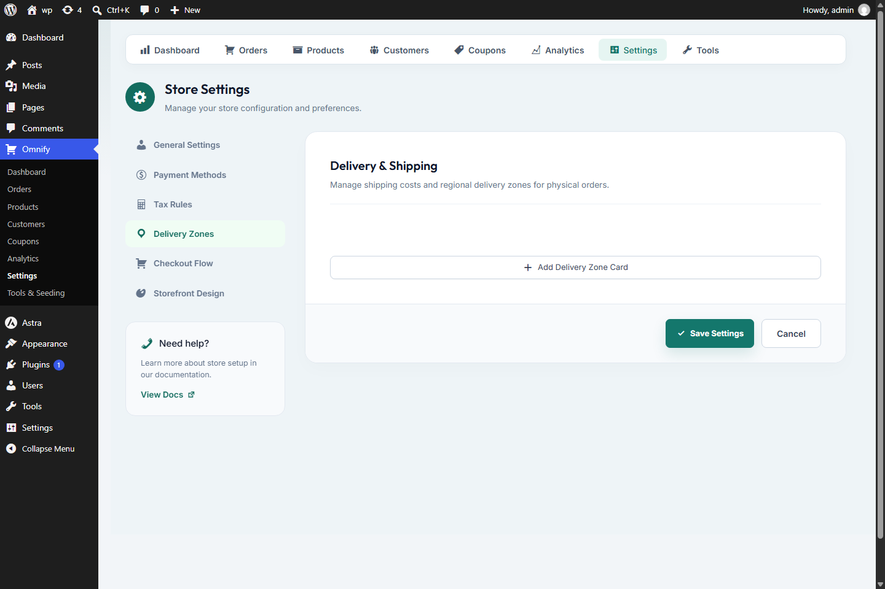
*Figure 11.3: Delivery settings for configuring shipping methods, flat rates, and free shipping thresholds.*

* **Flat Rate Shipping**: Charge a standard fee per order or per item.
* **Free Shipping Threshold**: Automatically grant free shipping when cart subtotal exceeds a designated amount (e.g., Free shipping over $75).
* **Local Pickup**: Allow local customers to collect their orders in-store without shipping fees.

---

### Tax Calculation & Regional Rates
Under **Settings → Tax**, configure sales tax, VAT, or GST calculations.

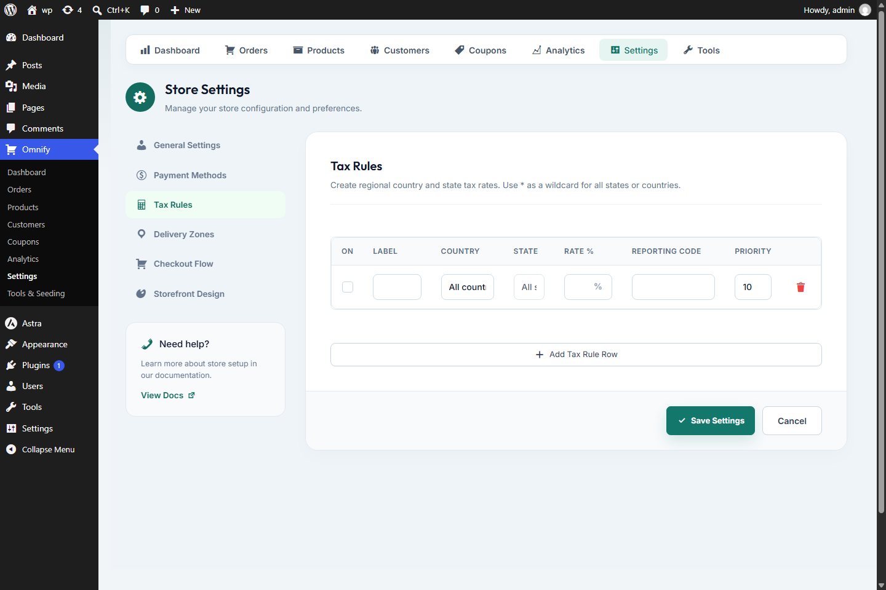
*Figure 11.4: Tax settings for inclusive/exclusive pricing, compound rates, and regional tax tables.*

* **Tax Calculation Status**: Enable or disable automated tax calculations.
* **Prices Entered With Tax**: Choose whether your catalog prices are tax-inclusive or tax-exclusive.
* **Calculate Tax Based On**: Calculate tax from Customer Shipping Address, Customer Billing Address, or Store Base Address.
* **Tax Classes**: Set Standard, Reduced Rate, or Zero Rate rules.

---

### Customer Email Notifications & Templates
Under **Settings → Email**, manage customer notifications and administrative alerts.

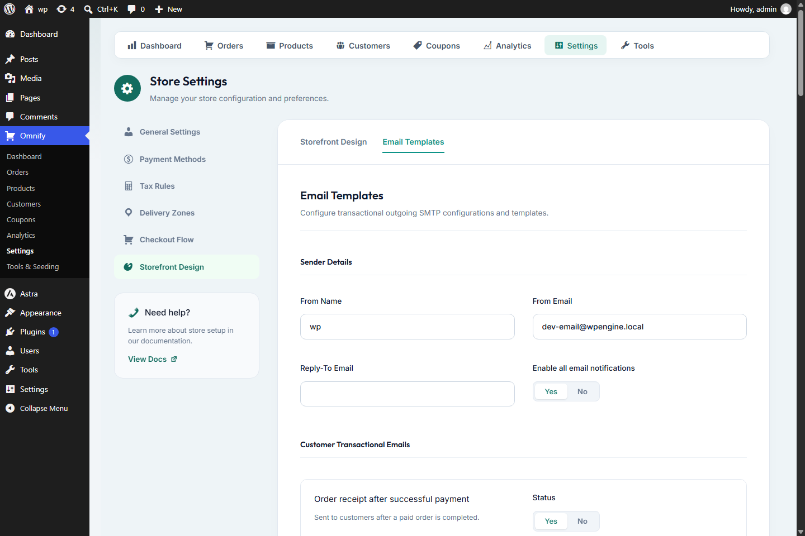
*Figure 11.5: Automated email management panel for customer receipts, order updates, and admin alerts.*

#### 17 Automated Store Email Triggers:
OmnifyWP features 17 granular email triggers that keep shoppers and administrators informed throughout the entire transaction lifecycle:

1. **Order Receipt / Confirmation (Customer)**: Instant order receipt with line items, tax breakdown, and shipping details.
2. **Admin New Order Notice**: Real-time sales alert dispatched to store managers with gross value and customer profile.
3. **Payment Pending**: Reminder sent to shoppers whose order is awaiting offline or delayed payment.
4. **Payment Failed (Admin)**: Alert to store managers when a card is declined or a gateway returns an error.
5. **Order Status Changed**: Automatic update whenever an order transitions between lifecycle statuses.
6. **Refund Request Under Review**: Acknowledgement sent when a refund request is submitted with its reason.
7. **Refund Processed**: Confirmation of partial or full refunds with the credited amount.
8. **Order Cancelled**: Formal cancellation notification with automated inventory restock notice.
9. **Shipment Dispatched**: Delivery update featuring shipping carrier, tracking URL, and estimated delivery date.
10. **Ready for Pickup**: Notification when a local-pickup order is packed and ready for collection.
11. **Customer Order Note**: Support-team note added to an order, delivered to the buyer.
12. **Customer Account Welcome**: Onboarding email welcoming newly registered customer accounts.
13. **Admin Low Stock Alert**: Threshold alert warning store managers when inventory drops below safety levels.
14. **Admin Out of Stock Emergency**: Urgent alert when a catalog SKU inventory hits zero.
15. **Back-In-Stock Alert**: Automated notification to waitlisted shoppers when an out-of-stock product or variation is replenished.
16. **Admin High-Risk Order Alert**: Fraud alert dispatched when an order exceeds security risk thresholds.
17. **Abandoned Cart Recovery**: High-converting reminder email with a 1-click checkout restoration link.

Each email template features customizable subject lines, editable HTML bodies, preview rendering modals, and support for dynamic template merge tags (e.g. `{customer_name}`, `{order_id}`, `{order_total}`, `{tracking_number}`).

---

### Checkout Flow Configuration
Under **Settings → Checkout**, configure your storefront conversion settings.

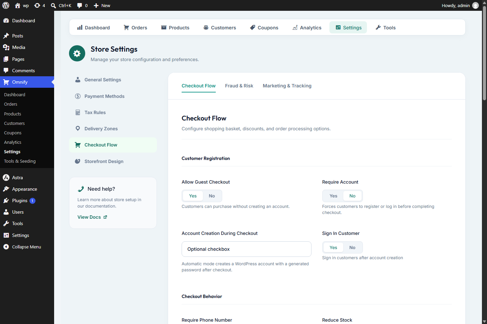
*Figure 11.6: Checkout flow configuration for guest checkout, terms requirements, and address forms.*

* **Guest Checkout**: Permit customers to place orders without creating a WordPress account.
* **Account Creation**: Option to automatically create customer accounts during checkout.
* **Coupon Input**: Toggle whether coupon code redemption boxes appear on cart and checkout pages.
* **Terms & Conditions**: Require shoppers to accept your store terms before completing checkout.

---

### Store Pages Mapping
Under **Settings → Pages**, review or remap the core store pages associated with Omnify shortcodes.

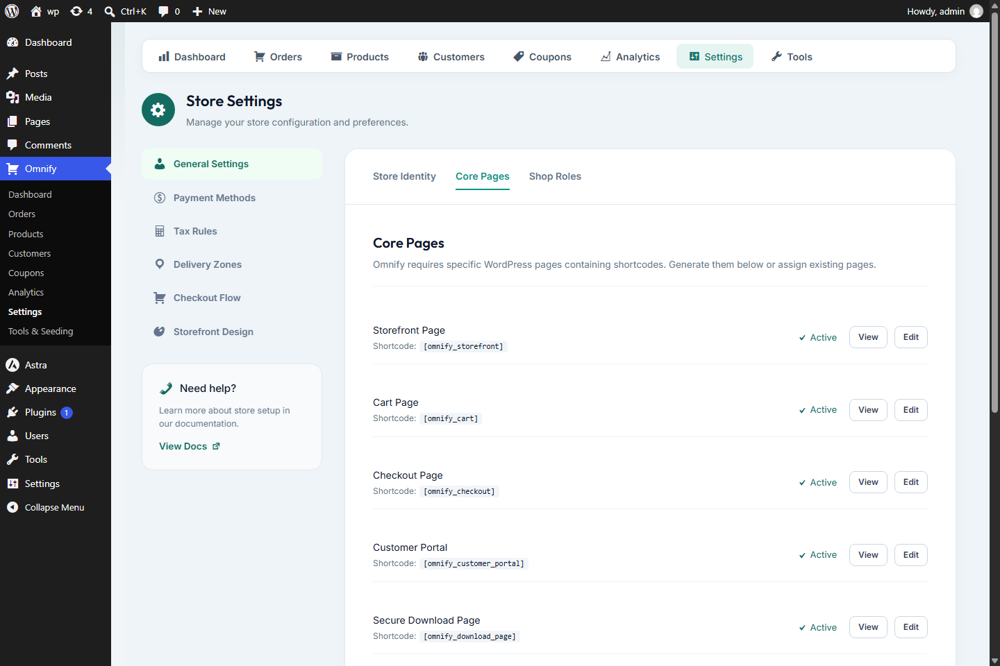
*Figure 11.7: Core storefront page mapping and shortcode assignment screen.*

---

## 12. System Tools, Demo Seeding & Maintenance

Under **Omnify → Tools & Seeding** (`page=omnify-tools`), store administrators can monitor database health, seed realistic demo catalogs, perform granular cleanup operations, inspect server runtime limits, and manage CSV dataset imports and exports.

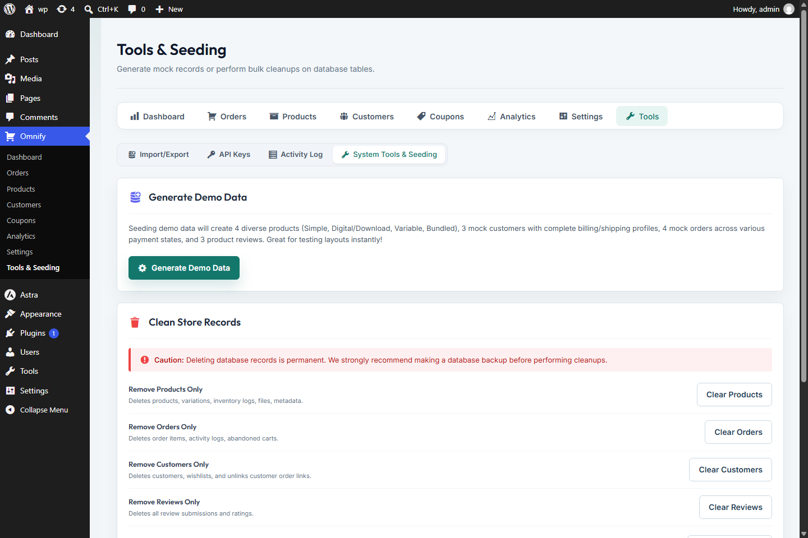
*Figure 12.1: System diagnostics, real-time database metric strip, demo data generator, and granular cleanup utilities.*

### Database Diagnostics Overview Bar
Located at the top of the System Tools dashboard, a live 4-card metric strip provides instant diagnostic visibility into custom database table health:
* **Total Products**: Live count of active products stored in `omnify_products`.
* **Total Orders**: Live count of completed, processing, and pending order records in `omnify_orders`.
* **Total Customers**: Live count of registered customer CRM profiles in `omnify_customers`.
* **Total Reviews**: Live count of verified customer product ratings and reviews in `omnify_reviews`.

### Demo Data Generator
Quickly populate a fresh store with realistic sample catalog records for theme development, client walkthroughs, and performance testing:
* **Seeded Assets**: 50 products across simple, variable, and digital types, sample customer profiles, past orders with multiple statuses, customer reviews, and category hierarchies.
* **Live Progress Engine**: Animated emerald progress bar providing step-by-step progress status during database insertion.
* **Informational Safeguards**: Pre-flight checklist confirming that demo seeding will never overwrite existing store transactions.

### Granular Database Cleanup Utilities
Manage database record hygiene with specialized individual cleanup operations:
* **Clean Products**: Removes generated catalog items, variations, attributes, and digital download file records.
* **Clean Orders**: Removes test purchase records, order items, and associated address records.
* **Clean Customers**: Wipes customer CRM profiles, billing records, and digital download access tokens.
* **Clean Reviews**: Removes product ratings, customer feedback comments, and moderation logs.
* **Clean Coupons**: Wipes promotional coupon codes, usage limits, and redemption statistics.
* **Clean Activity Logs**: Purges administrative audit trail records to free database storage.
* **Automated Daily Database Maintenance**: Runs a background cron job (`omnify_daily_database_cleanup`) that automatically purges abandoned carts older than 30 days, prunes expired session transients, cleans orphaned download tokens, and maintains database index efficiency without manual intervention.
* **Danger Zone (Wipe All Store Data)**: High-visibility alert container allowing administrators to permanently reset the store to a clean state with confirmation safeguards.

### Server Runtime & System Specifications
The server inspection panel reports critical environment parameters:
* **PHP Version**: Current PHP runtime (minimum required: 8.2+).
* **MySQL / MariaDB Version**: Database server release and compatibility status.
* **WordPress Core Version**: Active WordPress environment.
* **Memory Limit**: Available PHP memory allocation (e.g., `256M` or `512M`).
* **Max Execution Time**: PHP script execution timeout limit in seconds.
* **Table Prefix**: Current WordPress database prefix for table verification.

### Dataset Import & Export (`page=omnify-export`)
* **One-Click CSV Exports**: Dedicated cards to export Products, Orders, and Customers into standardized, UTF-8 formatted CSV spreadsheets.
* **Catalog CSV Import**: Drag-and-drop file upload container supporting custom column mapping overrides.
* **CSV Header Specification Table**: In-app reference documenting required and optional columns (`product_name`, `slug`, `sku`, `price`, `sale_price`, `stock_quantity`, `product_type`, `description`, `images`, `download_file_url`).

---

## 13. Administrative Activity Audit Log

Under **Omnify → Activity Log** (`page=omnify-activity`), the plugin maintains a searchable, filterable chronological audit trail of all administrative actions.

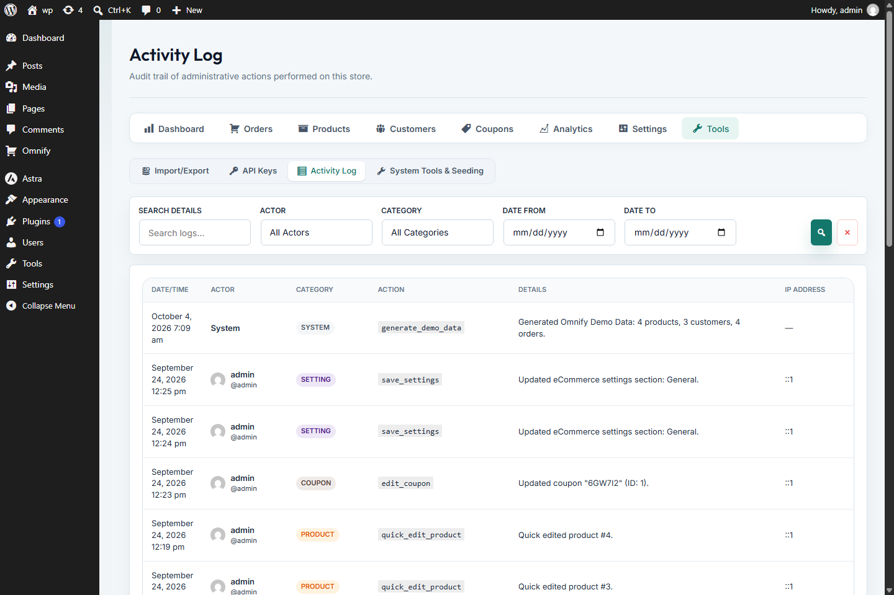
*Figure 13.1: Administrative audit trail recording staff actions, status updates, and setting changes.*

### Filter & Search Toolbar
* **Search Details**: Query log descriptions for specific product names, coupon codes, or order numbers.
* **Actor Filter**: Filter actions by specific administrative staff members or automated system events.
* **Category Filter**: Filter by entity type (`Orders`, `Products`, `Coupons`, `Settings`, `Customers`, `Reviews`).
* **Date Range Picker**: Filter logs between specific **Date From** and **Date To** boundaries.
* **Active Filter Chips**: Convenient pill bar displaying active criteria with one-click individual chip removal.

### Semantic Category Badge System
Events are tagged with high-visibility color-coded badges for rapid scanning:
* **Orders**: Blue badge (`#1d4ed8` on `#eff6ff`)
* **Products**: Amber badge (`#b45309` on `#fffbeb`)
* **Coupons**: Violet badge (`#6d28d9` on `#f5f3ff`)
* **Settings**: Slate badge (`#334155` on `#f8fafc`)
* **Customers**: Emerald badge (`#047857` on `#ecfdf5`)
* **Reviews**: Rose badge (`#be123c` on `#fff1f2`)

### Recorded Audit Metadata
* **Timestamp**: Formatted date and time matching the WordPress timezone configuration.
* **Actor**: Staff display name, `@username`, and Gravatar image with avatar fallback.
* **Action Identifier**: Monospaced action code (e.g., `product.updated`, `order.status_change`, `gateway.configured`).
* **Details Description**: Plain-language description of changes made, previous values, and new settings.
* **IP Address & Client**: Recorded remote IP with hover tooltip revealing the recorded HTTP User-Agent.

### Log Clearance Danger Zone
* An isolated danger zone card at the bottom of the audit log allows authorized administrators to clear audit trail records to reclaim database storage, protected by explicit confirmation prompts.

---

## 14. REST API Access & Integrations

Under **Omnify → API Keys** (`page=omnify-api`), store administrators manage REST API access keys, outbound webhook event streaming, payment gateway health checks, and remote URL diagnostic tools.

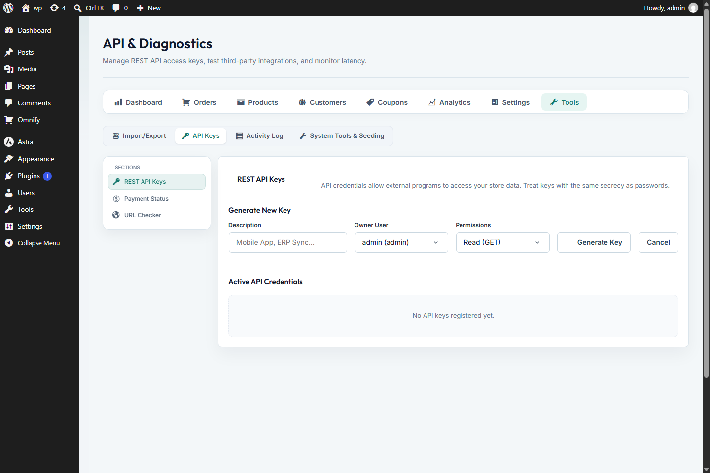
*Figure 14.1: REST API keys, outbound webhooks, payment connectivity diagnostics, and URL checker panel.*

### 1. REST API Keys (`section=keys`)
Generate cryptographically strong API credentials for mobile applications, ERP synchronization, inventory management software, and headless frontends:
* **Key Generation Form**: Specify a key description (e.g., *ERP Sync* or *iOS Mobile App*), select user ownership, and set permission levels (`Read`, `Write`, or `Read/Write`).
* **Credentials Modal**: Displays the generated **Client Key (Consumer Key)** and **Client Secret (Consumer Secret)** with 1-click clipboard copy buttons. For security, secrets are never stored in plain text and cannot be retrieved after closing the notice.
* **Active Credentials Table**: Lists all active API keys with description, user owner, consumer key last-4 identifier (`ck_...xxxx`), permission badge, creation date, last used timestamp, and a one-click **Revoke** action.

### 2. Outbound Webhooks (`section=webhooks`)
Stream real-time JSON payloads to external services (Zapier, Slack, Make, custom webhooks, ERP endpoints) whenever store events take place:
* **Registration Form**: Define a webhook name, target payload delivery URL, and an optional secret key (auto-generated if left blank).
* **Event Topic Subscriptions**: Checkbox selector to subscribe to specific store triggers:
  * `order.created`: Fires immediately when a customer places an order.
  * `order.status_changed`: Fires on payment confirmation, cancellation, or fulfillment.
  * `order.completed`: Fires when order processing is completed.
  * `order.refunded`: Fires when a refund is issued.
  * `order.cancelled`: Fires on order cancellation.
  * `customer.created`: Fires when a new customer account is registered.
* **Cryptographic Verification**: Every outbound delivery includes an `X-Omnify-Signature` header computed via HMAC-SHA256 over the payload using the subscription's secret key.
* **Active Subscriptions Table**: View endpoint URLs, subscribed topics, status badges, and test actions.
* **Send Test Ping**: Dispatches a sample JSON payload to the remote URL and displays immediate HTTP response status without leaving the page.

### 3. Payment Gateway Connectivity Diagnostics (`section=payments`)
Validate live authentication credentials and connection health for active payment systems:
* **Stripe Integration Card**: Reports active status, environment mode (`Live` vs `Test`), webhook secret configuration status, and provides an instant **Check Stripe Status** button that executes a live authenticated API ping and reports latency in milliseconds.
* **PayPal Integration Card**: Reports active status, environment mode (`Live` vs `Sandbox`), OAuth client ID configuration status, and provides an instant **Check PayPal Status** button that validates token authentication and reports latency in milliseconds.

### 4. Arbitrary URL Connection Checker (`section=checker`)
A built-in network diagnostic utility to test connectivity and response latency from your WordPress server to any remote API endpoint:
* **Remote URL Input**: Enter any target endpoint (e.g., `https://api.stripe.com`, `https://api.github.com`).
* **Diagnostic Report**:
  * **HTTP Status Code**: Visual response status (e.g., `200 OK`, `401 Unauthorized`, `500 Error`).
  * **Roundtrip Latency**: Millisecond ping time rated as *Excellent (Fast)* (<250ms), *Average (Good)* (<600ms), or *Poor (Slow)* (>600ms).
  * **Health Status**: High-visibility status pill (`Online`, `Status Alert`, `Offline`).
  * **Filtered Response Headers**: Monospaced inspection window displaying server response headers (Content-Type, Server, Date, Cache-Control).

---

## 15. Customer Storefront Experience

OmnifyWP delivers a modern, high-converting storefront experience engineered for sub-millisecond responsiveness. Built with clean CSS architecture, full-width responsive imagery, dynamic layout switching, visual swatches, live countdown timers, and instant client-side filtering, shoppers enjoy a luxury brand shopping journey across all desktop and mobile devices.

---

### Multi-Layout Catalog & Switcher
The storefront catalog toolbar features an interactive **Layout Switcher** (`.omnify-layout-switches`) allowing shoppers to toggle their preferred catalog display on the fly. The shopper's selection is stored in browser `localStorage` and automatically restored across browsing sessions:

#### 1. 4-Column Modern Dense Grid (`data-cols="4"` / Default Catalog View)
* **Design Philosophy**: High-density, catalog-rich layout designed for boutiques and multi-product stores to maximize product discovery without vertical scrolling fatigue.
* **Full-Width Image Canvas**: Images use a responsive full-width container (`width: 100%`, `max-width: 100%`, `aspect-ratio: auto`, `object-fit: cover`) ensuring consistent heights and zero gap or squish issues across any active WordPress theme.
* **Top-Left Status Badges**:
  * **BESTSELLER / HOT**: Vivid red badge for trending items.
  * **SAVE %**: Emerald green badge for active discount promotions.
  * **NEW**: Indigo badge highlighting recently added products.
  * **IN STOCK**: Slate badge for real-time inventory confirmation.
* **Top-Right Type Badge**: Clean indicator showing product format (`DIGITAL`, `PHYSICAL`, `BUNDLE`, `VARIABLE`).
* **Clean Card Typography**: Product titles feature a strict 2-line clamp (`-webkit-line-clamp: 2`) preventing text clipping or jagged card heights. In dense 4-column view, secondary descriptions are automatically hidden to maintain visual balance.
* **Compact Pill Action Buttons**: Streamlined action buttons (`+ Quick Add` and `View Details`) with `min-height: 24px-28px` ensuring clean alignment without wrapping.

#### 2. 3-Column Standard Grid (`data-cols="3"`)
* **Balanced Catalog Mode**: Ideal for lifestyle products and digital goods requiring moderate visual presence.
* **Card Padding**: Structured with 15px inner padding, visible 2-line description snippets, star rating indicator, and color swatch selector dots.
* **Actions Row**: Features side-by-side pill action buttons with hover animations.

#### 3. 2-Column Split View (`data-cols="2"`)
* **High-Impact Showcase**: Designed for premium items, luxury goods, and detailed digital bundles.
* **Card Padding**: Expansive 18px inner padding with generous typography, full product excerpt descriptions, star ratings with numerical review counts, and complete attribute swatches.

#### 4. 1-Column Detailed List View (`data-cols="list"`)
* **3-Section Horizontal Row**: Spans full catalog width with three specialized panels:
  * **Section 1 (Left Image - 200px)**: Boxed thumbnail with status badges, wishlist heart, and secondary hover image.
  * **Section 2 (Center Details)**: Title, star ratings, swatches, size indicators, and a rich multi-line product excerpt summary.
  * **Section 3 (Right Actions - 140px)**: Dedicated pricing and checkout column with bold current and original prices, live stock count, and full-width action button.

---

### Flash Sale Ticker & 1-Click Coupon Code Copy
Positioned prominently above the catalog shell, the **Flash Sale Announcement Ticker** (`#omnify-flash-ticker`) drives buyer urgency and conversion:

* **Live Real-Time Countdown Timer**:
  * Displays hours, minutes, and seconds (`#omnify-ticker-hours`, `#omnify-ticker-mins`, `#omnify-ticker-secs`) counting down every second.
  * Synchronized and persisted in browser `sessionStorage` (`omnify_flash_sale_end`), ensuring the timer does not reset when shoppers navigate between category filters or page views.
  * Features an animated green status dot (`.ticker-pulse`) indicating active real-time promotional pricing.
* **1-Click Coupon Code Pill**:
  * Displays the active promotional coupon code (e.g., `FLASH30` for 30% off).
  * Clicking the pill triggers the modern browser Clipboard API (`navigator.clipboard.writeText`), instantly copying the code to the shopper's clipboard.
  * Provides instantaneous visual feedback by transitioning the pill into a green `"Copied!"` confirmation state for 2 seconds.

---

### Interactive Quick Filter Pills Strip
The storefront features a horizontal **Quick Filter Pills Strip** (`.omnify-quick-filter-strip`) located directly above the products catalog:

* **Instant 1-Click Filtering**: Shoppers can instantly filter products by clicking:
  * **All Products**: Shows the full product catalog with total item counter badge.
  * **Flash Deals**: Instantly filters the catalog to show only items currently on sale (`data-onsale="1"`).
  * **Bestsellers**: Filters the catalog to highlight trending bestseller products (`data-is-hot="1"`).
  * **New In**: Displays recently published items (`data-is-new="1"`).
  * **Top Categories**: Automatically displays the store's top categories with individual live product counts.
* **Zero Page Reloads**: Executes entirely client-side for sub-millisecond catalog updates.
* **Dynamic Counter Recalculation**: Automatically updates the catalog result counter (`#omnify-storefront-results`) to reflect the number of matching items in real time.
* **Sidebar Synchronization**: Automatically synchronizes state with the desktop filter sidebar and mobile filter controls.

---

### Modern Product Card Visual Architecture
OmnifyWP product cards are engineered to look stunning and perform reliably across all WordPress themes (including Astra, Kadence, GeneratePress, and Block Themes):

* **Responsive Full-Width Image Canvas**:
  * Styled with authoritative CSS specificity (`width: 100% !important; max-width: 100% !important; aspect-ratio: auto !important; object-fit: cover !important;`).
  * Eliminates thumbnail squishing, image clipping, and unexpected gaps caused by aggressive theme stylesheets.
* **Floating Card Action Toolbar**:
  * Slides in smoothly on desktop card hover with frosted-glass circular buttons:
    * **Wishlist Heart Button** (`.omnify-wishlist-button`): Saves favorite items across browsing sessions with animated red heart feedback.
    * **Quick View Eye Button** (`.omnify-quick-view-button`): Opens an instant product preview modal without reloading the catalog.
    * **Compare Button** (`.omnify-compare-button`): Adds the product to the side-by-side comparison drawer.
* **Interactive Color Swatches**:
  * `.omnify-card-mock-swatches` displays circular swatch dots representing available product colors or variants.
  * Shoppers can click swatch dots to toggle active ring indicators.
* **Balanced Typography & 2-Line Clamps**:
  * Card titles are strictly clamped to 2 lines (`-webkit-line-clamp: 2; overflow: hidden;`) to ensure uniform card heights across the entire row, even when product names vary in length.
* **Streamlined Meta Row**:
  * Features the bold active price on the left (with strike-through original price if on sale) and clean pill action buttons on the right.

---

### Recently Viewed Products Engine & Cookie Storage
Positioned beneath the main catalog, the **Recently Viewed Products Section** (`#omnify-recently-viewed-grid`) re-engages shoppers with items they previously inspected:

* **Automatic Tracking**: Whenever a shopper visits a product details page, the product ID is securely saved to a browser cookie (`omnify_recently_viewed`) with a 30-day expiration window.
* **Smart Auto-Hiding**: If a shopper is visiting for the first time and has no viewing history, the section automatically hides itself completely from the DOM, leaving zero empty gaps.
* **Unified 4-Column Layout**: Displays recently viewed items in a 4-column responsive grid that matches the primary catalog layout, complete with rating stars, prices, and quick-add buttons.

---

### Storefront Catalog & Faceted Sidebar Filters
The storefront catalog page (`[omnify_storefront]`) pairs the product grid with a streamlined, responsive faceted sidebar:

* **Category Facets**: Hierarchical category filter checkboxes displaying real-time product counts for each taxonomy term.
* **Price Range Slider**: Dynamic slider allowing shoppers to narrow down products between $0 and the store's maximum price.
* **Stock & Sale Availability**: Toggles to view in-stock products or items with active promotional discounts.
* **Brand Filters**: Multi-select brand checkboxes for stores with multi-vendor or multi-brand catalogs.
* **Responsive Mobile Toggle**: On mobile and tablet screens, the sidebar collapses into a compact floating "Filters" button to keep the screen uncluttered.
* **One-Click Clear All**: Instantly resets all active category, price, and status filters with a single click.

---

### Single Product Page (Elessi-Style 3-Column Architecture)
Clicking any product opens the modern Elessi-inspired 3-column product details layout designed for maximum conversion:

* **Column 1: Vertical Thumbnail & Hero Gallery**:
  * Vertical thumbnail rail on left with high-resolution main viewport preview.
  * Smooth image zoom, sale discount percentage pills, and multi-angle product photography switcher.
* **Column 2: Product Core, Variation Swatches & Instant Actions**:
  * **Status & SKU Bar**: Live in-stock badge with 24h dispatch guarantee and dynamic SKU indicator.
  * **Verified Reviews**: 5-star summary with verified review counts and units sold.
  * **Pricing & Savings Callout**: Bold active price in unified accent `#0f766e` with strike-through retail price and savings calculation badge.
  * **Clickable Color & Size Swatches**: Circular color chips with active focus rings and pill size selectors that instantly update selected variant, SKU, and availability.
  * **Quantity Stepper & Action CTAs**: Intuitive `-` and `+` quantity adjuster, primary **Add to Cart** button, and secondary **Instant Buy Now** button for 1-click checkout.
* **Column 3: Elessi Trust Box & Live Order Bump Sidebar**:
  * **Merchant Guarantee Badges**: Free Expedited Shipping over $50, 30-Day Hassle-Free Returns, and 256-Bit TLS Encrypted Checkout signals.
  * **Interactive VIP Add-On Bump Box**: Pre-checkout bundled item checkbox (e.g. matching beanie or extended warranty) that adds complementary items directly to the purchase.
* **Full-Width Information Tabs**:
  * Clean tab navigation below product details: Description, Technical Specifications, Verified Customer Reviews, and Shipping & Care guidelines.

---

### Interactive Shopping Cart & Urgency Scarcity Engine
The shopping cart (`[omnify_cart]`) and slide-out cart drawer provide an intuitive, high-speed overview of selected merchandise:

* **Real-Time Scarcity Countdown Banner**:
  * Urgency countdown timer (e.g. *Special offer ends in 14:48 - items reserved*) that ticks down every second to reduce cart abandonment.
* **Dynamic Free Shipping Progress Meter**:
  * Interactive meter (`#omnify-shipping-progress-wrapper`) tracking exact dollar distance to free shipping.
  * Celebrates free shipping achievement with an animated green progress fill and unlocked banner.
* **Select-All Checkbox & Item Management**:
  * Bulk select/deselect checkbox for items, thumbnail preview with variation chips, and instant quantity steppers.
* **Coupon Application Tray**:
  * Prominent coupon input field with instant AJAX coupon validation and real-time total recalculation.

---

### Conversion-Optimized Checkout with Express Pay & 12 Gateways
The Omnify checkout experience (`[omnify_checkout]`) is built to eliminate checkout friction:

* **Express 1-Click Checkout**:
  * Native Apple Pay and Google Pay express buttons allowing mobile shoppers to complete purchases in seconds without typing billing addresses.
* **12 Built-In Payment Gateways (+ Offline Methods)**:
  * Interactive gateway selection cards featuring authentic gateway brand logos: Stripe, PayPal, Paddle, Paystack, Tap Payments, Mollie, Razorpay, Khalti, eSewa, Alipay, WeChat Pay, and SSLCommerz — plus offline Direct Bank Transfer (BACS), Cheque, Cash on Delivery (COD), and unlimited custom offline methods.
* **VIP Priority Order Bump**:
  * One-click checkbox for VIP Priority Processing (+$4.99) that lets customers prioritize their order in warehouse fulfillment queues.
* **Security & Trust Signals**:
  * PCI-DSS Level 1 compliance badge, 256-bit SSL encryption indicator, and money-back guarantee seal directly beside the primary "Complete Order" button.

---

### Customer Account Portal 2.0 & Order Tracking
Customers can manage their store accounts using dedicated self-service pages:

#### Customer Portal 2.0 (`[omnify_customer_portal]`)
A modern 1360px self-service dashboard:
* **4-Column KPI Stats Grid**: Real-time display of Lifetime Spent, Total Orders, Digital Assets, and Saved Addresses.
* **Live Counter Tabs**: Orders (with item counts), Downloads, Addresses, and Account Security.
* **Balanced Settings Grid**: Profile details on left, password update and address books on right.

#### Order Tracking Portal (`[omnify_order_tracking]`)
Allows guest shoppers to check order progress without logging into an account using only **Order ID** and **Billing Email**.

---

### Cryptographic Digital Downloads Delivery
OmnifyWP features an enterprise digital locker for software, media, and downloadable files:
* **HMAC-SHA256 Tokenization**: Download links use cryptographic tokens salted with WordPress authentication keys.
* **Direct Path Masking**: Actual server file paths (`wp-content/uploads/...`) are never exposed to the client.
* **Chunked Streaming**: Files stream in 8KB memory-safe chunks, enabling downloads of large files without hitting PHP memory limits.
* **Automatic Expiration & Limits**: Access links expire after a designated time window (e.g., 7 days) or download count (e.g., 3 attempts).
* **Automatic Revocation**: If an order is refunded, all active download access tokens are immediately revoked.

---

## 16. Variable Products, Preorders & Availability

Variable products let you sell the same item in multiple configurations (size, color, format, license tier) with independent SKUs, pricing, and stock. OmnifyWP also models **availability** as a first-class concept: backorders, preorders, estimated delivery, and a customer back-in-stock waitlist.

### Creating a Variable Product
1. Go to **Omnify → Products → + Add New Product** and set the Product Type to *Variable*.
2. Open the **Attributes** panel and add the axes you sell on (e.g. `SIZE`, `COLOR`).
3. Generate the variation matrix — each row inherits the parent pricing until overridden.

### Configuring Each Variation (v1.4.3 Builder)
* **Unified Attribute Badges**: each axis uses a clean badge chip with an integrated dropdown and custom chevron.
* **Pricing & Stock Grid**: SKU, Regular Price, and Sale Price share a normalized 42px / 8px-radius layout with currency prefixes and an aligned Inventory Tracking toggle.
* **Media Actions**: 32×32px icon buttons (`upload` / `trash`) with tooltips select and remove variation images.
* **Variation Notes**: lightweight native textareas replace heavy WYSIWYG toolbars.

### Availability, Backorders & Preorders
Open the **Availability & Preorders** panel on the variation:
* **Allow Backorders**: permit purchases once stock reaches zero.
* **Preorder**: enable preorders with a **Release Date**, a **Preorder Limit**, and a shopper-facing **Notice Message**.
* **Estimated Delivery**: a full-width input with a transport icon prefix communicates per-variation dispatch expectations.

### Back-In-Stock Waitlist
Out-of-stock products and variations display a customer opt-in. When stock is replenished, the automated *Back-In-Stock Alert* email fires to every waitlisted shopper.

> **Tip:** Preorder and backorder flags are stored per product and per variation, so a single storefront can sell in-stock, backorderable, and preorder items side by side.

---

## 17. Shipping Zones, Taxes & Multi-Currency

Under **Omnify → Settings**, the Delivery, Tax, and Currency panels control what shoppers pay and where you sell.

### Delivery Zones & Rates

*Figure 17.1: Delivery settings for configuring shipping zones, flat rates, and free shipping thresholds.*

* **Flat Rate**: charge a standard fee per order or per item.
* **Free Shipping Threshold**: automatically unlock free delivery above a cart subtotal.
* **Local Pickup**: let customers collect in-store with zero shipping fee.

### Tax Rules

*Figure 17.2: Tax settings for inclusive/exclusive pricing, rounding, and regional tax tables.*

* **Prices Entered With Tax**: toggle inclusive vs exclusive catalog pricing.
* **Calculate Tax Based On**: shipping address, billing address, or store base.
* **Rounding & Shipping Tax**: round per line or per total, and optionally tax shipping.
* **Reporting Codes**: attach tax reporting codes for accounting exports.

### Multi-Currency Switcher
Place `[omnify_currency_switcher]` (or the `omnify/currency-switcher` block) in a header or sidebar. Prices recalculate in real time, the shopper's choice is stored in a 1-year cookie, and gateways that don't support the selected currency are filtered out of checkout.

---

## 18. Email Notifications, SMTP & Logs

Under **Omnify → Settings → Email**, manage every customer and admin notification plus the delivery transport.


*Figure 18.1: Automated email management panel with 17 triggers, SMTP relay, and delivery logs.*

### 17 Automated Triggers
Omnify ships 17 transactional triggers covering the full order lifecycle: order receipt, payment pending/failed, refund requested/processed, order status changes, shipment dispatched, ready-for-pickup, order cancelled, customer order notes, account welcome, low-stock and out-of-stock admin alerts, back-in-stock alerts, high-risk order alerts, and abandoned-cart recovery.

### Custom SMTP Relay
* **Host & Port**: point Omnify at your SMTP server (e.g. `smtp.postmarkapp.com:587`).
* **Encryption & Auth**: choose TLS/SSL and supply credentials.
* **From / Reply-To / BCC**: set the sender identity and optional admin BCC.

### Delivery Logs & Retries
Every send is recorded in the email log with its trigger, recipient, status, and error message. Failed sends are automatically retried on an hourly schedule, and any log entry can be re-sent from the admin with one click.

---

## 19. Roles, Staff Permissions & Fraud

OmnifyWP lets you delegate store operations safely without handing over full WordPress administrator access.

### Built-In Roles
* **Shop Manager**: full operational store management (catalog, orders, customers, settings) without `manage_options`.
* **Shop Clerk**: fulfillment, order processing, and customer support focused access.

### Per-Feature Permissions
Under **Settings → Roles**, map roles to individual feature areas: Dashboard, Orders, Products, Customers, Coupons, Abandoned Carts, Reviews, and Analytics. A clerk can be allowed to manage Orders while Products and Settings remain locked.

### Automated Fraud Scoring
Each order receives a fraud risk level (*Safe*, *Suspicious*, *High Risk*) derived from IP geolocation, proxy indicators, billing/shipping mismatches, and transaction velocity. High-risk orders can raise an admin alert email and appear flagged in the order detail screen.

> **Least-Privilege Tip:** Grant *shop_clerk* access to Orders, Customers, and Reviews only. Keep Coupons, Settings, and Tools restricted to managers and administrators.

---

## 20. Conversion Tracking (GA4 & Meta Pixel)

Under **Omnify → Settings → Marketing**, enable built-in conversion tracking without a separate tagging plugin.

### Google Analytics 4 (GA4)
* Enable GA4 and paste your Measurement ID (e.g. `G-XXXXXXX`).
* Tracked events: `view_item_list`, `view_item`, `add_to_cart`, `begin_checkout`, and `purchase` with transaction revenue, currency, and item parameters.
* Enable debug mode to validate events in the GA4 DebugView.

### Meta Pixel (Facebook Pixel)
* Enable Meta Pixel and paste your numeric Pixel ID.
* Tracked events: `PageView`, `ViewContent`, `AddToCart`, `InitiateCheckout`, and `Purchase`.

> **Attribution:** Purchase events include the real order number and value, so revenue reconciles directly with your **Analytics** dashboard totals.

---

## 21. Privacy, GDPR & Data Maintenance

OmnifyWP integrates with the WordPress privacy framework so you can service data-subject requests without custom code.

### Personal Data Export & Erasure
* **Exporter**: under **Tools → Export Personal Data**, an "Omnify" exporter returns the customer profile, orders, order items, downloads, wishlist, and abandoned carts.
* **Eraser**: under **Tools → Erase Personal Data**, the matching eraser anonymizes or removes the same records.

### Data Retention & Maintenance
* **Soft Deletes**: trashed records are excluded from storefront and public queries but retained for audit.
* **Automated Daily Cleanup**: the `omnify_daily_database_cleanup` cron prunes expired abandoned carts and stale sessions and optimizes tables.
* **Download Audit Trail**: every delivery logs IP, user agent, and status for compliance evidence.

> **Compliance:** Combine these tools with your WordPress privacy policy page and a published data-retention window documented from **Settings → Advanced**.

---

## 22. Import, Export & Data Management

OmnifyWP ships a complete data lifecycle toolkit: realistic demo seeding for new stores, schema-validated import/export for migrations and bulk edits, and granular cleanup utilities that never touch live customer transactions.

### Demo Data Seeding
Under **Omnify → Tools**, one click seeds a realistic sample store: products across simple/variable/digital types, customer profiles, historical orders with varied statuses, reviews, coupons, and category hierarchies — with an animated progress bar.

### Exporting Records
Under **Omnify → Import / Export**, download records as standardized UTF-8 CSV (or XML for products):
* **Products** — full catalog with pricing, stock, preorder, shipping, and taxonomy columns.
* **Customers** — CRM profiles with status and tax-exemption flags.
* **Orders** — order headers with totals, payment method, and coupon data.
* **Coupons, Tax Rules & Delivery Zones** — marketing and configuration tables.

### Importing Records
Drag a CSV or XML file into the import dropzone. Required fields are validated per entity; column order does not matter and unknown columns are safely ignored. A starter template for each entity can be downloaded from the schema reference card.

### CSV Schema Reference

| Entity | Required Fields |
| :--- | :--- |
| **Products** | `name` |
| **Customers** | `email` |
| **Orders** | `order_number`, `customer_email` |
| **Coupons** | `code`, `discount_type`, `discount_value` |
| **Tax Rules** | `label`, `country`, `state`, `rate` |
| **Delivery Zones** | `name`, `countries`, `states`, `method_name` |

### Granular Maintenance & Cleanup
* **Clean by Type**: remove products, orders, customers, reviews, coupons, or activity logs individually.
* **Optimize Tables / Clear Transients**: reclaim space and refresh cached queries.
* **Purge Abandoned Carts**: prune stale sessions past the retention window.
* **Danger Zone**: wipe all store data behind explicit confirmation safeguards.

> **Back up first:** Always take a database snapshot before running imports or any Danger Zone cleanup operation.

---

## 23. Frequently Asked Questions & Troubleshooting

### Q: Why is OmnifyWP faster than standard WooCommerce?
> **A:** OmnifyWP stores products, orders, and customer data in dedicated, normalized SQL tables (`wp_omnify_*`) rather than cramming metadata into WordPress's shared `wp_posts` and `wp_postmeta` tables. This enables single-query lookups with proper database indexing, eliminating costly postmeta joins.

### Q: How do I test payments before going live?
> **A:** Navigate to **Omnify → Settings → Payments**. Enable **Test Mode** (Sandbox) for Stripe or PayPal, enter your test API keys, and test transactions using Stripe/PayPal test cards without processing real charges.

### Q: Where are digital files stored on the server?
> **A:** Digital files are uploaded to WordPress's secure upload directory (`wp-content/uploads/omnify_files/` or protected storage). Direct file access via URL is blocked by server configuration; downloads are served exclusively through Omnify's streaming handler.

### Q: What should I do if an order does not automatically update after payment?
> **A:** Verify your payment gateway webhooks. For Stripe, confirm that the webhook endpoint `https://yourdomain.com/wp-json/omnify/v1/webhook/stripe` is configured in your Stripe Dashboard with the correct **Webhook Signing Secret** entered in **Omnify → Settings → Payments**.

### Q: Can I run Omnify alongside other plugins?
> **A:** Yes. OmnifyWP runs smoothly alongside popular page builders (Elementor, Beaver Builder, Block Editor), SEO plugins, and caching suites without conflict.

---

*Documentation maintained by the OmnifyWP Development Team. For support and developer inquiries, visit [https://omnifywp.com/doc/](https://omnifywp.com/doc/).*
