# OmnifyWP eCommerce — Complete User Manual & Store Owner Guide

> **Official User Documentation for OmnifyWP eCommerce**  
> **Plugin Version:** 1.4.0 | **WordPress Requirements:** 6.5+ | **PHP Requirements:** 8.2+ | **Database:** MySQL 5.7+ / MariaDB 10.3+  
> **Official Website:** [https://omnifywp.com](https://omnifywp.com) | **wp.org:** [https://wordpress.org/plugins/omnifywp-ecommerce/](https://wordpress.org/plugins/omnifywp-ecommerce/)  
> **Developer Docs:** [`DEVELOPER_DOCS.md`](./DEVELOPER_DOCS.md) | **HTML Guide:** [`user-guide.html`](./user-guide.html)

---

## Table of Contents
1. [Introduction to OmnifyWP eCommerce](#1-introduction-to-omnifywp-ecommerce)
2. [Installation, Activation & Onboarding](#2-installation-activation--onboarding)
   - [System Prerequisites](#system-prerequisites)
   - [Step-by-Step Installation](#step-by-step-installation)
   - [Onboarding Setup Wizard](#onboarding-setup-wizard)
   - [Core Generated Store Pages](#core-generated-store-pages)
3. [Store Dashboard & Performance Overview](#3-store-dashboard--performance-overview)
   - [Key Performance Indicators (KPIs)](#key-performance-indicators-kpis)
   - [Store at a Glance & Quick Actions](#store-at-a-glance--quick-actions)
   - [Recent Orders & Customer Feeds](#recent-orders--customer-feeds)
4. [Product Catalog & Inventory Management](#4-product-catalog--inventory-management)
   - [Products Directory & Filters](#products-directory--filters)
   - [Adding & Editing Products](#adding--editing-products)
   - [Supported Product Types (Physical, Variable, Digital, Bundle)](#supported-product-types)
   - [Pricing, Sales Scheduling & Inventory Rules](#pricing-sales-scheduling--inventory-rules)
   - [Product Taxonomies: Categories, Tags, Brands & Attributes](#product-taxonomies)
5. [Order Lifecycle, Fulfillment & Refunds](#5-order-lifecycle-fulfillment--refunds)
   - [Orders Listing & Status Workflows](#orders-listing--status-workflows)
   - [Order Details & Financial Breakdown](#order-details--financial-breakdown)
   - [Fraud & Risk Assessment Engine](#fraud--risk-assessment-engine)
   - [Processing Refunds & Automatic License Revocation](#processing-refunds--automatic-license-revocation)
   - [Order Notes & Customer Receipts](#order-notes--customer-receipts)
6. [Customer Relationship Management (CRM)](#6-customer-relationship-management-crm)
   - [Customer Directory & Lifetime Analytics](#customer-directory--lifetime-analytics)
   - [Customer Address Books & Access Control](#customer-address-books--access-control)
7. [Promotions, Discounts & Coupons Engine](#7-promotions-discounts--coupons-engine)
   - [Creating Promotional Coupons](#creating-promotional-coupons)
   - [Discount Rules, Restrictions & Usage Limits](#discount-rules-restrictions--usage-limits)
8. [Store Analytics & Business Intelligence](#8-store-analytics--business-intelligence)
   - [Sales Over Time & Performance Cards](#sales-over-time--performance-cards)
   - [Conversion Rates, AOV & Metric Comparisons](#conversion-rates-aov--metric-comparisons)
   - [Exporting Reports to CSV](#exporting-reports-to-csv)
9. [Customer Reviews Moderation](#9-customer-reviews-moderation)
   - [Review Directory & Ratings Management](#review-directory--ratings-management)
   - [Review Approvals, Spam Handling & Trashing](#review-approvals-spam-handling--trashing)
10. [Abandoned Cart Recovery](#10-abandoned-cart-recovery)
    - [Automated Cart Tracking](#automated-cart-tracking)
    - [Recovery Notification Workflows & Conversion Stats](#recovery-notification-workflows--conversion-stats)
11. [Store Configuration & Settings](#11-store-configuration--settings)
    - [General Settings (Currency, Locales, Formatting)](#general-settings)
    - [Payment Gateways Configuration & Step-by-Step Setup](#payment-gateways-configuration)
      - [Gateway Activation & Secure-by-Default Architecture](#gateway-activation--secure-by-default-architecture)
      - [Stripe Setup Guide (Credit/Debit, Apple Pay, Google Pay, SEPA)](#stripe-setup-guide)
      - [PayPal Commerce Platform Setup Guide](#paypal-commerce-platform-setup-guide)
      - [Razorpay Setup Guide (India: UPI, NetBanking, RuPay)](#razorpay-setup-guide)
      - [SSLCommerz Setup Guide (Bangladesh: bKash, Nagad, Rocket)](#sslcommerz-setup-guide)
      - [Cash on Delivery (COD) Setup Guide](#cash-on-delivery-cod-setup-guide)
      - [Direct Bank Transfer (BACS / Wire) Setup Guide](#direct-bank-transfer-bacs--wire-setup-guide)
      - [Cheque Payment Setup Guide](#cheque-payment-setup-guide)
    - [Shipping & Delivery Zones](#shipping--delivery-zones)
    - [Tax Calculation & Regional Rates](#tax-calculation--regional-rates)
    - [Customer Email Notifications & Templates](#customer-email-notifications--templates)
    - [Checkout Flow Configuration](#checkout-flow-configuration)
    - [Store Pages Mapping](#store-pages-mapping)
12. [System Tools, Demo Seeding & Maintenance](#12-system-tools-demo-seeding--maintenance)
    - [One-Click Demo Data Generation & Reset](#one-click-demo-data-generation--reset)
    - [Database Integrity Check & Cache Flushing](#database-integrity-check--cache-flushing)
13. [Administrative Activity Audit Log](#13-administrative-activity-audit-log)
14. [REST API Access & Integrations](#14-rest-api-access--integrations)
15. [Customer Storefront Experience](#15-customer-storefront-experience)
    - [Multi-Layout Catalog & Switcher (4-Col Grid, 2-Col Split, 1-Col List)](#multi-layout-catalog--switcher)
    - [Modern Product Card Features (Badges, Swatches, Wishlist, Hover Tools)](#modern-product-card-features)
    - [Storefront Catalog & Faceted Sidebar Filters](#storefront-catalog--faceted-sidebar-filters)
    - [Single Product Page (Gallery, Swatches, Urgency, Reviews)](#single-product-page)
    - [Interactive Shopping Cart](#interactive-shopping-cart)
    - [Frictionless Multi-Step & Slide-Over Checkout](#frictionless-multi-step-checkout)
    - [Customer Account Portal 2.0 & Order Tracking](#customer-account-portal--order-tracking)
    - [Cryptographic Digital Downloads Delivery](#cryptographic-digital-downloads-delivery)
16. [Frequently Asked Questions & Troubleshooting](#16-frequently-asked-questions--troubleshooting)

---

## 1. Introduction to OmnifyWP eCommerce

**OmnifyWP eCommerce** is a high-performance eCommerce solution engineered from the ground up for modern WordPress store owners, digital entrepreneurs, creators, and merchants.

### Why OmnifyWP eCommerce?
Traditional WordPress eCommerce plugins rely heavily on the WordPress core `wp_posts` and `wp_postmeta` tables. As your store grows to thousands of orders and products, querying EAV (Entity-Attribute-Value) postmeta creates massive database overhead, slow page loads, and checkout bottlenecks.

OmnifyWP solves this with:
* **Custom Normalized SQL Tables**: 18 dedicated tables specifically indexed for products, variations, orders, customers, downloads, reviews, and logs.
* **Instantaneous Page Loads**: Sub-millisecond database queries regardless of store size.
* **All-in-One Product Support**: Sell physical goods, variable multi-attribute items, software, audio/video courses, digital downloads, and product bundles simultaneously.
* **Enterprise Digital Locker**: Built-in HMAC-SHA256 cryptographically signed download tokens, 8KB chunked memory-safe file delivery, and automated access revocation upon refunds.
* **Zero-Friction Checkout**: Sleek single-page and multi-step checkout layouts designed to maximize conversion rates.

---

## 2. Installation, Activation & Onboarding

### System Prerequisites
Ensure your hosting environment meets the following specifications before installing OmnifyWP eCommerce:
* **WordPress:** 6.5 or higher
* **PHP:** 8.2 or higher (with `mbstring`, `openssl`, `curl`, and `json` extensions enabled)
* **Database:** MySQL 5.7+ or MariaDB 10.3+
* **HTTPS/SSL:** Required for production Stripe, PayPal, and digital download token security.

### Step-by-Step Installation
1. Download the plugin archive `omnifywp-ecommerce.zip` from your account portal or repository.
2. In your WordPress dashboard, navigate to **Plugins → Add New → Upload Plugin**.
3. Choose the `.zip` file and click **Install Now**.
4. Click **Activate Plugin**.

### Onboarding Setup Wizard
Upon initial activation, OmnifyWP offers a streamlined **Setup Wizard** accessible via **Omnify → Setup Wizard** (`admin.php?page=omnify-setup`). The wizard guides you through currency selection, business contact details, default payment gateways, and page creation in just four quick steps.

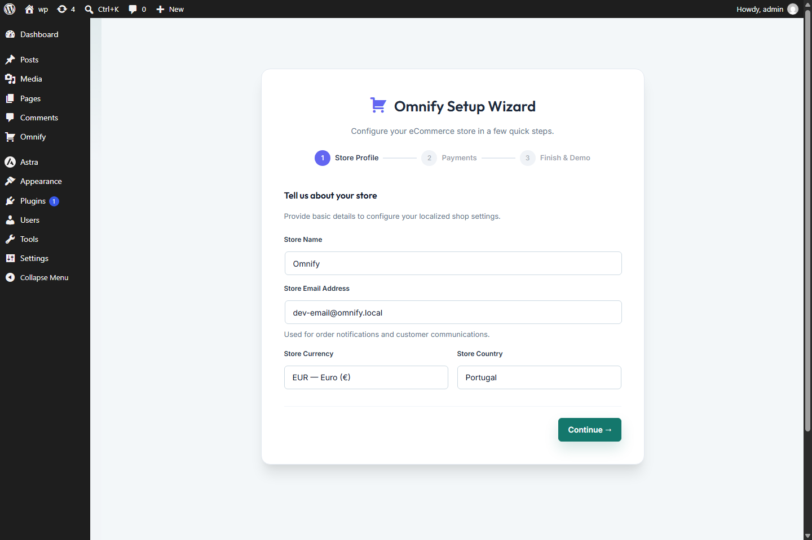
*Figure 2.1: OmnifyWP eCommerce Setup Wizard guiding store owners through essential initial configuration.*

### Core Generated Store Pages
During installation, OmnifyWP creates and configures the following dedicated storefront pages:

| Page Title | Default Slug | Shortcode | Description |
| :--- | :--- | :--- | :--- |
| **Storefront** | `/storefront/` | `[omnify_storefront]` | Main shop catalog grid featuring responsive filtering and search. |
| **Cart** | `/cart/` | `[omnify_cart]` | Interactive shopping cart with quantity selectors and coupon box. |
| **Checkout** | `/checkout/` | `[omnify_checkout]` | Frictionless conversion-optimized checkout and payment form. |
| **Customer Portal** | `/customer-portal/` | `[omnify_customer_portal]` | Customer self-service dashboard for orders, addresses, and downloads. |
| **Order Tracking** | `/order-tracking/` | `[omnify_order_tracking]` | Instant public tracking lookup via Order Number and Billing Email. |
| **Secure Download** | `/secure-download/` | `[omnify_download_page]` | Cryptographic streaming handler for authorized digital files. |

---

## 3. Store Dashboard & Performance Overview

The **Omnify Dashboard** (**Omnify → Dashboard**) serves as your central command center, offering real-time visibility into sales metrics, order volumes, inventory, and customer activity.

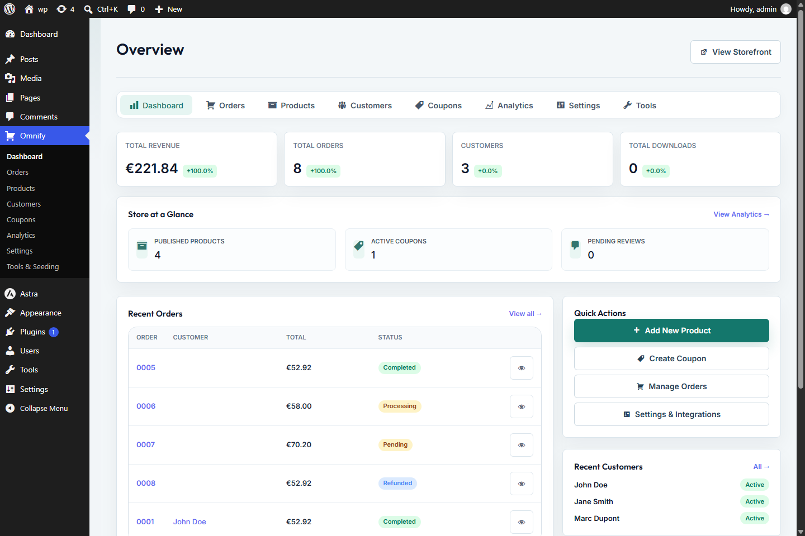
*Figure 3.1: Omnify Store Dashboard showing financial KPIs, active coupons, recent transactions, and quick action shortcuts.*

### Key Performance Indicators (KPIs)
At the top of the dashboard, four metric cards display vital statistics along with percentage comparisons against previous periods:
* **Total Revenue**: Cumulative gross revenue generated by completed and processing orders.
* **Total Orders**: Total volume of customer transactions processed.
* **Customers**: Registered customer profiles and purchasing accounts.
* **Total Downloads**: Cumulative authorized digital product deliveries.

### Store at a Glance & Quick Actions
* **Store at a Glance**: Displays published products count, active coupon campaigns, and customer reviews pending administrative moderation.
* **Quick Actions Panel**: Direct one-click shortcuts to:
  * **+ Add New Product**: Jump straight into the product creation suite.
  * **Create Coupon**: Launch a new promotional campaign.
  * **Manage Orders**: Navigate to the orders fulfillment table.
  * **Settings & Integrations**: Configure gateways, taxes, and system settings.
* **Recent Orders & Recent Customers**: Real-time tabular previews of your latest incoming customer transactions and newly registered shoppers.

---

## 4. Product Catalog & Inventory Management

### Products Directory & Filters
Navigate to **Omnify → Products** to inspect, search, and manage your entire product catalog. The listing displays the product thumbnail, SKU, regular/sale price, publication status, assigned categories, tags, physical/digital file badges, and quick management actions.

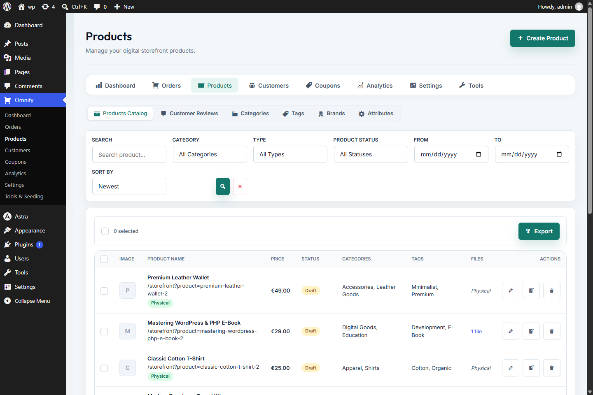
*Figure 4.1: Product catalog management table with multi-attribute filtering, date ranges, status filters, and bulk export.*

#### Filter and Search Capabilities:
* **Search Field**: Instantly search by product title, SKU, or slug.
* **Category Filter**: Filter items by specific catalog taxonomies.
* **Product Type**: Narrow down by Physical, Digital Download, Variable, or Bundle.
* **Product Status**: View All, Published, Draft, or Trashed records.
* **Date Range**: Filter products added between specific calendar dates.
* **Bulk Export**: Export your filtered catalog to CSV with a single click.

---

### Adding & Editing Products
To create a new product, click **+ Add New Product** or edit an existing product to open the product editor.

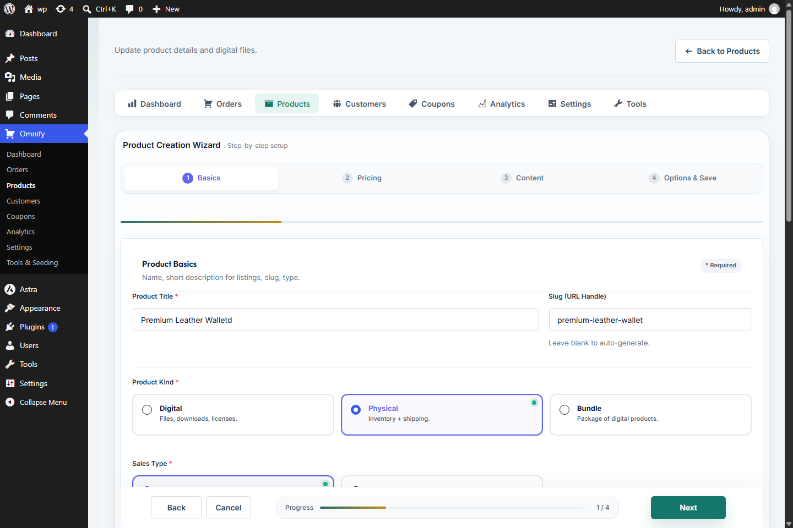
*Figure 4.2: Comprehensive product editor interface for pricing, stock management, dimensions, and digital file attachments.*

#### Essential Product Fields:
1. **Product Name & Slug**: Enter a descriptive title and customize the SEO-friendly URL slug.
2. **Product Description & Excerpt**: Full rich-text description for the product page and a concise summary for card previews.
3. **Product Type**: Choose between:
   * **Physical**: Tangible items requiring weight, dimensions, and shipping calculations.
   * **Digital / Downloadable**: Software, eBooks, presets, or media requiring secured file attachments.
   * **Variable**: Multi-variant products with options such as Size, Color, or Material.
   * **Bundle**: Curated collections of multiple items sold as a package.
4. **Pricing & Sale Rules**:
   * **Regular Price**: Standard retail price.
   * **Sale Price**: Optional promotional price with optional schedule dates.
5. **Inventory & SKU**:
   * **SKU**: Unique Stock Keeping Unit identifier.
   * **Manage Stock**: Toggle inventory tracking on/off.
   * **Stock Quantity**: Specify available warehouse units.
   * **Allow Backorders**: Permit purchases when stock reaches zero.
6. **Shipping Specifications**: Input physical package weight, length, width, and height.
7. **Digital Locker Attachments**: For digital items, upload downloadable files, set maximum download counts, and define expiration intervals.

---

### Product Taxonomies

OmnifyWP eCommerce includes structured taxonomies to organize your storefront catalog:

#### 1. Product Categories (**Omnify → Categories**)
Group items hierarchically (e.g., *Apparel → Jackets*, *Digital Goods → Templates*). Categories can have custom images, descriptions, and slugs.

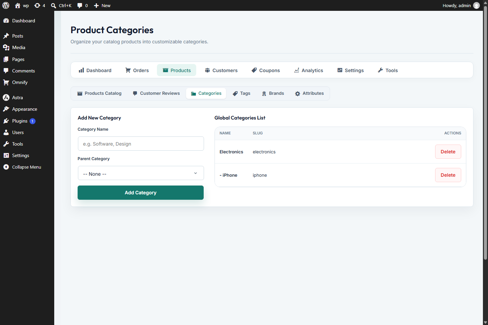
*Figure 4.3: Category management table for organizing storefront catalog taxonomy.*

#### 2. Product Tags (**Omnify → Tags**)
Attach granular keywords and thematic tags to help customers discover related items.

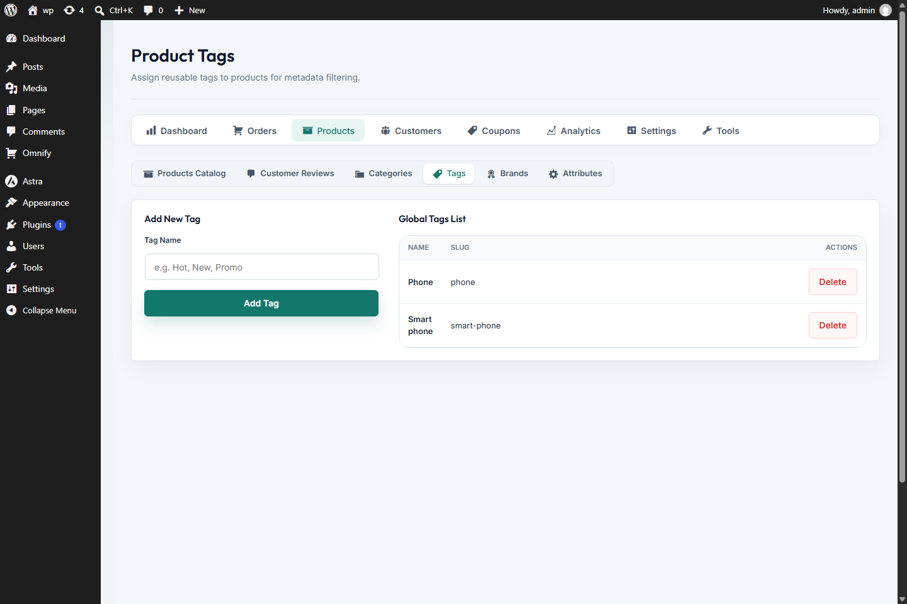
*Figure 4.4: Tag directory showing tag names, slugs, and associated product counts.*

#### 3. Product Brands (**Omnify → Brands**)
Assign manufacturer or brand identifiers to products with dedicated brand logos and storefront filtering.

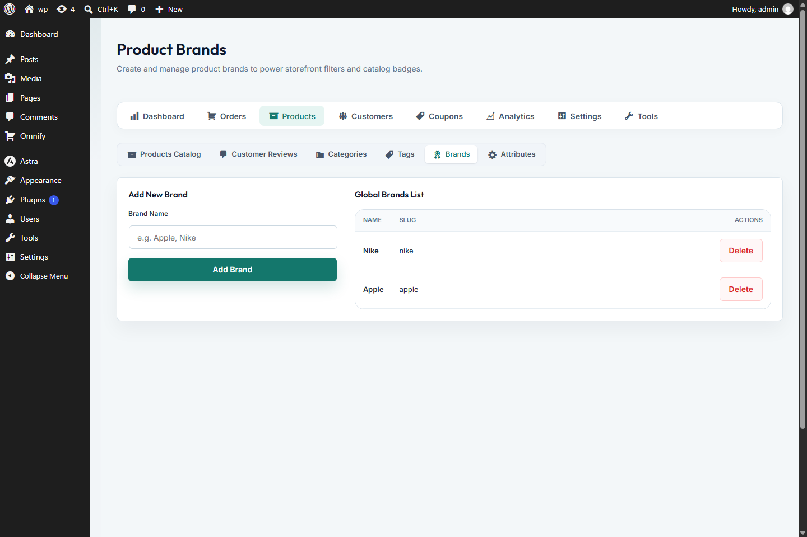
*Figure 4.5: Brands management table for catalog brand filtering.*

#### 4. Product Attributes (**Omnify → Attributes**)
Define global attributes (such as *Color*, *Size*, *Format*, or *Storage*) and assign terms (e.g., *Small, Medium, Large* or *Red, Navy, Charcoal*) used to create variable product matrix variations.

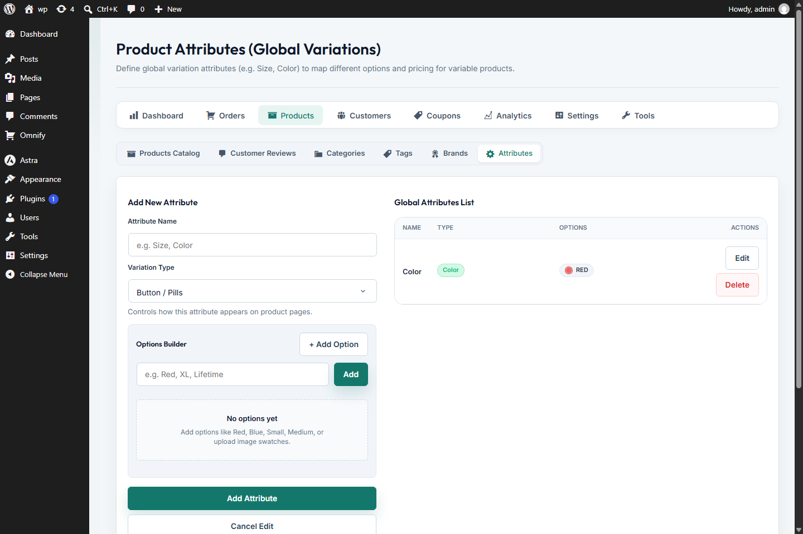
*Figure 4.6: Global Attributes manager for configuring variation axes and terms.*

---

## 5. Order Lifecycle, Fulfillment & Refunds

### Orders Listing & Status Workflows
Manage all storefront transactions under **Omnify → Orders**. Every order displays its unique sequential Order Number, Customer Name, Timestamp, Payment Method, Fulfillment Status, and Total Amount.

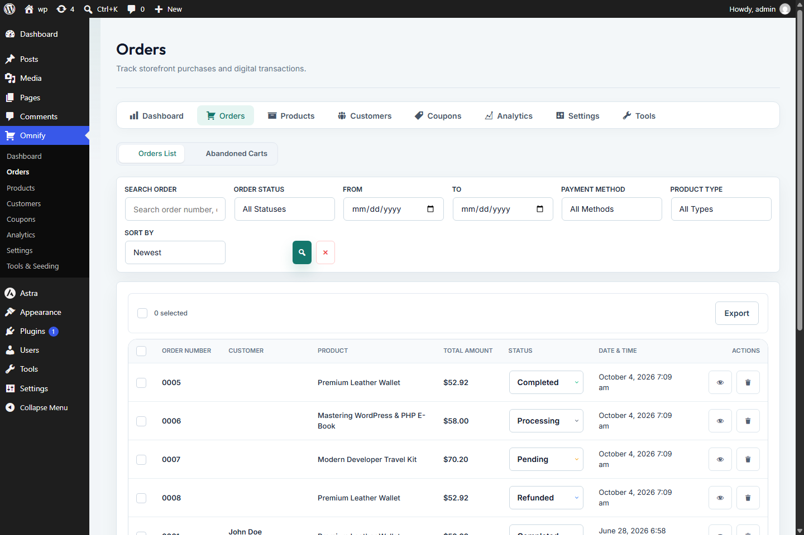
*Figure 5.1: Orders management directory with status tabs, customer details, and action shortcuts.*

#### Supported Order Statuses & Lifecycle State Machine:

| Status Code | Display Label | Description & Triggers | Stock Impact | Digital Access | Notification Triggered |
| :--- | :--- | :--- | :--- | :--- | :--- |
| `pending_payment` | **Pending Payment** | Customer started checkout; awaiting gateway response or redirect completion. | Reserved | Locked | Order Initiated |
| `processing` | **Processing** | Payment successfully confirmed via gateway callback or instant capture. Awaiting physical packing. | Decremented | Unlocked | Payment Received Receipt |
| `completed` | **Completed** | Physical goods dispatched or digital order finalized. | Decremented | Permanently Granted | Order Completed / Download Ready |
| `on_hold` | **On Hold** | Offline payment method chosen (Direct Wire Transfer, Cheque). Awaiting bank clearance. | Reserved | Locked | Bank Wire Instructions Email |
| `cancelled` | **Cancelled** | Order aborted by customer, admin, or session expiration timeout. | Restored | Revoked | Order Cancelled Notice |
| `refunded` | **Refunded** | Transaction funds returned via one-click refund or gateway webhook. | Optional Restock | Revoked Immediately | Refund Confirmation |
| `failed` | **Failed** | Card declined, 3DS authentication failed, or gateway error returned. | Restored | Locked | Payment Failed Notice |

#### State Transition Logic:
- **Instant Digital Delivery**: When an order consists exclusively of digital downloadable products and transitions to `processing`, Omnify automatically advances it to `completed` and grants signed download access within sub-millisecond execution.
- **Automated Revocation**: When an order status transitions to `refunded`, Omnify's `Omnify_Order_Lifecycle_Service` immediately queries `wp_omnify_customer_access` and revokes digital download entitlements, terminating valid HMAC signature tokens.

---

### Order Details & Financial Breakdown
Click on any order or the eye icon to view the comprehensive **Order Detail** screen (`admin.php?page=omnify-orders&action=view&id=...`).

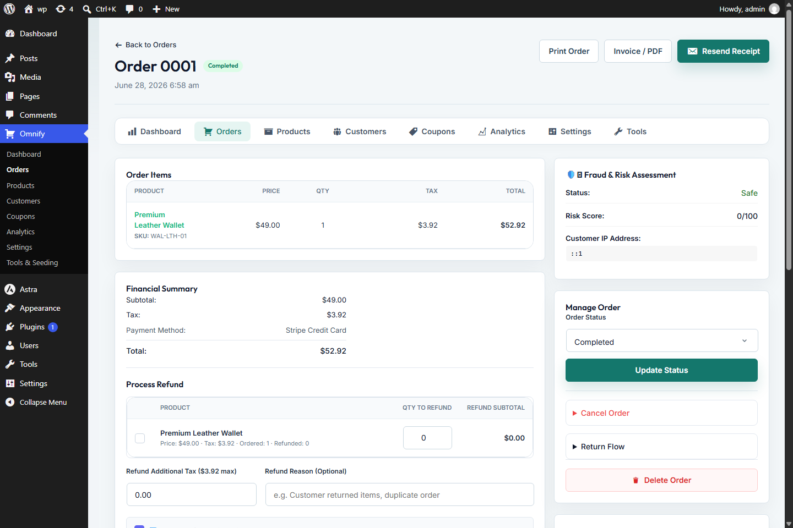
*Figure 5.2: Order detail view showing item breakdown, financial summary, fraud risk assessment, and refund tools.*

#### Key Sections of Order Detail:
1. **Order Items Table**: Line-by-line item names, variation attributes, SKUs, unit prices, purchased quantities, applied taxes, and line totals.
2. **Financial Summary**: Subtotal, shipping fees, tax calculation, discount deductions, payment gateway reference, and grand total.
3. **Fraud & Risk Assessment**: Built-in security widget evaluating transaction safety:
   * **Status**: `Safe`, `Suspicious`, or `High Risk`.
   * **Risk Score**: Score from 0 to 100 based on IP location, billing address validation, and email velocity.
   * **Customer IP Address**: Direct IPv4/IPv6 logging for dispute defense.
4. **Fulfillment Controls**: Change status dropdown, print packing slip, generate PDF invoice, or resend email receipts.
5. **Process Refund Module**:
   * Select specific items and quantities to refund.
   * Input refund amount and additional tax adjustments.
   * State optional refund rationale.
   * Omnify automatically updates inventory counts and revokes associated digital download licenses immediately upon refund completion.

---

## 6. Customer Relationship Management (CRM)

### Customer Directory & Lifetime Analytics
Under **Omnify → Customers**, store owners have a built-in CRM directory profiling every registered and guest shopper.

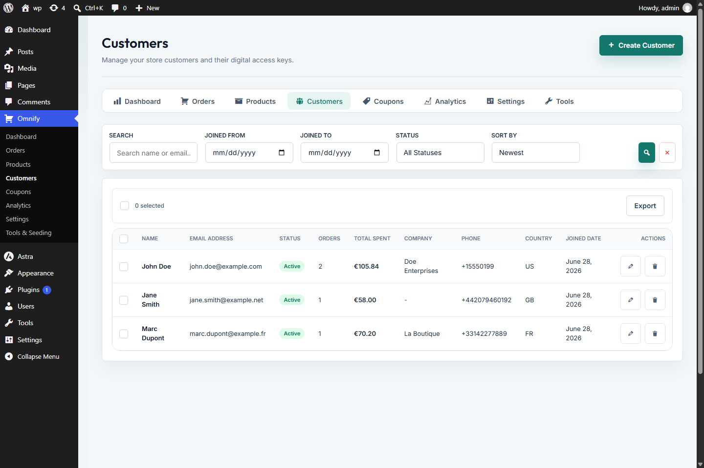
*Figure 6.1: Customer relationship management directory displaying buyer history, order volume, and lifetime spend.*

#### Customer Profile Attributes:
* **Customer Name & Email**: Primary billing and communication contacts.
* **Orders Count**: Total lifetime orders placed.
* **Lifetime Value (LTV)**: Total revenue generated by the customer.
* **Country & Location**: Primary registered geographic territory.
* **Account Status**: `Active`, `VIP`, or `Restricted`.
* **Address Book**: Primary Billing and Shipping addresses saved for seamless one-click storefront checkouts.

---

## 7. Promotions, Discounts & Coupons Engine

Promotions drive sales velocity. Under **Omnify → Coupons**, you can create and manage discount codes with comprehensive usage restrictions.

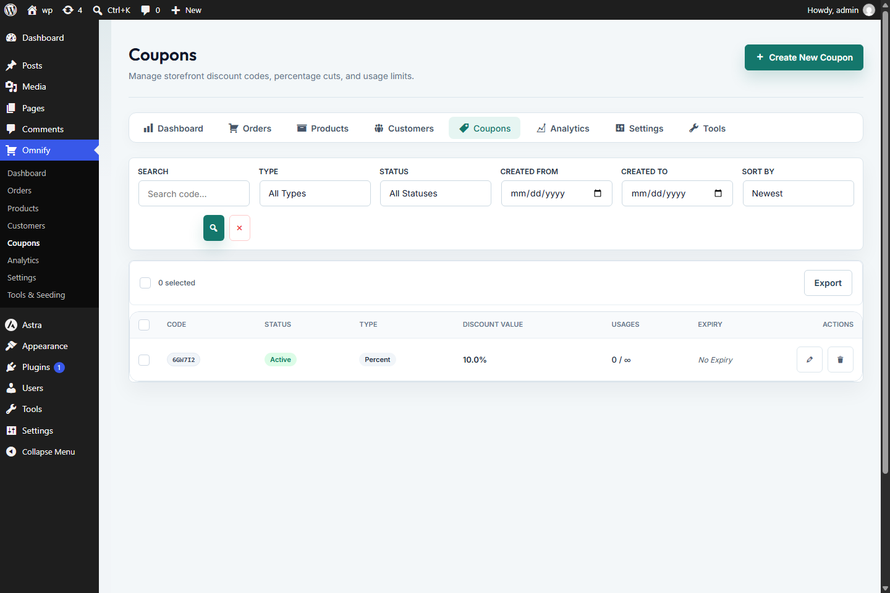
*Figure 7.1: Promotional coupon campaigns manager with usage counters, expiration dates, and discount rules.*

### Creating Promotional Coupons
Click **+ Create Coupon** to configure your promotional campaign:

| Setting Field | Options / Format | Description |
| :--- | :--- | :--- |
| **Coupon Code** | Alphanumeric (e.g., `SUMMER20`) | The code customers enter during checkout. |
| **Discount Type** | `Percentage (%)`, `Fixed Cart ($)`, `Fixed Product ($)` | Determines how the deduction is computed. |
| **Coupon Amount** | Numerical value | Percentage off or fixed monetary amount. |
| **Minimum Spend** | Monetary threshold | Minimum cart subtotal required to activate code. |
| **Maximum Spend** | Monetary cap | Maximum allowed cart value for coupon eligibility. |
| **Individual Use Only** | Yes / No | Prevents stacking with other promotional coupons. |
| **Usage Limit per Coupon** | Integer | Total times the coupon may be redeemed storewide. |
| **Usage Limit per User** | Integer | Total times an individual customer email may redeem the code. |
| **Expiry Date** | Date picker | Automatic expiration date and time. |

---

## 8. Store Analytics & Business Intelligence

Under **Omnify → Analytics**, store owners can monitor store performance with comprehensive visual reporting and financial metrics.

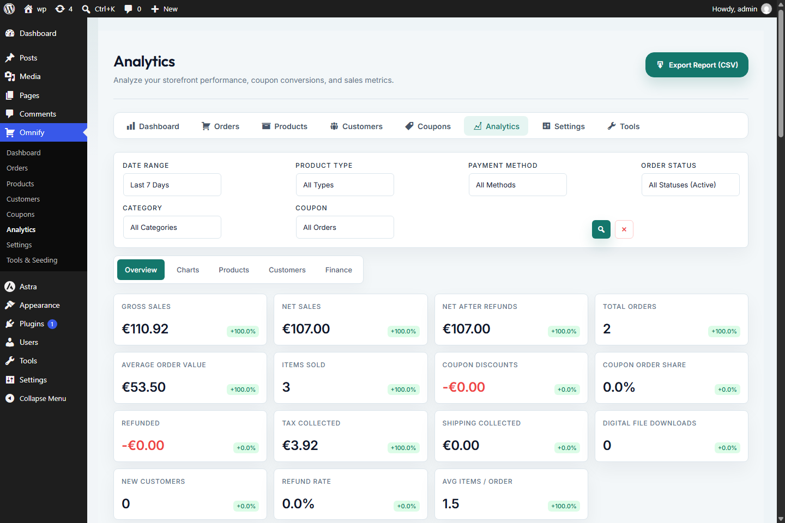
*Figure 8.1: Real-time analytics dashboard presenting sales figures, conversion metrics, AOV, and performance cards.*

### Performance Metric Cards
* **Gross Sales**: Total revenue before refunds and fees.
* **Net Sales**: Gross sales minus discounts and refunds.
* **Average Order Value (AOV)**: Mean revenue generated per transaction.
* **Items Sold**: Total units of physical and digital products purchased.
* **Coupon Discounts**: Total monetary value redeemed through promotions.
* **Tax & Shipping Collected**: Breakdown of collected governmental taxes and delivery fees.
* **Digital File Downloads**: Number of successful cryptographic download accesses.
* **CSV Export**: Click **Export Report (CSV)** to download complete transaction and accounting spreadsheets for external bookkeeping.

---

## 9. Customer Reviews Moderation

Customer feedback builds trust. Under **Omnify → Reviews**, manage all submitted product testimonials, ratings, and customer commentary.

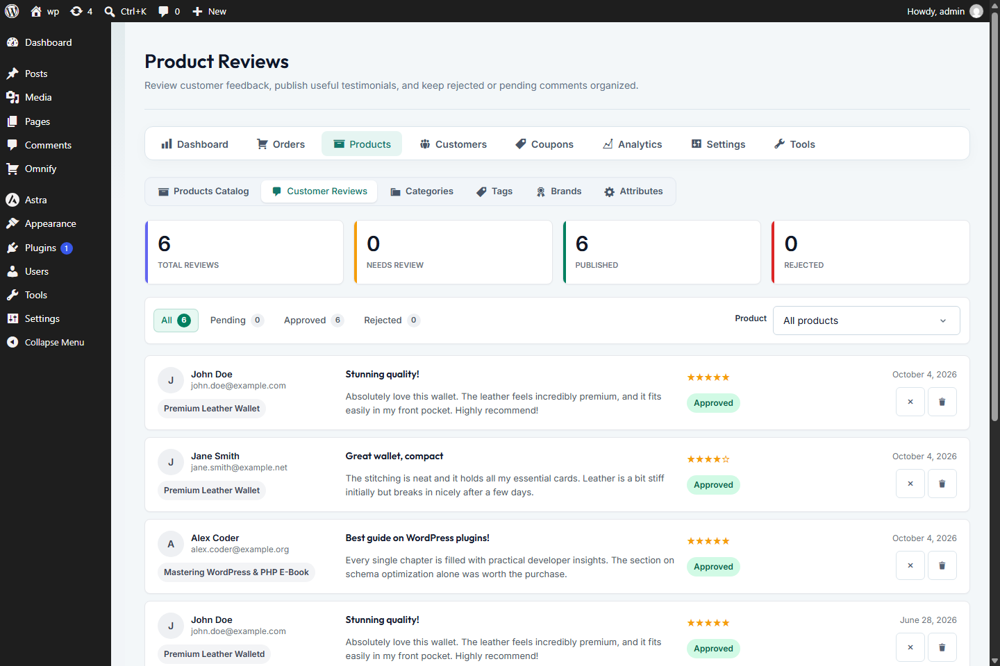
*Figure 10.1: Customer reviews moderation table with star ratings, verified buyer indicators, and status controls.*

### Review Features:
* **Verified Buyer Badge**: Automatically flags reviews left by customers who purchased the product through OmnifyWP.
* **Star Ratings**: Visual 1 to 5 star ratings.
* **Approval Workflow**: Reviews can be marked as `Approved`, `Unapproved` (held for moderation), or sent to `Trash`.
* **Direct Moderation**: Edit customer comments or reply directly to queries from the admin panel.

---

## 10. Abandoned Cart Recovery

Shopping cart abandonment is one of the biggest revenue leaks in online commerce. Under **Omnify → Abandoned Carts**, OmnifyWP automatically tracks unfinished checkouts and recovers lost sales.

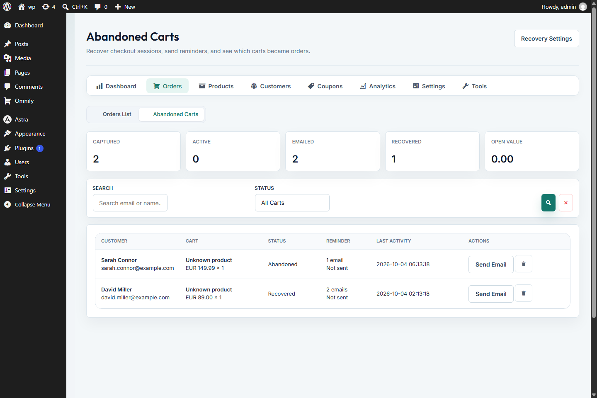
*Figure 10.1: Abandoned cart recovery directory tracking shopper email, cart contents, subtotal, and recovery status.*

### How Abandoned Cart Tracking Works:
1. **Dynamic Capture**: When a customer enters their contact email on the checkout page, Omnify securely captures the session cart contents and contact information.
2. **Abandonment Threshold**: If the checkout is not completed within 60 minutes, the session is marked as `Abandoned`.
3. **Automated Recovery**: Omnify can dispatch scheduled recovery reminder emails containing direct one-click checkout restoration links.
4. **Recovery Attribution**: When a customer returns via the link and completes payment, the status automatically switches to `Recovered`, crediting the recovery to your store reports.

---

## 11. Store Configuration & Settings

Navigate to **Omnify → Settings** to configure your store's operating rules, payment processors, tax calculations, and communication templates.

### General Settings
Configure core regional, financial, and product display parameters (**Settings → General**).

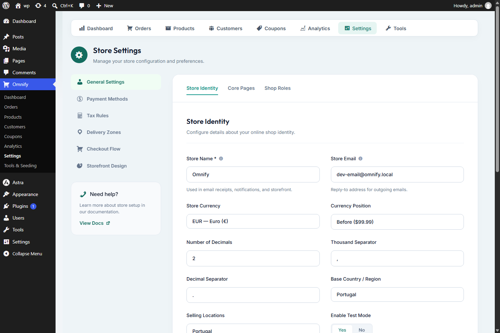
*Figure 11.1: General settings tab for store currency, formatting, and measurement units.*

* **Store Currency**: Choose from over 30 global currencies (USD, EUR, GBP, CAD, AUD, JPY, INR, BDT, etc.).
* **Currency Symbol Position**: Display symbol before (`$100`) or after (`100 €`) the numerical amount.
* **Thousand & Decimal Separators**: Set custom formatting (e.g., `,` vs `.`).
* **Decimals**: Choose decimal precision (typically `2` decimal places).
* **Weight & Dimension Units**: Specify kilograms (`kg`), pounds (`lbs`), centimeters (`cm`), or inches (`in`).

---

### Payment Gateways Configuration & Step-by-Step Setup
Under **Omnify → Settings → Payments**, store owners can configure and activate payment gateways to process transactions securely across international and local markets.

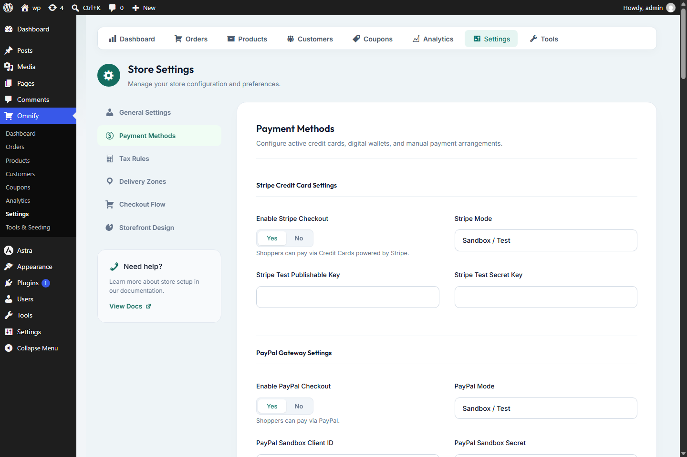
*Figure 11.2: Payment gateways settings screen supporting Stripe, PayPal, Razorpay, SSLCommerz, and manual payment options.*

#### Gateway Activation & Secure-by-Default Architecture
> [!IMPORTANT]
> **Secure-by-Default Policy**: When OmnifyWP eCommerce is freshly installed, **all payment gateways are disabled by default** (`'0'` / inactive). A payment method will never be exposed to shoppers on the checkout page until the store owner explicitly toggles it active and saves the required API credentials. This prevents incomplete transactions, customer confusion, and accidental live checkouts without proper merchant accounts.

---

#### Stripe Setup Guide
**Supported Payment Methods**: Visa, MasterCard, American Express, Discover, JCB, Apple Pay, Google Pay, SEPA Direct Debit, and 3D Secure / SCA.

##### Step 1: Create or Access Your Stripe Account
1. Visit [https://stripe.com](https://stripe.com) and create or log in to your Stripe Merchant Dashboard.
2. Complete your business verification in the Stripe dashboard to enable live payouts.

##### Step 2: Retrieve API Keys
1. In the Stripe Dashboard, navigate to **Developers → API keys**.
2. Notice the **Test mode** toggle in the top-right corner:
   * **For Sandbox Testing**: Ensure Test Mode is toggled **ON**. Copy the **Publishable Key** (starts with `pk_test_...`) and the **Secret Key** (click *Reveal live/test key*, starts with `sk_test_...`).
   * **For Live Sales**: Toggle Test Mode **OFF**. Copy your **Publishable Key** (`pk_live_...`) and **Secret Key** (`sk_live_...`).

##### Step 3: Configure Webhook Endpoint
Webhooks are essential for instant order confirmation, handling 3D Secure bank redirects, payment failure notifications, and automatic file access revocation upon refunds.
1. In Stripe Dashboard, navigate to **Developers → Webhooks**.
2. Click **+ Add an endpoint**.
3. In the **Endpoint URL** field, enter:
   ```
   https://yourdomain.com/wp-json/omnify/v1/webhook/stripe
   ```
   *(Replace `yourdomain.com` with your actual store domain name).*
4. Under **Select events to listen to**, choose:
   * `payment_intent.succeeded` — Confirms successful customer payments and unlocks order fulfillment.
   * `payment_intent.payment_failed` — Marks orders as failed when card authorization fails.
   * `charge.refunded` — Automatically records refunds in Omnify and revokes digital download access.
5. Click **Add endpoint**.
6. On the newly created webhook overview page, find **Signing secret** and click **Reveal**. Copy the secret string (starts with `whsec_...`).

##### Step 4: Configure Stripe in OmnifyWP Settings
1. In WordPress Admin, go to **Omnify → Settings → Payments**.
2. Locate the **Stripe** card and click **Configure**.
3. Toggle **Enable Stripe** to active (`ON`).
4. Set **Test Mode**:
   * Turn **ON** for Sandbox testing.
   * Turn **OFF** when ready to accept real customer payments.
5. Paste your **Publishable Key**, **Secret Key**, and **Webhook Secret**.
6. *(Optional)* Customize the **Title** (e.g., *Credit Card / Debit Card (Stripe)*) and **Statement Descriptor** (appears on customer bank statements, max 22 characters).
7. Click **Save Changes**.

##### Step 5: Test Verification
1. With Test Mode enabled, add a product to the cart and proceed to checkout.
2. Enter Stripe's official test card number: `4242 4242 4242 4242`, any future expiration date (e.g., `12/30`), and any 3-digit CVC (`123`).
3. Place order and verify the order status updates to **Processing** or **Completed** in **Omnify → Orders**.

---

#### PayPal Commerce Platform Setup Guide
**Supported Payment Methods**: PayPal Wallet Balance, Pay in 4 / Pay Later installments, Venmo, and credit cards via PayPal Smart Buttons.

##### Step 1: Create a PayPal Developer App
1. Visit the [PayPal Developer Dashboard](https://developer.paypal.com) and log in with your PayPal business credentials.
2. Go to **Dashboard → Apps & Credentials**.
3. Toggle between **Sandbox** (for testing) or **Live** (for production).
4. Click **Create App**:
   * **App Name**: Enter a name (e.g., *OmnifyWP Storefront*).
   * **App Type**: Select *Merchant*.
5. Click **Create App**.

##### Step 2: Retrieve Client ID and Secret
1. On your newly created application details page, copy the **Client ID**.
2. Click **Show** under **Secret** and copy your **Secret Key**.

##### Step 3: Configure PayPal Webhooks
1. Scroll down to the **Webhooks** section on the app page and click **Add Webhook**.
2. Enter your Webhook URL:
   ```
   https://yourdomain.com/wp-json/omnify/v1/webhook/paypal
   ```
3. Under **Event Types**, check:
   * `CHECKOUT.ORDER.APPROVED`
   * `PAYMENT.CAPTURE.COMPLETED`
   * `PAYMENT.CAPTURE.REFUNDED`
4. Click **Save** and note your Webhook ID.

##### Step 4: Configure PayPal in OmnifyWP Settings
1. In WordPress Admin, navigate to **Omnify → Settings → Payments → PayPal**.
2. Toggle **Enable PayPal** to `ON`.
3. Select Environment (**Sandbox** or **Live**).
4. Paste your **Client ID** and **Secret Key**.
5. Choose your Smart Button style, layout (Vertical or Horizontal), and color scheme.
6. Click **Save Changes**.

---

#### Razorpay Setup Guide
**Supported Payment Methods**: UPI (Google Pay, PhonePe, Paytm, BHIM), RuPay, Visa, Mastercard, NetBanking across 50+ Indian banks, and Digital Wallets (Mobikwik, Freecharge).

##### Step 1: Access Razorpay Merchant Dashboard
1. Visit [https://razorpay.com](https://razorpay.com) and log into the Dashboard (`dashboard.razorpay.com`).
2. Complete KYC verification to accept live payments in Indian Rupees (INR) and international currencies.

##### Step 2: Generate API Key ID & Secret
1. In Razorpay Dashboard, navigate to **Account & Settings → API Keys** (or **Settings → API Keys**).
2. Toggle between **Test Mode** and **Live Mode** in the header.
3. Click **Generate Key**:
   * Copy the **Key ID** (starts with `rzp_test_...` or `rzp_live_...`).
   * Copy the **Key Secret** (keep this confidential; it cannot be viewed again once dismissed).

##### Step 3: Configure Razorpay Webhooks
1. In Razorpay Dashboard, go to **Settings → Webhooks → Add New Webhook**.
2. In **Webhook URL**, enter:
   ```
   https://yourdomain.com/wp-json/omnify/v1/webhook/razorpay
   ```
3. In **Secret**, enter a secure random passphrase of your choice.
4. Under **Active Events**, select:
   * `payment.captured`
   * `payment.failed`
   * `refund.processed`
5. Click **Create Webhook**.

##### Step 4: Configure Razorpay in OmnifyWP Settings
1. In WordPress Admin, navigate to **Omnify → Settings → Payments → Razorpay**.
2. Toggle **Enable Razorpay** to `ON`.
3. Enter your **Key ID**, **Key Secret**, and the **Webhook Secret** created above.
4. Set Merchant Name and Theme Color (e.g., `#3399cc`).
5. Click **Save Changes**.

---

#### SSLCommerz Setup Guide
**Supported Payment Methods**: bKash, Nagad, Rocket, Upay, local Bangladeshi Visa, MasterCard, UnionPay, and Internet Banking.

##### Step 1: Obtain SSLCommerz Merchant Account
1. Register for a merchant account at [https://sslcommerz.com](https://sslcommerz.com).
2. Contact SSLCommerz integration support to obtain your **Sandbox Store ID** and **Store Password**.
3. Upon live approval, access your production merchant panel at `merchant.sslcommerz.com`.

##### Step 2: Configure IPN (Instant Payment Notification)
1. In your SSLCommerz Merchant Panel, navigate to **IPN Settings**.
2. Enter your IPN listener endpoint:
   ```
   https://yourdomain.com/wp-json/omnify/v1/webhook/sslcommerz
   ```
3. Set IPN HTTP method to `POST`.

##### Step 3: Configure SSLCommerz in OmnifyWP Settings
1. In WordPress Admin, navigate to **Omnify → Settings → Payments → SSLCommerz**.
2. Toggle **Enable SSLCommerz** to `ON`.
3. Set Environment to **Sandbox** (Testing) or **Live** (Production).
4. Enter your **Store ID** and **Store Password**.
5. Save changes. Customers selecting SSLCommerz will be seamlessly redirected to the secure hosted checkout and returned with instant order verification.

---

#### Cash on Delivery (COD) Setup Guide
**Ideal For**: Physical product merchants selling locally or via courier cash collection.

##### Configuration Steps:
1. In WordPress Admin, navigate to **Omnify → Settings → Payments → Cash on Delivery**.
2. Toggle **Enable Cash on Delivery** to `ON`.
3. Configure the settings:
   * **Title**: Text displayed to shoppers (e.g., *Cash on Delivery (COD)*).
   * **Description**: Subtitle explaining payment upon delivery.
   * **Instructions**: Detailed guidance displayed on the Order Received confirmation screen (e.g., *Please prepare exact cash for our courier upon parcel arrival*).
   * **Enable for Virtual/Digital Products**: Leave **Disabled** (`OFF`). When disabled, carts containing only digital downloads will automatically hide COD.
   * **Minimum & Maximum Order Totals**: Optional thresholds to restrict COD only to specific cart value ranges (e.g., Minimum $10, Maximum $500).
4. **Order Lifecycle**: Orders placed with COD are marked as `Processing` or `Pending Payment`. Once your delivery driver or courier collects the cash, administrators mark the order as `Completed`.
5. Click **Save Changes**.

---

#### Direct Bank Transfer (BACS / Wire) Setup Guide
**Ideal For**: B2B sales, wholesale invoices, high-ticket items, and offline bank deposits.

##### Configuration Steps:
1. In WordPress Admin, navigate to **Omnify → Settings → Payments → Direct Bank Transfer**.
2. Toggle **Enable Bank Transfer** to `ON`.
3. Set **Title** and **Description** (e.g., *Direct Bank Wire Transfer*).
4. Set **Instructions**: Inform shoppers that their order will be held until funds clear into your business account.
5. **Add Bank Accounts**: Enter one or more banking accounts:
   * **Account Name**: Business or beneficiary name (e.g., *Omnify Commerce LLC*).
   * **Account Number**: Domestic account number.
   * **Bank Name**: Name of financial institution (e.g., *Chase Bank*, *Barclays*).
   * **Routing Number / Sort Code**: Domestic routing code (ABA, Sort Code, IFSC).
   * **IBAN**: International Bank Account Number for cross-border wires.
   * **BIC / SWIFT**: Bank Identifier Code for international transfers.
6. **Order Lifecycle & Reconciliation**:
   * Orders placed via Bank Transfer are automatically assigned status **On Hold**.
   * Your bank account details and customer reference number (Order ID) are displayed on the confirmation screen and sent via the automated Order Confirmation email.
   * When your accounting department verifies the received wire, open the order in **Omnify → Orders** and change status to **Processing** or **Completed**.
7. Click **Save Changes**.

---

#### Cheque Payment Setup Guide
**Ideal For**: Organizations, schools, or government agencies requiring physical paper check processing.

##### Configuration Steps:
1. In WordPress Admin, navigate to **Omnify → Settings → Payments → Cheque Payment**.
2. Toggle **Enable Cheque Payment** to `ON`.
3. Set **Title** and **Description**.
4. In **Instructions**, provide:
   * **Payee Name**: Make cheque payable to (e.g., *Omnify Commerce Inc.*).
   * **Mailing Address**: Full mailing address where the physical check should be delivered.
5. Orders are initially set to **On Hold**. Once the check is received, deposited, and cleared, update the order to **Completed**.
6. Click **Save Changes**.

---

#### Paystack Setup Guide (Africa: Nigeria, Ghana, Kenya, South Africa)
**Supported Payment Methods**: Mastercard, Visa, Verve, Mobile Money (M-Pesa, MTN, Airtel), Bank Transfer, and USSD.

##### Step 1: Obtain Paystack API Credentials
1. Register at [https://paystack.com](https://paystack.com).
2. Navigate to **Settings → API Keys & Webhooks**.
3. Copy your **Public Key** (`pk_live_...` or `pk_test_...`) and **Secret Key** (`sk_live_...` or `sk_test_...`).

##### Step 2: Configure Paystack Webhook
1. In Paystack Dashboard under **Webhook URL**, input:
   ```
   https://yourdomain.com/wp-json/omnify/v1/paystack/webhook
   ```
2. Click **Save Changes**.

##### Step 3: Configure in OmnifyWP Settings
1. Navigate to **Omnify → Settings → Payments → Paystack**.
2. Toggle **Enable Paystack** to `ON`.
3. Set Environment to **Test** or **Live**.
4. Paste **Public Key** and **Secret Key**.
5. Save changes.

---

#### Tap Payments Setup Guide (Middle East & GCC)
**Supported Payment Methods**: mada (Saudi Arabia), KNET (Kuwait), Benefit (Bahrain), NAPS (Qatar), OmanNet, Visa, and Mastercard.

##### Step 1: Obtain Tap Credentials
1. Register at [https://tap.company](https://tap.company).
2. Go to your merchant dashboard to generate your **Public Key** and **Secret Key**.

##### Step 2: Webhook Endpoint
1. Set Webhook URL in your Tap dashboard to:
   ```
   https://yourdomain.com/wp-json/omnify/v1/tap/webhook
   ```

##### Step 3: Configure in OmnifyWP Settings
1. Navigate to **Omnify → Settings → Payments → Tap Payments**.
2. Toggle **Enable Tap Payments** to `ON`.
3. Enter your **Public Key** and **Secret Key**.
4. Save changes.

---

#### Mollie Setup Guide (European Union)
**Supported Payment Methods**: iDEAL (Netherlands), Bancontact (Belgium), SEPA Direct Debit / Bank Transfer, Klarna, SOFORT, and cards.

##### Step 1: Obtain Mollie API Key
1. Register at [https://mollie.com](https://mollie.com).
2. In your dashboard, copy your **Live API Key** (`live_...`) or **Test API Key** (`test_...`).

##### Step 2: Configure in OmnifyWP Settings
1. Navigate to **Omnify → Settings → Payments → Mollie**.
2. Toggle **Enable Mollie** to `ON`.
3. Paste your **API Key**.
4. Save changes. Mollie manages all European localized checkout payment schemes automatically.

---

#### Khalti Digital Wallet Setup Guide (Nepal)
**Supported Payment Methods**: Khalti digital wallet balance, e-Banking, mobile banking, and ConnectIPS.

##### Step 1: Register Khalti Merchant Account
1. Register at [https://khalti.com/merchant](https://khalti.com/merchant).
2. Obtain your **Live Secret Key** (or **Test Secret Key** from `test-admin.khalti.com`).

##### Step 2: Configure in OmnifyWP Settings
1. Navigate to **Omnify → Settings → Payments → Khalti**.
2. Toggle **Enable Khalti** to `ON`.
3. Set Environment to **Test** or **Live**.
4. Enter **Khalti Secret Key**.
5. Save changes.

---

#### eSewa Setup Guide (Nepal)
**Supported Payment Methods**: eSewa digital wallet balance and connected bank accounts.

##### Step 1: Merchant Code & Secret Key
1. Register as an eSewa merchant via [https://merchant.esewa.com.np](https://merchant.esewa.com.np).
2. Obtain your **Merchant Code** (Product Code) and **Secret Key** for HMAC-SHA256 signature verification.

##### Step 2: Configure in OmnifyWP Settings
1. Navigate to **Omnify → Settings → Payments → eSewa**.
2. Toggle **Enable eSewa** to `ON`.
3. Set Environment to **Test / Sandbox** or **Live**.
4. Enter **Merchant Code** and **Secret Key**.
5. Save changes.

---

#### Paddle Billing Setup Guide (Global Merchant of Record)
**Supported Payment Methods**: Global credit/debit cards, PayPal, Apple Pay, Wire transfers with automated sales tax and VAT filing.

##### Step 1: Obtain Paddle API Credentials
1. Register at [https://paddle.com](https://paddle.com).
2. Under **Developer tools → Authentication**, generate a **Client-side token** and **API Secret Key**.
3. Under **Developer tools → Notifications**, add a webhook destination pointing to:
   ```
   https://yourdomain.com/wp-json/omnify/v1/paddle/webhook
   ```
4. Copy the webhook secret key (`Paddle-Signature`).

##### Step 2: Configure in OmnifyWP Settings
1. Navigate to **Omnify → Settings → Payments → Paddle**.
2. Toggle **Enable Paddle** to `ON`.
3. Paste **Client-Side Token**, **API Key**, and **Webhook Secret**.
4. Save changes.

---

#### Gateway Testing & Sandbox Reference Table

| Gateway | Environment Switch | Recommended Test Credentials | Test Cards / Simulation |
| :--- | :--- | :--- | :--- |
| **Stripe** | Test Mode toggle | `pk_test_...` / `sk_test_...` | Card: `4242 4242 4242 4242`, Expiry: any future date, CVC: any 3 digits |
| **PayPal** | Sandbox toggle | Client ID & Secret from developer.paypal.com | Use Sandbox Personal buyer account from developer dashboard |
| **Razorpay** | Test Mode toggle | `rzp_test_...` Key ID & Secret | Standard test card: `4111 1111 1111 1111`, OTP: `123456` |
| **SSLCommerz** | Sandbox toggle | Store ID: `testbox`, Pass: `qwerty` | Test cards and simulated mobile wallets provided in test sandbox portal |
| **Paystack** | Test Mode toggle | `pk_test_...` / `sk_test_...` | Test card: `4084 0840 8408 4081`, PIN: `1111`, OTP: `123456` |
| **Mollie** | Test Mode toggle | `test_...` API Key | Select payment status (`Paid`, `Cancelled`, `Expired`) on test gateway screen |
| **Khalti** | Test Mode toggle | Test Secret Key | Test mobile: `9800000000`, MPIN: `1111`, OTP: `987654` |
| **eSewa** | Sandbox toggle | Merchant Code: `EPAYTEST`, Secret: `8gBm/:&EnhH.1/q` | Test credentials provided in eSewa Developer Portal |

---

### Shipping & Delivery Zones
Under **Settings → Delivery**, set up your shipping fulfillment rules and delivery rates.

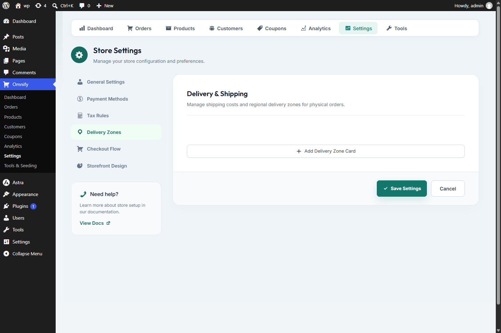
*Figure 11.3: Delivery settings for configuring shipping methods, flat rates, and free shipping thresholds.*

* **Flat Rate Shipping**: Charge a standard fee per order or per item.
* **Free Shipping Threshold**: Automatically grant free shipping when cart subtotal exceeds a designated amount (e.g., Free shipping over $75).
* **Local Pickup**: Allow local customers to collect their orders in-store without shipping fees.

---

### Tax Calculation & Regional Rates
Under **Settings → Tax**, configure sales tax, VAT, or GST calculations.

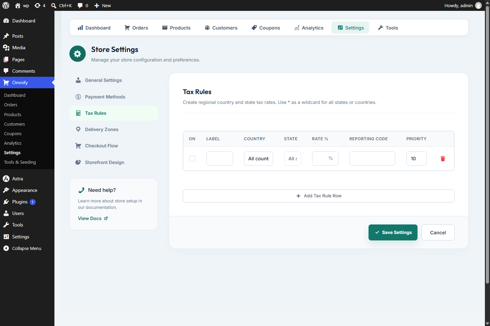
*Figure 11.4: Tax settings for inclusive/exclusive pricing, compound rates, and regional tax tables.*

* **Tax Calculation Status**: Enable or disable automated tax calculations.
* **Prices Entered With Tax**: Choose whether your catalog prices are tax-inclusive or tax-exclusive.
* **Calculate Tax Based On**: Calculate tax from Customer Shipping Address, Customer Billing Address, or Store Base Address.
* **Tax Classes**: Set Standard, Reduced Rate, or Zero Rate rules.

---

### Customer Email Notifications & Templates
Under **Settings → Email**, manage customer notifications and administrative alerts.

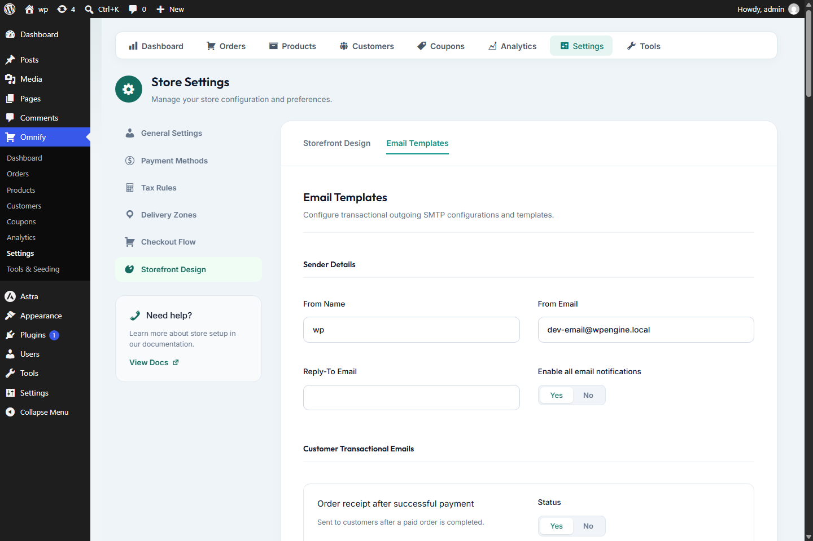
*Figure 11.5: Automated email management panel for customer receipts, order updates, and admin alerts.*

#### Automated Store Emails:
* **Customer Order Confirmation**: Dispatched immediately upon successful checkout with order receipt and download links.
* **Order Processing & Dispatched**: Sent when an order is updated with tracking details.
* **Order Refunded Notice**: Dispatched when an order is refunded.
* **New Order Alert (Admin)**: Sends an instant summary to store managers when a new sale is made.
* **Abandoned Cart Reminder**: Dispatched to re-engage customers who abandoned their carts.

---

### Checkout Flow Configuration
Under **Settings → Checkout**, configure your storefront conversion settings.

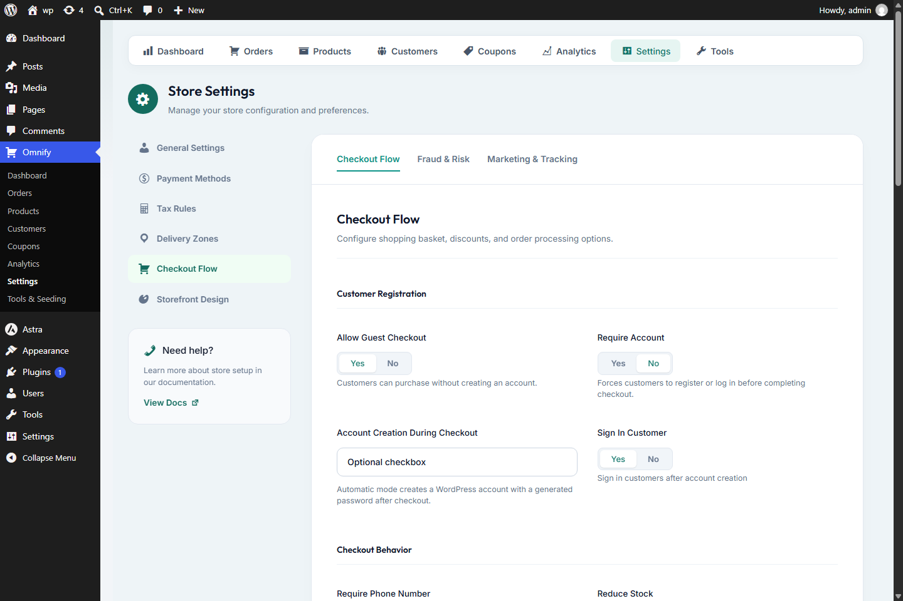
*Figure 11.6: Checkout flow configuration for guest checkout, terms requirements, and address forms.*

* **Guest Checkout**: Permit customers to place orders without creating a WordPress account.
* **Account Creation**: Option to automatically create customer accounts during checkout.
* **Coupon Input**: Toggle whether coupon code redemption boxes appear on cart and checkout pages.
* **Terms & Conditions**: Require shoppers to accept your store terms before completing checkout.

---

### Store Pages Mapping
Under **Settings → Pages**, review or remap the core store pages associated with Omnify shortcodes.

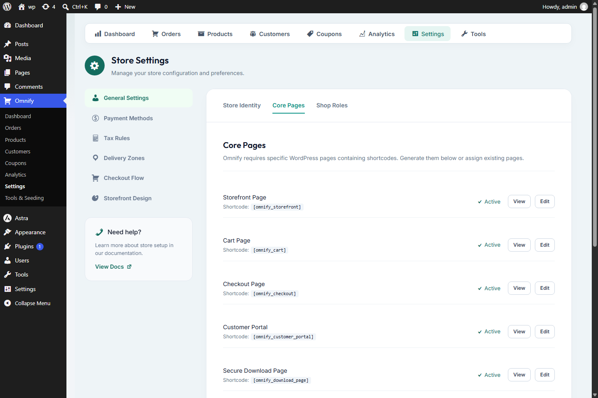
*Figure 11.7: Core storefront page mapping and shortcode assignment screen.*

---

## 12. System Tools, Demo Seeding & Maintenance

Under **Omnify → Tools & Seeding**, store administrators can maintain database health, flush caches, or seed demo data for store previewing.

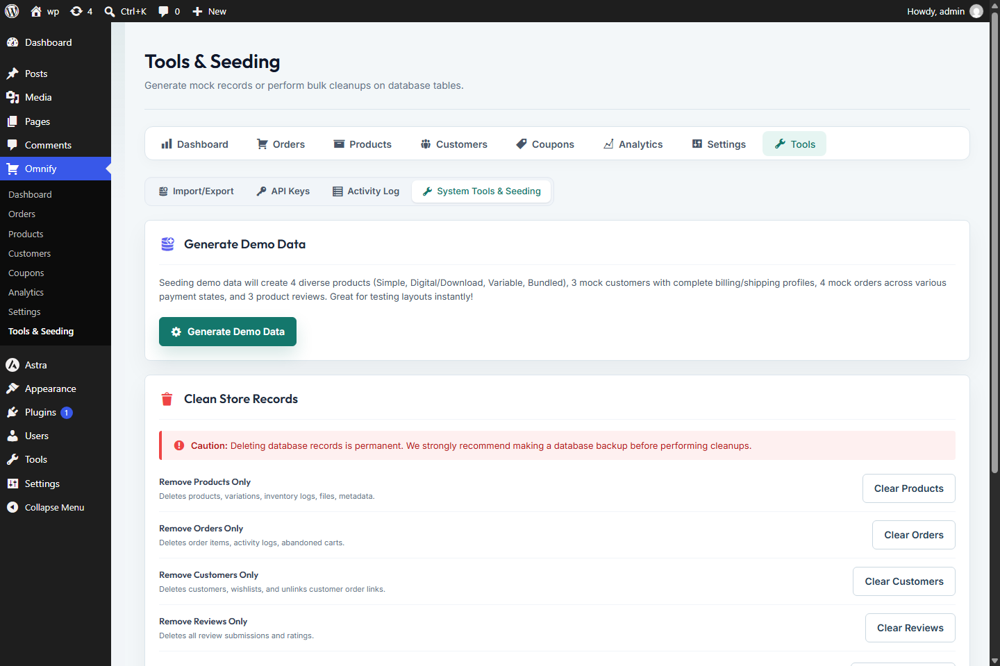
*Figure 12.1: System diagnostics, one-click demo data generation, and database optimization tools.*

### Available Tools:
* **Generate Demo Data**: Instantly populates your store with realistic sample products, customers, orders, reviews, and categories for theme development and testing.
* **Clear Demo Data**: Completely wipes all generated demo records while preserving real store transactions.
* **Flush Transients & Caches**: Clears cached catalog queries, transients, and calculated price indices.
* **Verify Database Tables**: Checks and repairs the 18 custom Omnify database tables to ensure structural integrity.

---

## 13. Administrative Activity Audit Log

Under **Omnify → Activity Log**, the plugin maintains an immutable audit trail of all administrative actions.

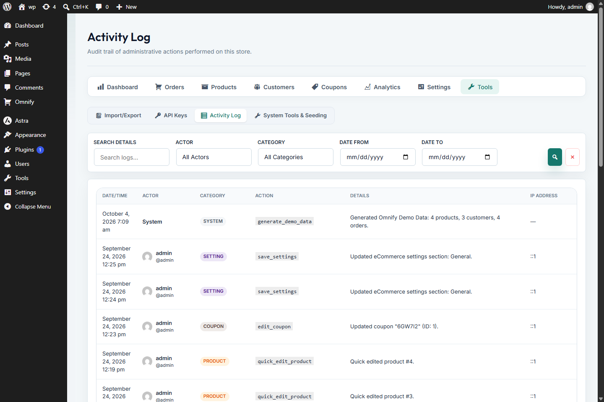
*Figure 13.1: Administrative audit trail recording staff actions, status updates, and setting changes.*

### Logged Events Include:
* Product creation, price modifications, and inventory adjustments.
* Order status updates and refund processing.
* Coupon creations, modifications, and deletions.
* Store setting alterations and gateway credential updates.
* Recorded metadata includes staff username, timestamp, and IP address.

---

## 14. REST API Access & Integrations

Under **Omnify → API Keys**, generate secure REST API credentials for mobile applications, third-party ERPs, CRM systems, and headless frontends.

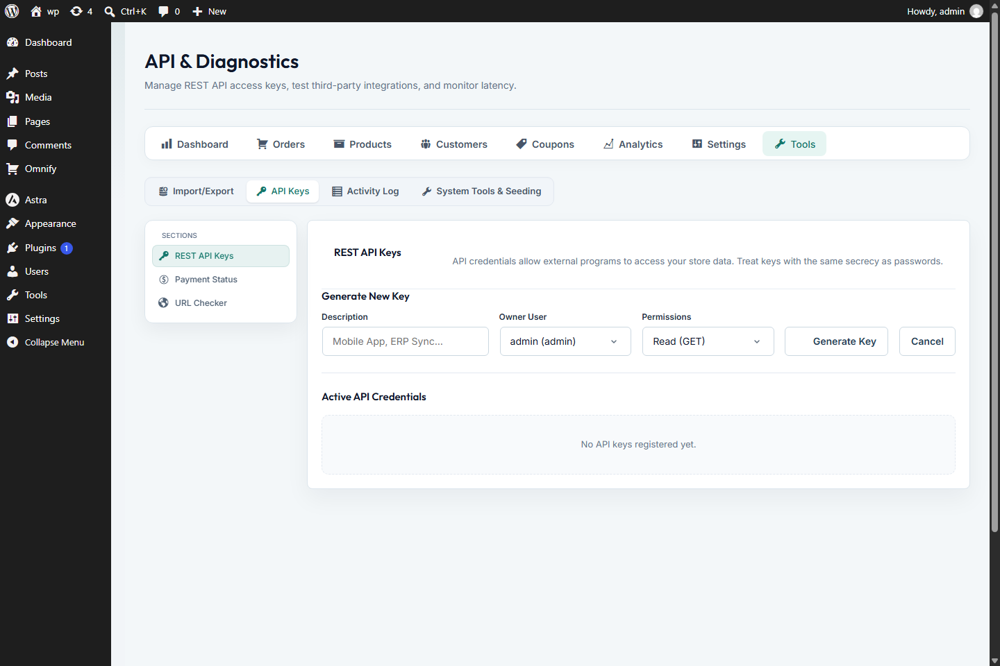
*Figure 14.1: REST API key management panel for headless commerce and external integrations.*

### Generating API Credentials:
1. Click **+ Add Key**.
2. Provide a **Description** (e.g., *iOS Mobile App* or *Zapier Fulfillment Sync*).
3. Select **Permissions**: `Read`, `Write`, or `Read/Write`.
4. Click **Generate API Key** to receive your **Consumer Key** and **Consumer Secret**.
5. All REST endpoints are available under the `/wp-json/omnify/v1/` route.

---

## 15. Customer Storefront Experience

OmnifyWP delivers a modern, high-converting storefront experience inspired by modern apparel and luxury fashion brands. Engineered for sub-millisecond responsiveness, shoppers enjoy dynamic layout switching, visual swatches, social proof notifications, and seamless checkout journeys.

---

### Multi-Layout Catalog & Switcher
The catalog toolbar features an interactive **Layout Switcher** (`.omnify-layout-switches`) allowing shoppers to toggle their preferred view seamlessly with preferences remembered in browser `localStorage`:

#### 1. 4-Column Modern Borderless Grid (`data-cols="4"` / Default Catalog View)
* **Design Philosophy**: Minimalist, clean white cards with **zero border outlines and zero drop shadows**, putting full visual focus on product photography.
* **Image Container**: Soft `#f6f6f8` backdrop with a tailored 1:1.18 aspect ratio and smooth 4px rounded corners.
* **Top-Left Status Badges**:
  * **HOT** (`#ea3a3c` vivid red pill) for trending items.
  * **-14%** (`#22c55e` emerald green pill) for sale discounts.
  * **LIMITED** (`#f59e0b` amber pill) for low-stock urgency.
* **Top-Right Wishlist Button**: Outline heart icon button permanently visible with a transparent background; instantly turns solid red (`#ea3a3c`) when clicked and saves across customer sessions.
* **Right Edge Hover Tools**: Dark circular buttons (`#222`) that slide in on desktop card hover:
  * **Quick View**: Opens high-speed product preview modal without reloading the catalog.
  * **Compare**: Adds the product to side-by-side comparison tray.
* **Bottom-Left Floating Sizes**: Clean uppercase size labels (`S  M`) floating directly over the bottom-left corner of the image.
* **Bottom-Right Circular Plus (`+`)**: Distinctive circular button with red accent outline and icon, enabling single-click add-to-cart or option selection.
* **Product Meta Row**: Sits cleanly beneath the title with bold price on the left (`$25.00`) and round color dot swatches + count indicator on the right.

#### 2. 2-Column Split View (`data-cols="2"`)
* **Horizontal Split Card**: Each product is presented in an expansive 2-column card:
  * **Left Column (46% width)**: High-resolution product image with badges and wishlist button.
  * **Right Column (54% width)**: Comprehensive product information:
    * Product title with hover state.
    * 5-Star customer rating display (5.0 / 5.0 Stars `#f59e0b`).
    * Price display with strikethrough original price if on sale.
    * Row of circular color dot swatches with `+1` indicator.
    * Uppercase available sizes row (`M  L`).
    * Full-width light-gray **"Select options"** / **"Add to Cart"** button (`#f3f4f6`, hover `#111`).
    * Sub-actions row: **Quick View** and **Compare** links.

#### 3. 1-Column Detailed List View (`data-cols="list"`)
* **3-Section Horizontal Row**: Spans full catalog width with three specialized panels:
  * **Section 1 (Left Image - 220px)**: Boxed thumbnail with status badges and wishlist heart.
  * **Section 2 (Center Details)**: Title, 5-star rating, swatches, size indicators, and a 2-line product excerpt summary for rapid evaluation.
  * **Section 3 (Right Actions - 220px)**: Dedicated pricing and checkout column:
    * Bold price display (`$25.00`).
    * Live stock indicator badge in bold uppercase green (`292 IN STOCK`).
    * Full-width **"Select options"** / **"Add to Cart"** button.
    * Vertical link stack: **Add to Wishlist**, **Quick View**, and **Compare**.

---

### Storefront Shortcodes Reference

| Shortcode | Supported Attributes | Example Usage |
| :--- | :--- | :--- |
| `[omnify_storefront]` | `columns="4"`, `per_page="12"`, `category="slug"`, `tag="slug"`, `orderby="price"`, `order="ASC"` | `[omnify_storefront columns="4" per_page="16"]` |
| `[omnify_cart]` | None (Renders interactive cart table) | `[omnify_cart]` |
| `[omnify_checkout]` | `layout="single"` or `layout="steps"` | `[omnify_checkout]` |
| `[omnify_customer_portal]` | `tab="orders"`, `tab="downloads"`, `tab="addresses"` | `[omnify_customer_portal]` |
| `[omnify_customer_downloads]`| None (Renders digital locker) | `[omnify_customer_downloads]` |
| `[omnify_order_tracking]` | None (Renders public guest lookup form) | `[omnify_order_tracking]` |

---

### Storefront Catalog & Faceted Sidebar Filters
The storefront catalog page (`[omnify_storefront]`) pairs the product grid with a slide-out or sticky desktop faceted sidebar:
* **Category Facets**: Hierarchical category filter with item count badges.
* **Status Checks**: Instant toggle between `In Stock` and `On Sale` products.
* **Brand Filters**: Multi-select brand checkboxes.
* **Price Range Slider**: Dynamic dual-handle slider ($0 – $1000).
* **Attribute Swatches**: Color circles and size blocks.
* **One-Click Clear All**: Instantly resets all active filters without page refresh.

---

### Single Product Page
Clicking any product opens the product details layout designed for high conversions:
* **Product Gallery**: High-resolution image zoom and thumbnail selector.
* **Trust Badges & Security Seals**: Built-in badges highlighting encrypted checkout and money-back guarantees.
* **Variation Swatches**: Select options via buttons, color chips, or dropdown selectors.
* **Customer Reviews & Ratings**: Real buyer reviews and verified buyer badges.

---

### Interactive Shopping Cart
The shopping cart page (`[omnify_cart]`) provides an intuitive overview of selected items:
* **Quantity Controls**: Adjust quantities or remove items with automatic AJAX total updates.
* **Coupon Application**: Enter promotional codes and receive instant feedback.
* **Shipping Estimate**: Real-time delivery fee calculation based on destination.

---

### Frictionless Multi-Step & Slide-Over Checkout
* **Slide-Over Quick Checkout Modal (`#omnify-checkout-overlay`)**: Allows single-click instant purchase from any catalog product without full page redirection.
* **Multi-Step Checkout Page (`[omnify_checkout]`)**:
  * **Step Indicator**: Clear visual progression: `01 Shopping Cart` → `02 Checkout Details` → `03 Order Complete`.
  * **Smart Autofill**: Returning customers can log in to autofill saved billing and shipping details.
  * **Available Coupons Tray**: Displays active store promotions directly on the checkout page for easy redemption.
  * **Integrated Payment Forms**: Credit card inputs via Stripe Elements, PayPal buttons, Razorpay, SSLCommerz, and manual payment options.

---

### Customer Account Portal 2.0 & Order Tracking
Customers can manage their relationship with your store using dedicated self-service pages:

#### Customer Portal 2.0 (`[omnify_customer_portal]`)
A modern 1360px self-service dashboard:
* **4-Column KPI Stats Grid**: Real-time display of Lifetime Spent, Total Orders, Digital Assets, and Saved Addresses.
* **Live Counter Tabs**: Orders (with item counts), Downloads, Addresses, and Account Security.
* **Balanced Settings Grid**: Profile details on left, password update and address books on right.

#### Order Tracking Portal (`[omnify_order_tracking]`)
Allows guest shoppers to check order progress without logging into an account using only **Order ID** and **Billing Email**.

---

### Cryptographic Digital Downloads Delivery
OmnifyWP features an enterprise digital locker for software, media, and downloadable files:
* **HMAC-SHA256 Tokenization**: Download links use cryptographic tokens salted with WordPress authentication keys.
* **Direct Path Masking**: Actual server file paths (`wp-content/uploads/...`) are never exposed to the client.
* **Chunked Streaming**: Files stream in 8KB memory-safe chunks, enabling downloads of large files without hitting PHP memory limits.
* **Automatic Expiration & Limits**: Access links expire after a designated time window (e.g., 7 days) or download count (e.g., 3 attempts).
* **Automatic Revocation**: If an order is refunded, all active download access tokens are immediately revoked.

---

## 16. Frequently Asked Questions & Troubleshooting

### Q: Why is OmnifyWP faster than standard WooCommerce?
> **A:** OmnifyWP stores products, orders, and customer data in dedicated, normalized SQL tables (`wp_omnify_*`) rather than cramming metadata into WordPress's shared `wp_posts` and `wp_postmeta` tables. This enables single-query lookups with proper database indexing, eliminating costly postmeta joins.

### Q: How do I test payments before going live?
> **A:** Navigate to **Omnify → Settings → Payments**. Enable **Test Mode** (Sandbox) for Stripe or PayPal, enter your test API keys, and test transactions using Stripe/PayPal test cards without processing real charges.

### Q: Where are digital files stored on the server?
> **A:** Digital files are uploaded to WordPress's secure upload directory (`wp-content/uploads/omnify_files/` or protected storage). Direct file access via URL is blocked by server configuration; downloads are served exclusively through Omnify's streaming handler.

### Q: What should I do if an order does not automatically update after payment?
> **A:** Verify your payment gateway webhooks. For Stripe, confirm that the webhook endpoint `https://yourdomain.com/wp-json/omnify/v1/webhook/stripe` is configured in your Stripe Dashboard with the correct **Webhook Signing Secret** entered in **Omnify → Settings → Payments**.

### Q: Can I run Omnify alongside other plugins?
> **A:** Yes. OmnifyWP runs smoothly alongside popular page builders (Elementor, Beaver Builder, Block Editor), SEO plugins, and caching suites without conflict.

---

*Documentation maintained by the OmnifyWP Development Team. For support and developer inquiries, visit [https://omnifywp.com/doc/](https://omnifywp.com/doc/).*
